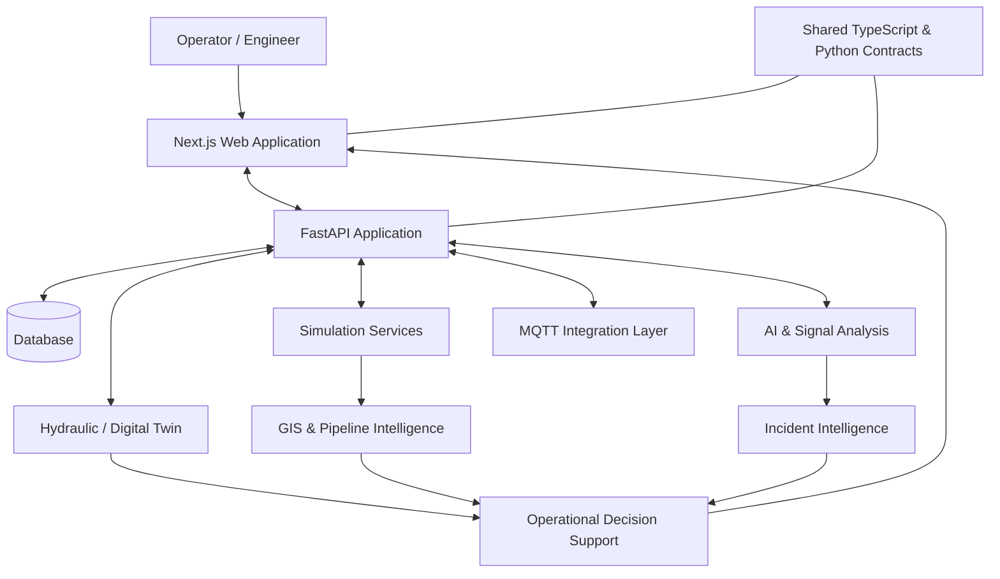

# AQUA CREW

<p align="center">
  <strong>Water Infrastructure Intelligence · Leak Detection · Inspection · Decision Support</strong>
</p>

<p align="center">
  A software-first platform for monitoring water distribution networks, identifying suspected leaks, coordinating virtual inspections, and supporting engineering-led maintenance decisions.
</p>

<p align="center">
  <a href="https://nextjs.org/"></a>
  <a href="https://www.typescriptlang.org/"></a>
  <a href="https://fastapi.tiangolo.com/"></a>
  <a href="https://www.python.org/"></a>
  
  
</p>

---

## Overview

**AQUA CREW** is a modular water-network operations and intelligence platform. It brings together geospatial pipeline visualization, synthetic sensor telemetry, acoustic leak-analysis workflows, hydraulic modelling, virtual rover inspection, predictive maintenance, and repair planning in one web-based command environment.

The project follows a **simulation-first engineering approach**: develop and exercise the software workflows before connecting any physical field equipment. This makes it possible to demonstrate end-to-end operational scenarios while keeping real-world infrastructure protected.

> **Project status:** Software prototype / release-candidate track. The repository is intended for development, testing, and controlled demonstrations. It is not a certified water utility control system and has not been established as field-validated or production-approved.

## What the platform covers

| Capability | What it does |
| --- | --- |
| **Operations command center** | Brings network indicators, incidents, rover activity, missions, sensors, analytics, and alerts into one overview. |
| **GIS pipeline intelligence** | Visualizes pipeline segments, zones, incidents, sensor stations, and virtual rover locations on an interactive map. |
| **Virtual rover fleet** | Tracks rover state, simulated movement, battery, thermal telemetry, and inspection activity. |
| **Sensor monitoring** | Organizes simulated acoustic, pressure, flow, moisture, thermal, and other sensor observations. |
| **AI leak intelligence** | Provides acoustic signal feature analysis, anomaly classification, and leak-analysis workflows using synthetic/test data. |
| **Leak localization** | Uses sensor timing and pipeline information to estimate a suspected leak location. |
| **Hydraulic digital twin** | Supports network scenario analysis and comparison of simulated hydraulic conditions. |
| **Predictive maintenance** | Calculates condition indicators and maintenance-risk estimates to support inspection prioritization. |
| **Operational decision support** | Combines available incident, asset, hydraulic, and inspection information into decision-support views. |
| **Network optimization** | Evaluates candidate operating scenarios against water-loss, pressure, demand, and energy objectives. |
| **Autonomous inspection planning** | Scores inspection urgency, evaluates virtual rover suitability, and plans simulated missions. |
| **Repair management** | Organizes damage assessment, suggested repair approaches, resources, estimates, approvals, and lifecycle tracking. |
| **IoT device readiness** | Provides device-registry and telemetry-integration foundations for a future controlled hardware pilot. |
| **Incident workspace** | Connects detection, investigation, inspection, repair planning, review, and simulated closure into an incident workflow. |
| **Reports and analytics** | Presents operational summaries, system analytics, and engineering-oriented report views. |

Capabilities that rely on synthetic inputs or model estimates must be interpreted as **simulation or decision-support outputs**, not as confirmed field measurements or engineering certification.

## System architecture

AQUA CREW is organized as a monorepo with separate web, API, and shared-contract packages.



### Repository layout

```text
AQUA-CREW/
├── apps/
│   ├── web/                  # Next.js frontend
│   │   └── src/
│   │       ├── app/          # App Router pages
│   │       ├── components/   # Dashboard and domain-specific UI
│   │       ├── context/      # Application context
│   │       ├── services/     # API, simulation, and client services
│   │       └── lib/          # Shared frontend utilities
│   └── api/                  # FastAPI backend
│       ├── app/
│       │   ├── api/          # Versioned API routes
│       │   ├── core/         # Configuration and infrastructure
│       │   ├── models/       # Persistence models
│       │   ├── schemas/      # Pydantic schemas
│       │   └── services/     # Domain and orchestration services
│       ├── alembic/          # Database migrations
│       ├── scripts/          # Operational and verification scripts
│       └── tests/            # Backend test suite
├── packages/
│   └── contracts/            # Shared TypeScript and Python contracts
├── docker/
│   ├── Dockerfile.api
│   ├── Dockerfile.web
│   ├── nginx.conf
│   └── mosquitto.conf
├── docs/                     # Architecture, API, safety, and task documentation
├── docker-compose.yml
├── .env.example
└── README.md
```

## Technology stack

| Layer | Technologies |
| --- | --- |
| Web application | Next.js 14, React 18, TypeScript |
| Styling and UI | Tailwind CSS, Lucide React, reusable application components |
| Geospatial visualization | MapLibre GL |
| API | Python 3.11+, FastAPI, Pydantic v2, Uvicorn |
| Persistence | SQLAlchemy 2.x, Alembic; SQLite development configuration and PostgreSQL/PostGIS deployment configuration |
| Scientific and ML tooling | NumPy, SciPy, scikit-learn |
| Real-time communication | REST, WebSockets |
| Device messaging foundation | Paho MQTT client and Mosquitto broker configuration |
| Local orchestration | Docker and Docker Compose |

The exact services enabled depend on the selected environment and configuration. Refer to the application configuration and deployment documentation before enabling integrations.

## Getting started

### Prerequisites

- Git
- Node.js 18 or later and npm
- Python 3.11 or later
- A terminal (PowerShell, Bash, or equivalent)

Docker and Docker Compose are optional for container-based development.

### 1. Clone the repository

```bash
git clone https://github.com/navneethvaradharaj11-dev/AQUA-CREW.git
cd AQUA-CREW
```

### 2. Configure environment variables

Create a local environment file from the supplied template:

**Windows (PowerShell)**

```powershell
Copy-Item .env.example .env
```

**macOS / Linux**

```bash
cp .env.example .env
```

Review every value before starting the application. Set environment-specific database credentials and a unique, randomly generated JWT secret. Configure any optional AI provider credentials only in your local environment or secret manager.

Never commit `.env` files, API keys, database passwords, signing keys, or other secrets.

### 3. Start the API

```bash
cd apps/api
python -m venv .venv
```

Activate the virtual environment:

**Windows (PowerShell)**

```powershell
.\.venv\Scripts\Activate.ps1
```

**macOS / Linux**

```bash
source .venv/bin/activate
```

Install dependencies and run the development server:

```bash
pip install -r requirements.txt
uvicorn app.main:app --reload --host 0.0.0.0 --port 8000
```

The API documentation is typically available at:

- Swagger UI: [http://localhost:8000/api/v1/docs](http://localhost:8000/api/v1/docs)
- ReDoc: [http://localhost:8000/api/v1/redoc](http://localhost:8000/api/v1/redoc)

Use the health routes exposed by the running API to confirm service status.

### 4. Start the web application

Open a second terminal:

```bash
cd apps/web
npm install
npm run dev
```

Open [http://localhost:3000](http://localhost:3000).

The frontend API and WebSocket endpoints are environment-configurable. Check the frontend service configuration and ensure they point to the API instance you started.

## Docker Compose

The repository includes a Compose configuration for the web application, API, PostgreSQL/PostGIS, Mosquitto, and Nginx gateway.

Before starting containers:

1. Inspect `docker-compose.yml` and the files under `docker/`.
2. Provide strong, unique values for database credentials and the JWT secret through environment variables.
3. Replace development defaults and verify port exposure, CORS origins, broker authentication, and gateway settings.
4. Do not expose the stack to the public internet until it has undergone a separate deployment and security review.

Validate and start the local stack:

```bash
docker compose config
docker compose up --build
```

Stop the stack:

```bash
docker compose down
```

**Important:** The checked-in Compose file contains fallback credential values to simplify configuration. Do not use those fallback values for a shared, staging, or production deployment. Supply secure overrides first. A successful Compose configuration or container build is not, by itself, proof of production readiness.

## Development checks

Run checks from the relevant project directory.

**Backend tests**

```bash
cd apps/api
pytest -q
```

**Frontend type check and production build**

```bash
cd apps/web
npm run type-check
npm run build
```

These commands provide a repeatable starting point for local verification. Record the runtime, database, command, and result when reporting test or performance figures.

## Safety, evidence, and operating boundaries

Safety is a core design constraint, not an optional deployment setting.

- **Physical actuation is disabled.** The platform's intended software-only operating boundary keeps `HARDWARE_ACTUATION_ENABLED = false`. It must not issue commands to physical valves, pumps, PLCs, SCADA systems, or actuators.
- **Virtual equipment is not field equipment.** Rover movement, sensor telemetry, inspections, and repair outcomes in demonstration scenarios are simulated.
- **Human review remains required.** Mission approvals and engineering review must not be bypassed by an AI result or automated workflow.
- **Evidence provenance matters.** Data should retain its provenance, such as `MEASURED`, `SIMULATED`, `DERIVED`, `PREDICTED`, `OPERATOR_ENTERED`, or `UNKNOWN`. Do not present synthetic or predicted information as measured field evidence.
- **Recommendations are decision support.** Repair methods, hydraulic changes, costs, risk scores, and predicted outcomes require validation by qualified personnel before any real-world use.

A future hardware pilot would require a separately authorized design, device identity and credential management, secure communications, safety interlocks, fail-safe behavior, manual override, and independent engineering and security review.

## Known limitations

- Model training and demonstration scenarios use synthetic or test inputs; performance on real utility networks has not been established.
- Leak classifications, localization estimates, risk scores, and predictive maintenance outputs require validation against representative field data.
- Hydraulic simulations depend on network topology, boundary conditions, asset data, demand assumptions, and model calibration.
- Cost and repair estimates are planning aids, not contractor quotations or approved work orders.
- Container definitions and deployment documentation do not constitute an independently verified production deployment.
- No physical sensor, rover, valve, pump, or actuator operation is implied by the presence of integration interfaces.

See [AQUA CREW Known Limitations](docs/AQUA_CREW_KNOWN_LIMITATIONS.md) and the task-specific safety notes for more detail.

## Documentation

The `docs/` directory contains design notes, architecture descriptions, API references, validation reports, safety boundaries, and operational guidance.

| Document | Description |
| --- | --- |
| [System architecture](docs/AQUA_CREW_SYSTEM_ARCHITECTURE.md) | High-level platform design and component relationships |
| [Backend architecture](docs/BACKEND_ARCHITECTURE.md) | API and backend service organization |
| [API specification](docs/API_SPECIFICATION.md) | REST and WebSocket interface reference |
| [AI and ML architecture](docs/AQUA_CREW_AI_AND_ML_ARCHITECTURE.md) | AI workflow and model integration context |
| [Acoustic signal processing](docs/ACOUSTIC_SIGNAL_PROCESSING.md) | Acoustic feature extraction and signal-analysis approach |
| [Digital twin architecture](docs/DIGITAL_TWIN_ARCHITECTURE.md) | Hydraulic and scenario-modelling design |
| [IoT architecture](docs/AQUA_CREW_IOT_ARCHITECTURE.md) | Device and telemetry integration design |
| [Safety and governance](docs/AQUA_CREW_SAFETY_AND_GOVERNANCE.md) | Human oversight, safety, and governance boundaries |
| [Deployment guide](docs/AQUA_CREW_DEPLOYMENT_GUIDE.md) | Environment and deployment guidance |
| [Known limitations](docs/AQUA_CREW_KNOWN_LIMITATIONS.md) | Current constraints and validation gaps |
| [Project presentation](docs/AQUA_CREW_PROJECT_PRESENTATION.md) | Project overview and demonstration material |

## Contributing

Contributions, issue reports, and technical feedback are welcome.

1. Review the architecture and safety documentation before changing system behavior.
2. Create a focused branch for your change.
3. Add or update tests for behavior changes.
4. Preserve evidence provenance and the physical-actuation safety boundary.
5. Document configuration changes and any new operational assumptions.
6. Open a pull request with a clear summary and verification notes.

## License

No license file is currently included in this repository. Unless a license is added, the project remains subject to the default copyright rules; do not assume permission to redistribute or reuse it.

## Project

**AQUA CREW**  
A software-first water infrastructure intelligence and decision-support platform.

Repository: [github.com/navneethvaradharaj11-dev/AQUA-CREW](https://github.com/navneethvaradharaj11-dev/AQUA-CREW)
