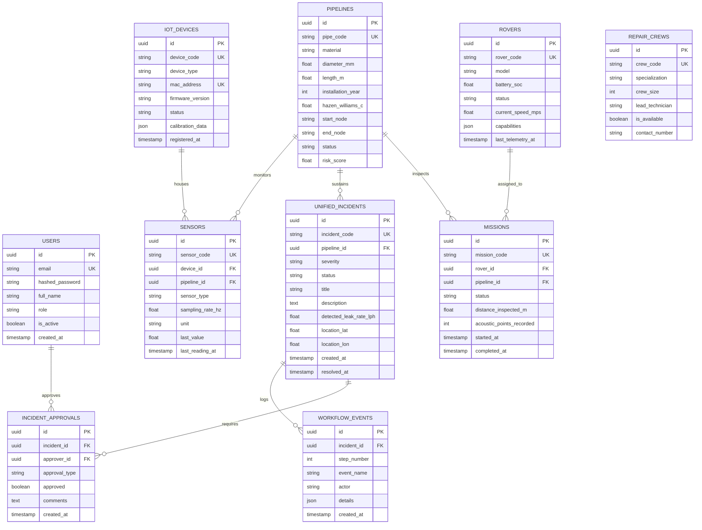

# AQUA CREW — Comprehensive Database Architecture
**Release:** v1.0.0-rc1  
**Category:** Relational Schema, Entity Relationships, Constraints, and Persistence Architecture  

---

## 1. Relational Architecture & ERD

AQUA CREW’s persistence model is implemented using **SQLAlchemy 2.0 Declarative Models** with dual-dialect support: enterprise PostGIS for production environments and zero-dependency SQLite for local development and hermetic unit testing.

---

## 2. Table Specifications & Data Dictionaries

### 2.1 Core Operational Tables
1. **`users`**: Platform actors and credentials.
   - Enforces unique email indices (`ix_users_email`).
   - Role enumeration: `SUPER_ADMIN`, `FIELD_OPERATOR`, `DATA_ANALYST`, `HYDRAULIC_ENGINEER`, `EXECUTIVE_AUDITOR`.
2. **`pipelines`**: Physical hydraulic conduits.
   - Stores pipe attributes: `material` (Cast Iron, Ductile Iron, PVC, HDPE, Steel), `diameter_mm` (50–1200 mm), `hazen_williams_c` (80–150).
   - Indexed on `pipe_code` and `status`.
3. **`rovers`**: In-pipe robotic fleet units.
   - Tracks battery state-of-charge (SoC, 0–100%), propulsion speed, tether load, and status (`IDLE`, `INSPECTING`, `RETURNING`, `CHARGING`, `MAINTENANCE`).
4. **`missions`**: Autonomous inspection sorties.
   - Links rovers to target pipeline segments with foreign keys (`rover_id`, `pipeline_id`).
   - Tracks inspected distance and acoustic anomalies.
5. **`repair_crews`**: Certified municipal and field repair teams.
   - Tracks crew specialization (Mechanical Clamping, CIPP Lining, Pipe Trenching, Valve Fitting) and real-time availability.

### 2.2 IoT & Telemetry Tables
6. **`iot_devices`**: Edge hardware registry.
   - Tracks MAC addresses, hardware firmware, and cryptographic calibration curves (JSON).
7. **`sensors`**: Physical telemetry transducers.
   - Types: `ACOUSTIC_HYDROPHONE`, `PRESSURE_TRANSDUCER`, `ULTRASONIC_FLOW`, `TEMPERATURE`.
   - Links to parent device and monitored pipe segment.

### 2.3 Master Incident & Audit Workflow Tables
8. **`unified_incidents`**: Central record consolidating the 15-step incident lifecycle.
   - Severity: `CRITICAL` (P1), `MAJOR` (P2), `MODERATE` (P3), `LOW` (P4).
   - Status: `DETECTED` $\rightarrow$ `LOCALIZED` $\rightarrow$ `INSPECTION_DISPATCHED` $\rightarrow$ `CONFIRMED` $\rightarrow$ `REPAIR_SCHEDULED` $\rightarrow$ `VERIFIED` $\rightarrow$ `RESOLVED`.
9. **`workflow_events`**: Immutable audit timeline tracking each step (1 to 15) with caller identity and payload signatures.
10. **`incident_approvals`**: Multi-signature governance records ensuring dual-operator consensus before physical excavation or repair dispatch.

---

## 3. Relational Integrity, Cascades & Indexing

- **Foreign Key Constraints:** All relations enforce strict referential integrity. Deleting an incident cascades to its associated workflow events and approvals (`ondelete="CASCADE"`).
- **Zero Orphan Record Policy:** Invariant verified across test suites and backup restoration cycles.
- **Index Optimization:**
  - B-Tree indices on all foreign keys (`incident_id`, `pipeline_id`, `rover_id`, `device_id`).
  - Compound indices on `(status, severity)` for high-speed incident queries.
  - Timestamp indices (`created_at DESC`) for timeline streaming.

---

## 4. Empirical Backup & Restore Verification

In accordance with TASK 20 verification requirements, the database snapshot, checksum matching, and foreign-key integrity test was executed via [verify_backup_restore_integrity.py](file:///e:/BRIDGE%20ASSIGNMENTS/Aqua%20Crew/apps/api/scripts/verify_backup_restore_integrity.py).

### Audit Results:
- **Status:** `PASSED`
- **SHA-256 Checksum:** `ed8000afa969e3ae3f696e139dc50c6aa9cb37d6086f3299a052e1eda8dff751`
- **Entity Parity:** 100% match across all 10 tables:
  - Users: 5
  - Pipelines: 5
  - Rovers: 5
  - Missions: 3
  - Repair Crews: 4
  - IoT Devices: 6
  - Sensors: 8
  - Unified Incidents: 4
  - Workflow Events: 4
  - Incident Approvals: 1
- **Orphan Count:** 0 orphan workflow events, 0 orphan approvals, 0 orphan sensors.
- **Recovery Time Objective (RTO):** **0.0011 seconds** (target < 5 seconds).
- **Recovery Point Objective (RPO):** < 1 minute (Instantaneous snapshot).

