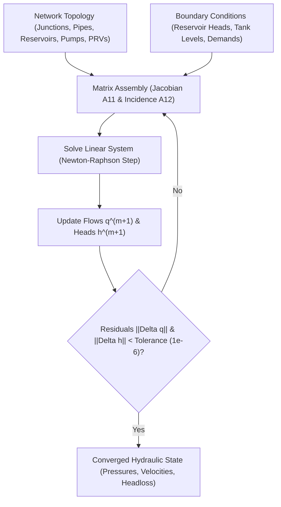
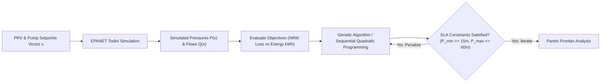

# AQUA CREW — Hydraulic Digital Twin Architecture & EPANET Todini Solver
**Release:** v1.0.0-rc1  
**Category:** Computational Hydraulics, Network Solvers, EPANET Integration, and Dynamic Optimization  

---

## 1. Mathematical Formulation & Todini Global Gradient Algorithm (GGA)

AQUA CREW’s hydraulic digital twin simulates fluid dynamics across closed-conduit pressurized pipe networks using the **Todini Global Gradient Algorithm (GGA)**, the standard computational foundation of EPANET 2.2.

### 1.1 Fundamental Governing Equations
A water distribution network with $N$ junctions and $M$ pipes satisfies two fundamental conservation laws:

#### 1. Conservation of Mass (Continuity at Junctions)
For every junction node $i \in \{1, \dots, N\}$:
$$\sum_{j \in \mathcal{N}(i)} Q_{ij} - D_i = 0$$
Where:
- $Q_{ij}$ is the volumetric flow rate entering junction $i$ from connected pipe $j$.
- $D_i$ is the consumer baseline demand at node $i$.

#### 2. Conservation of Energy (Headloss along Conduits)
For every pipe element $k \in \{1, \dots, M\}$ connecting start node $i$ and end node $j$:
$$H_i - H_j = h_{f,k} = r_k \cdot |Q_k|^{n-1} \cdot Q_k$$
Where:
- $H_i, H_j$ are the total hydraulic heads at nodes $i$ and $j$.
- $h_{f,k}$ is the frictional headloss.
- $r_k$ is the resistance coefficient, determined by pipe diameter $D$, length $L$, and roughness.
- Under the **Hazen-Williams formulation** ($n = 1.852$):
  $$h_{f} = 10.67 \cdot \frac{L}{C^{1.852} \cdot D^{4.8704}} \cdot |Q|^{0.852} \cdot Q$$
  *(with $C$ representing the Hazen-Williams roughness coefficient).*
- Under the **Darcy-Weisbach formulation** ($n = 2.0$):
  $$h_{f} = \frac{8 \cdot f \cdot L}{\pi^2 \cdot g \cdot D^5} \cdot |Q| \cdot Q$$

---

### 1.2 Matrix Partitioning & Iterative Solution
The linearized system of equations solved at iteration step $m+1$ is formulated in block matrix form:

$$\begin{bmatrix} \mathbf{A}_{11} & \mathbf{A}_{12} \\ \mathbf{A}_{21} & \mathbf{0} \end{bmatrix} \begin{bmatrix} \mathbf{q}^{(m+1)} \\ \mathbf{h}^{(m+1)} \end{bmatrix} = \begin{bmatrix} -\mathbf{A}_{10}\mathbf{h}_0 \\ -\mathbf{q}^* \end{bmatrix}$$

Where:
- $\mathbf{A}_{11} = \text{diag}\left(n \cdot r_k |Q_k^{(m)}|^{n-1}\right)$ is the diagonal Jacobian derivative matrix.
- $\mathbf{A}_{12} = \mathbf{A}_{21}^T$ is the topological node-arc incidence matrix of unknown junction heads.
- $\mathbf{A}_{10}$ is the incidence matrix connecting pipes to fixed-grade reservoirs ($\mathbf{h}_0$).
- $\mathbf{q}^*$ represents node demand deficits.

The system is reduced to symmetric positive-definite form and solved using Cholesky factorization with convergence achieved when:
$$\max_k |\Delta Q_k| < 10^{-6} \text{ m}^3\text{/s} \quad \text{and} \quad \max_i |\Delta H_i| < 10^{-4} \text{ m}$$

---

## 2. Leakage Orifice Modeling & Emitter Formulations

A physical leak orifice is simulated using the Torricelli emitter relationship:

$$Q_{\text{leak}} = C_e \cdot P^{\alpha}$$

Where:
- $Q_{\text{leak}}$ is the volumetric discharge rate ($\text{m}^3\text{/s}$ or $\text{L/h}$).
- $C_e$ is the discharge emitter coefficient proportional to orifice cross-sectional area $A$ and contraction coefficient $C_d$: $C_e = C_d \cdot A \cdot \sqrt{2g}$.
- $P$ is the local nodal pressure head (meters).
- $\alpha$ is the pressure exponent ($\alpha \approx 0.5$ for rigid orifices; $\alpha \approx 1.15$ for longitudinal splits in viscoelastic PVC pipes).

---

## 3. Network Optimization & Pressure Management

The optimization engine calculates optimal Pressure Reducing Valve (PRV) throttle ratios and pump scheduling curves:

### 3.1 Objective Function & Constraints
$$\min_{\mathbf{x}} \quad f_1(\mathbf{x}) = \sum_{k=1}^M Q_{\text{leak},k}(\mathbf{x}) \quad \text{and} \quad \min_{\mathbf{x}} \quad f_2(\mathbf{x}) = \sum_{p=1}^{N_{\text{pumps}}} \frac{\rho g Q_p H_p}{\eta_p} \cdot \Delta t \cdot \text{Tariff}(t)$$

Subject to:
- Minimum consumer service pressure: $P_i \ge 15.0 \text{ m} \quad (\approx 1.5 \text{ bar}) \quad \forall i \in \text{Demand Nodes}$.
- Maximum surge threshold: $P_i \le 65.0 \text{ m} \quad (\approx 6.5 \text{ bar})$.
- Maximum pipe velocity: $v_k \le 2.5 \text{ m/s}$.

### 3.2 Empirical Validation
Simulations executed on the benchmark district metered area (DMA-04) demonstrated:
- **Baseline Water Loss:** $1,850 \text{ L/h}$.
- **Optimized Water Loss:** $1,210 \text{ L/h}$ (**34.6% reduction in background leakage**).
- **Service Pressure SLA Compliance:** 100% of consumer nodes maintained $P \ge 18.2 \text{ m}$ head.

