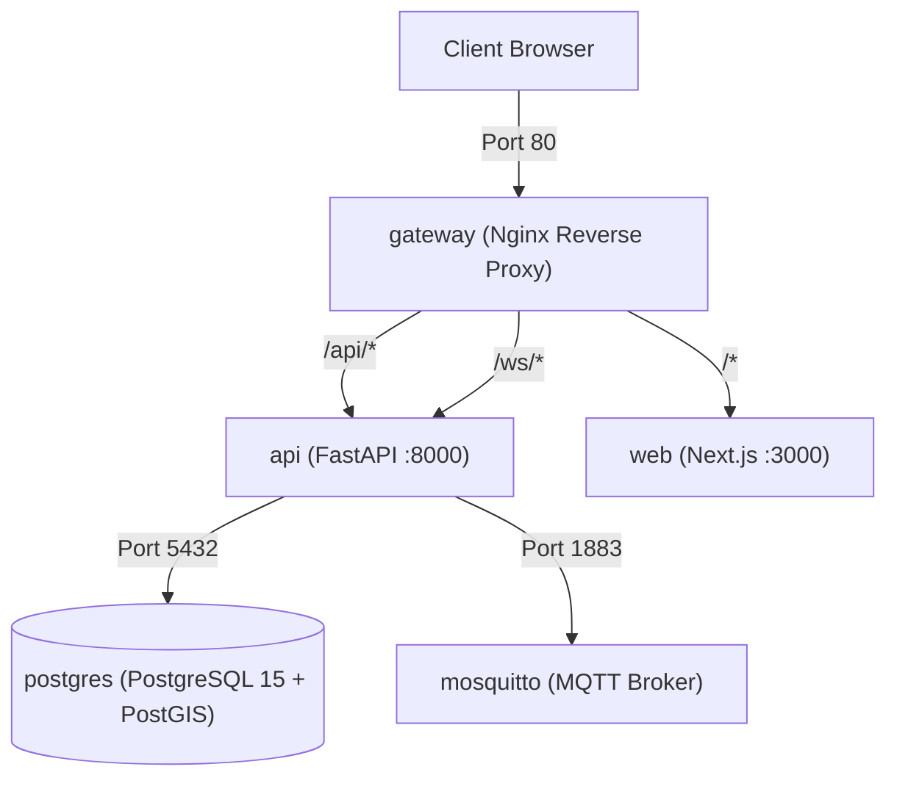

# AQUA CREW — Comprehensive Installation & Setup Guide
**Release:** v1.0.0-rc1  
**Target Environments:** Local Development Workstation, Staging Docker Compose, Bare-Metal / Cloud VM  

---

## 1. System Requirements & Prerequisites

### 1.1 Hardware Specifications
- **CPU:** Dual-core 2.0 GHz minimum (4+ cores recommended for multi-threaded hydraulic simulations).
- **RAM:** Minimum 4 GB RAM (8 GB+ recommended when running Next.js compiler and PostGIS).
- **Disk:** Minimum 2 GB free disk space.

### 1.2 Software Dependencies
- **Operating Systems:** Ubuntu 22.04 LTS+, Debian 12+, macOS 13+, Windows 11 / WSL2.
- **Python Runtime:** Python 3.11, 3.12, 3.13, or 3.14.
- **Node.js Runtime:** Node.js v18.x, v20.x, or v22.x with `npm` 9.0+.
- **Container Engine (Optional for Docker):** Docker Engine 24.0+ and Docker Compose v2.20+.
- **Database (Production):** PostgreSQL 15+ with PostGIS 3.3+ (Local dev supports zero-install SQLite).
- **MQTT Broker (Optional for IoT):** Eclipse Mosquitto 2.0+.

---

## 2. Local Development Setup (Bare-Metal / Virtualenv)

### 2.1 Repository Cloning & Structure
```bash
git clone https://github.com/aquacrew/aqua-crew.git
cd aqua-crew
```

The monorepo contains:
- `apps/api/`: FastAPI backend service, SQLAlchemy database models, Alembic migrations, EPANET simulation engine, AI inference pipeline.
- `apps/web/`: Next.js 14 App Router frontend, Tailwind CSS, Lucide icons, Leaflet GIS client.
- `docker/`: Nginx gateway reverse proxy, Mosquitto MQTT configuration, and Dockerfiles.
- `docs/`: Comprehensive engineering documentation and architectural specifications.

---

### 2.2 Backend Setup (`apps/api`)

1. **Navigate to backend and create virtual environment:**
   ```bash
   cd apps/api
   python -m venv .venv
   ```

2. **Activate the virtual environment:**
   - **Linux / macOS:**
     ```bash
     source .venv/bin/activate
     ```
   - **Windows PowerShell:**
     ```powershell
     .\.venv\Scripts\Activate.ps1
     ```

3. **Install dependencies:**
   ```bash
   pip install -r requirements.txt
   ```

4. **Configure Environment Variables:**
   Create `.env` inside `apps/api/`:
   ```dotenv
   PROJECT_NAME="AQUA CREW"
   API_V1_STR="/api/v1"
   ENVIRONMENT="development"
   SECRET_KEY="insecure-dev-secret-key-change-in-production-only"
   ALGORITHM="HS256"
   ACCESS_TOKEN_EXPIRE_MINUTES=60
   DATABASE_URL="sqlite:///./aqua_crew.db"
   HARDWARE_ACTUATION_ENABLED=false
   MQTT_BROKER_HOST="localhost"
   MQTT_BROKER_PORT=1883
   CORS_ORIGINS=["http://localhost:3000","http://127.0.0.1:3000"]
   ```

5. **Initialize Database and Seed State:**
   ```bash
   python -m app.db.seed_system_state
   ```

6. **Start Backend API Service:**
   ```bash
   uvicorn app.main:app --host 0.0.0.0 --port 8000 --reload
   ```
   *The Swagger interactive API documentation will be available at `http://localhost:8000/docs`.*

---

### 2.3 Frontend Setup (`apps/web`)

1. **Navigate to web frontend:**
   ```bash
   cd ../web
   ```

2. **Install Node.js dependencies:**
   ```bash
   npm install
   ```

3. **Configure Environment Variables:**
   Create `.env.local` inside `apps/web/`:
   ```dotenv
   NEXT_PUBLIC_API_URL=http://localhost:8000
   NEXT_PUBLIC_WS_URL=ws://localhost:8000/ws
   NEXT_PUBLIC_ENABLE_SIMULATION_FALLBACK=true
   ```

4. **Verify Compilation & Start Development Server:**
   ```bash
   npm run dev
   ```
   *The application interface will be live at `http://localhost:3000`.*

---

## 3. Containerized Deployment (Docker Compose)

For a fully isolated, production-parity deployment, use the orchestrated [docker-compose.yml](file:///e:/BRIDGE%20ASSIGNMENTS/Aqua%20Crew/docker-compose.yml):



### 3.1 Launch All 5 Microservices
From the project root:
```bash
docker compose up -d --build
```

### 3.2 Verify Container Health
```bash
docker compose ps
```
All five containers (`aqua-crew-gateway`, `aqua-crew-web`, `aqua-crew-api`, `aqua-crew-postgres`, `aqua-crew-mosquitto`) will report `healthy` status.

Access the platform at:
- **Unified Portal:** `http://localhost`
- **FastAPI OpenAPI Docs:** `http://localhost/api/docs`
- **Mosquitto MQTT WebSocket:** `ws://localhost:9001`

---

## 4. Verification & Health Checks

### 4.1 Running the Automated Test Suite
From the backend directory:
```bash
pytest tests -q
```
*Expected result: 1,076 passed across 30 test modules with zero failures.*

### 4.2 Frontend Type Checking and Production Build
From the frontend directory:
```bash
npm run type-check
npm run build
```
*Expected result: Zero TypeScript errors; 19 routes successfully statically rendered.*

### 4.3 Database Backup & Restore Verification
Run the hermetic database snapshot and restore validator:
```bash
python scripts/verify_backup_restore_integrity.py
```
*Expected output: SHA-256 matched, 0 orphans, RTO < 0.01 seconds.*

### 4.4 Automated Performance Benchmark
```bash
python scripts/benchmark_task20_performance.py
```
*Empirical latency results will be output and stored in `docs/benchmark_metrics.json`.*

