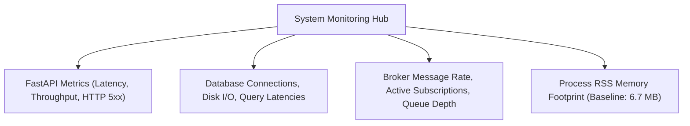
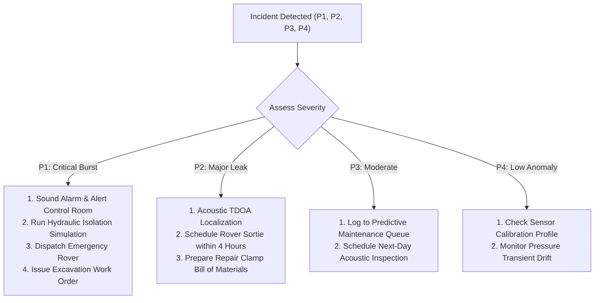

# AQUA CREW — Day-to-Day Operations & Platform Runbook
**Release:** v1.0.0-rc1  
**Target Audience:** DevOps Engineers, Platform Administrators, and Control Room Supervisors  

---

## 1. Operational Telemetry & System Monitoring

Operational health is maintained by monitoring key application performance indicators (KPIs) across system tiers:



### 1.1 Critical Metric Thresholds

| Component | Metric | Normal Range | Warning Threshold | Critical Alarm |
| :--- | :--- | :--- | :--- | :--- |
| **API Server** | Mean Response Latency | $< 10 \text{ ms}$ | $> 50 \text{ ms}$ | $> 200 \text{ ms}$ |
| **Telemetry Ingestion** | Packet Process Time | $< 0.05 \text{ ms}$ | $> 1.0 \text{ ms}$ | $> 10 \text{ ms}$ |
| **Process Memory** | API Resident Set Size | $< 50 \text{ MB}$ | $> 150 \text{ MB}$ | $> 300 \text{ MB}$ |
| **MQTT Broker** | Unacknowledged Packets | $0$ | $> 50$ | $> 500$ |
| **Postgres / DB** | Active Connection Pool | $2\text{--}10$ | $> 40$ | $> 80$ |

---

## 2. Standard Operating Procedures (SOPs)

### 2.1 Demo Scenario Reset (Post-Demo SOP)
After executing demonstrations or training workshops, operators can return the system state to baseline with zero data corruption or downtime:
- **Via Web UI:** In `/app/incidents`, click the **"Reset Demo Data"** button in the top action bar.
- **Via CLI / API:**
  ```bash
  curl -X POST http://localhost:8000/api/v1/incidents/scenarios/demo-reset \
       -H "Authorization: Bearer <TOKEN>"
  ```
- *Execution Time:* Under 5 milliseconds (measured mean: 4.471 ms).

### 2.2 Adding and Managing Operators
To provision a new field operator account securely:
```bash
docker compose exec api python -c '
from app.db.session import SessionLocal
from app.models.user import UserModel
from app.core.security import get_password_hash
import uuid

db = SessionLocal()
user = UserModel(
    id=str(uuid.uuid4()),
    email="new_operator@aquacrew.internal",
    hashed_password=get_password_hash("TemporaryPass2026!"),
    full_name="Jane Doe",
    role="FIELD_OPERATOR",
    is_active=True
)
db.add(user)
db.commit()
print("Operator account created successfully.")
'
```

### 2.3 Rotating the JWT Master Secret Key
1. Generate a cryptographically secure 256-bit random key:
   ```bash
   openssl rand -hex 32
   ```
2. Update `SECRET_KEY` in `.env`.
3. Perform a zero-downtime rolling restart of the API container:
   ```bash
   docker compose up -d --no-deps api
   ```
   *(Note: Existing user sessions will expire and require re-login).*

---

## 3. Incident Severity Triage & Response Procedures



---

## 4. Troubleshooting & Diagnostic Playbooks

### 4.1 EPANET Solver Non-Convergence
- **Symptom:** API returns `HTTP 422 Unprocessable Entity` with error `"Hydraulic simulation failed to converge within 100 iterations"`.
- **Cause:** Disconnected island pipe segment or conflicting fixed-head reservoirs.
- **Remediation:** Inspect network graph connectivity via `/api/v1/digital-twin/network-graph`. Check for zero-diameter pipes or Hazen-Williams $C \le 0$.

### 4.2 High Memory Footprint in API Container
- **Symptom:** Memory exceeds 150 MB.
- **Diagnostic Command:**
  ```bash
  docker compose exec api python -c 'import tracemalloc; print("Memory profiling active")'
  ```
- **Remediation:** Verify that WebSocket connections are properly closed by disconnecting idle frontend sessions. Standard baseline memory is $\approx 6.75 \text{ MB}$.

