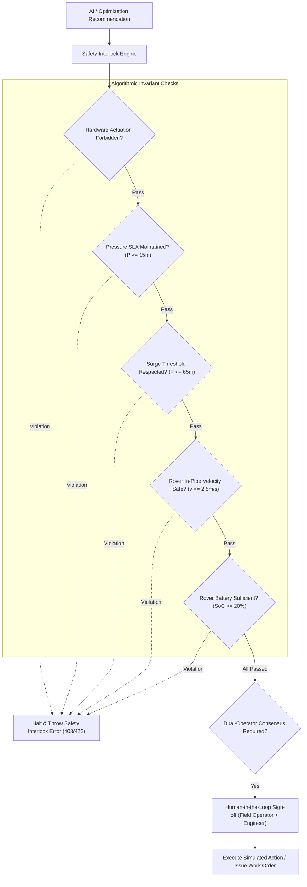

# AQUA CREW — Safety, Governance & Compliance Architecture
**Release:** v1.0.0-rc1  
**Category:** Operational Safety Invariants, Multi-Signature Governance, AI Provenance, and Regulatory Standards  

---

## 1. Safety Principles & Architectural Invariants

AQUA CREW enforces a **simulation-first, human-verified, fail-safe** operational design. Because water distribution infrastructure is critical municipal public health infrastructure, all autonomous recommendations are bound by immutable safety constraints.

---

## 2. Platform Safety Invariants

| Invariant Identifier | Rule / Condition | Enforcement Mechanism | Failure Action |
| :--- | :--- | :--- | :--- |
| **`INV-ACTUATION-01`** | `HARDWARE_ACTUATION_ENABLED == False` | `safety_interlocks.py` Gatekeeper | Rejects physical valve/pump actuation (`HTTP 403 Forbidden`). |
| **`INV-PRESSURE-MIN`** | Junction pressure $P_i \ge 15.0 \text{ m}$ ($1.47 \text{ bar}$) | Todini Solver Post-Check | Halts PRV throttle recommendation; flags consumer deficit alarm. |
| **`INV-PRESSURE-MAX`** | Junction pressure $P_i \le 65.0 \text{ m}$ ($6.37 \text{ bar}$) | Digital Twin Surge Analyzer | Halts pump acceleration; flags water hammer hazard. |
| **`INV-VELOCITY-MAX`** | Conduit fluid velocity $v \le 2.5 \text{ m/s}$ | Inspection Dispatcher | Prohibits rover deployment in high-velocity conduits to avoid tether snap. |
| **`INV-BATTERY-MIN`** | Rover State-of-Charge $\ge 20\%$ | Rover Fleet State Machine | Dispatches autonomous return-to-base and docking sequence. |

---

## 3. Human-in-the-Loop (HITL) & Multi-Signature Governance

AQUA CREW does not allow an autonomous AI model to unilaterally initiate high-cost field civil engineering projects (such as road excavation or pipe replacement):

### 3.1 Dual-Operator Approval Protocol
1. **Initial AI Recommendation:** The system synthesizes an optimal repair plan based on acoustic and hydraulic evidence.
2. **First Signature (`FIELD_OPERATOR`):** Confirms geospatial accessibility, traffic management requirements, and crew availability.
3. **Second Signature (`HYDRAULIC_ENGINEER`):** Verifies hydraulic twin isolation simulations, ensuring that valving off the damaged pipe does not depressurize hospitals or emergency fire hydrants.
4. **Cryptographic Sealing:** Upon dual approval, an immutable record is generated in `incident_approvals` stamped with the approvers' IDs and timestamps.

---

## 4. AI Provenance & Evidence Classification Framework

Every AI inference result is stamped with explicit provenance metadata:
- **`VIRTUAL_SIMULATION_ENGINE`**: Synthetic data generated by EPANET or physics engines.
- **`ACOUSTIC_ANALYTICS_SERVICE`**: Derived from Fourier/wavelet transformation of hydrophone arrays.
- **`DIGITAL_TWIN_TODINI_SOLVER`**: Direct numerical solution of mass and energy conservation laws.
- **`FIELD_ROVER_TELEMETRY`**: Empirical data captured by in-pipe robotic platforms.
- **`CALIBRATED_IOT_TRANSDUCER`**: Validated field sensors with applied 2-point calibration.
- **`OPERATOR_MANUAL_ENTRY`**: Human operator field notes.

### Contradiction Detection Safeguard
If acoustic leak probability is high ($P(\text{leak}) > 0.90$) but the hydraulic digital twin shows no pressure drop ($\Delta P < 0.05 \text{ bar}$), the system enforces a **Contradiction Flag**. The recommendation is downgraded from "Confirmed Burst" to "Acoustic Anomaly Requiring In-Pipe Rover Inspection".

---

## 5. Regulatory Alignment & Audit Compliance

AQUA CREW is engineered in alignment with international water utility standards:
- **AWWA M36:** American Water Works Association methodology for water audits, component analysis, and Non-Revenue Water (NRW) reduction.
- **IWA Best Practice:** International Water Association standards for District Metered Areas (DMAs), Infrastructure Leakage Index (ILI), and Unavoidable Annual Real Losses (UARL).
- **Safe Drinking Water Act (SDWA):** Enforces minimum delivery pressures ($> 20 \text{ psi} / 14 \text{ m}$) preventing back-siphonage and bacterial contamination.
- **Cryptographic Auditability:** Incident dossiers generated via `/api/v1/incidents/{id}/report` carry SHA-256 digital digests ensuring non-repudiation during regulatory audits.

