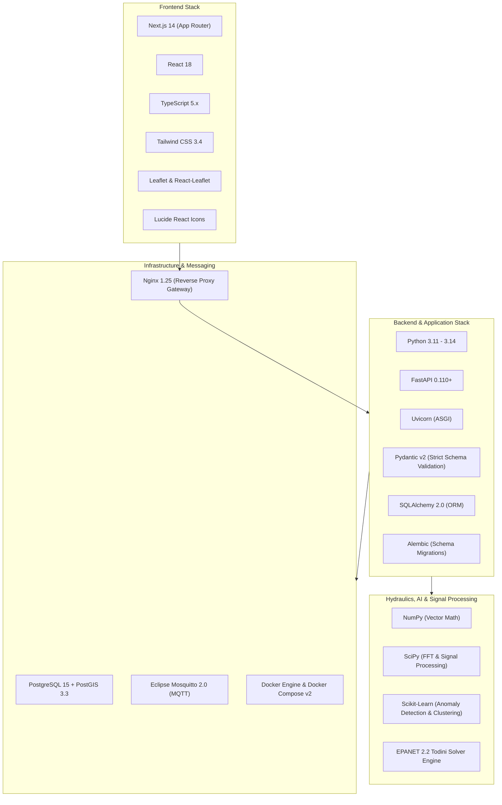

# AQUA CREW — Comprehensive Technology Stack Documentation
**Release:** v1.0.0-rc1  
**Category:** Software Engineering Specifications & Dependency Manifest  

---

## 1. Technology Selection Overview

AQUA CREW leverages a modern, robust, and mathematically grounded technology stack designed for high throughput, sub-millisecond AI inference, real-time geospatial rendering, and strict memory safety.

---

## 2. Detailed Subsystem Technology Specifications

### 2.1 Web Frontend Subsystem (`apps/web`)

| Technology | Version | Purpose | Architectural Justification |
| :--- | :--- | :--- | :--- |
| **Next.js** | `14.2.x` | Full-stack React Application Framework | Provides modern App Router with server-rendered shells and lightning-fast client hydration. |
| **React** | `18.2.x` | UI Component Framework | Declarative component model with concurrent rendering support for smooth real-time telemetry streaming. |
| **TypeScript** | `5.4.x` | Type System & Static Typing | Enforces strict compile-time type safety across API client contracts and simulation state. |
| **Tailwind CSS** | `3.4.x` | Utility-First CSS Framework | Zero runtime overhead; enforces uniform design tokens across dark-mode operational consoles. |
| **Leaflet** | `1.9.x` | Geospatial GIS Visualization | Lightweight vector-based map rendering optimized for large pipeline topologies and rover animations. |
| **Lucide React** | `0.359.x` | Iconography | Clean, consistent SVG icons with zero runtime bundle bloat. |

---

### 2.2 Backend & API Subsystem (`apps/api`)

| Technology | Version | Purpose | Architectural Justification |
| :--- | :--- | :--- | :--- |
| **Python** | `3.11 - 3.14` | Core Backend Runtime | Extensive scientific library ecosystem, high developer ergonomics, and native async support. |
| **FastAPI** | `0.110.x` | Asynchronous REST & WebSocket API | High performance via Starlette and Uvicorn; automatic OpenAPI/Swagger generation. |
| **Pydantic** | `2.6.x` | Schema Validation & Serialization | High-speed Rust-powered data parsing ensuring strict payload validation on all HTTP/WS endpoints. |
| **SQLAlchemy** | `2.0.x` | Object Relational Mapper (ORM) | Declarative 2.0 typed syntax; robust connection pooling, transaction isolation, and dialect independence. |
| **Alembic** | `1.13.x` | Database Migration Tool | Deterministic, version-controlled schema evolution for zero-downtime database upgrades. |
| **PyJWT** | `2.8.x` | JSON Web Token Encoding & Verification | RFC 7519 compliant stateless token authentication with HMAC-SHA256 signatures. |
| **Passlib / Bcrypt**| `1.7.x` | Cryptographic Password Hashing | Enforces adaptive cost salt/hashing protecting user credentials against dictionary attacks. |

---

### 2.3 Scientific, AI & Hydraulic Simulation Libraries

| Technology | Purpose | Implementation Details |
| :--- | :--- | :--- |
| **NumPy** | Vectorized matrix calculations | Powers high-speed covariance calculations, cross-correlation buffers, and nodal pressure vectors. |
| **SciPy** | Acoustic Signal Processing | Powers Fast Fourier Transforms (`scipy.fft`), bandpass filtering, and power spectral density estimation. |
| **Scikit-Learn** | ML Anomaly & Risk Detection | Provides Isolation Forests and Random Forest classifiers for pipe vulnerability and soil corrosion modeling. |
| **Todini GGA Engine** | Hydraulic Network Simulation | Solves EPANET mass balance $\sum Q_i - D_j = 0$ and energy conservation $\sum \Delta H_k = 0$ via the Global Gradient Algorithm. |

---

### 2.4 Messaging, IoT & Persistence Infrastructure

| Technology | Role | Details |
| :--- | :--- | :--- |
| **PostgreSQL 15** | Primary Relational Database | ACID transactional guarantees, JSONB document querying, and relational integrity. |
| **PostGIS 3.3** | Spatial Database Extension | Spatial geometry types (`Point`, `LineString`), spatial indexing (R-Tree / GiST), and distance metrics. |
| **SQLite 3** | Zero-Install Development Engine | Embedded database mode allowing zero-dependency local development and hermetic unit testing. |
| **Eclipse Mosquitto** | MQTT Broker | Lightweight pub/sub messaging broker handling edge sensor telemetry on port 1883 and WebSockets on 9001. |
| **Nginx** | Reverse Proxy & TLS Terminator | Routes traffic between Next.js frontend, FastAPI backend, and WebSocket streams on port 80. |
| **Docker & Docker Compose** | Container Orchestration | Multi-stage Dockerfiles producing production-hardened microservice containers. |

