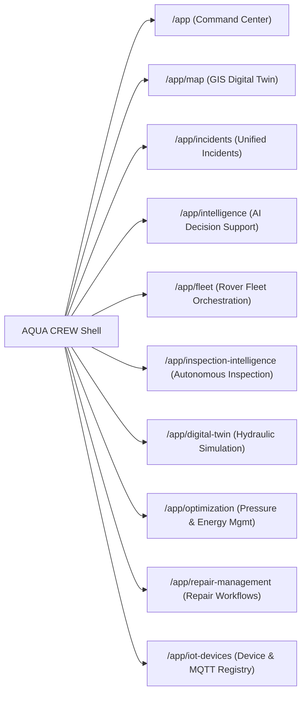

# AQUA CREW — Comprehensive End-User Guide
**Version:** 1.0.0-rc1  
**Target Audience:** Utility Operators, Fleet Dispatchers, Hydraulic Engineers, Maintenance Supervisors, and System Administrators  
**System Classification:** Autonomous Water Infrastructure Intelligence & Decision-Support Platform  

---

## 1. Introduction & Access

AQUA CREW is a software-first digital twin and autonomous operations platform designed to detect leaks, simulate hydraulic impacts, orchestrate robotic inspection rovers, and generate verified engineering repair plans.

### 1.1 Accessing the Platform
- **Production / Local Web UI:** `http://localhost:3000` (or reverse proxy `http://localhost:80`)
- **Backend API & Swagger Documentation:** `http://localhost:8000/docs`
- **Supported Browsers:** Google Chrome 110+, Mozilla Firefox 115+, Microsoft Edge 110+, Apple Safari 16+.

### 1.2 Default Credentials & Role-Based Workspaces
The system is seeded with five pre-configured role profiles in [seed_system_state.py](file:///e:/BRIDGE%20ASSIGNMENTS/Aqua%20Crew/apps/api/app/db/seed_system_state.py):

| User Identifier | Email | Password | Role | Primary Functional Scope |
| :--- | :--- | :--- | :--- | :--- |
| `SUPER_ADMIN_01` | `admin@aquacrew.internal` | `AdminSecurePass2026!` | `SUPER_ADMIN` | Global platform administration, user provisioning, system resets |
| `OPERATOR_01` | `operator@aquacrew.internal` | `OperatorSecurePass2026!` | `FIELD_OPERATOR` | Incident triage, live telemetry monitoring, rover mission control |
| `ANALYST_01` | `analyst@aquacrew.internal` | `AnalystSecurePass2026!` | `DATA_ANALYST` | Acoustic AI analysis, leak localization, ML risk prediction |
| `ENGINEER_01` | `engineer@aquacrew.internal` | `EngineerSecurePass2026!` | `HYDRAULIC_ENGINEER` | EPANET twin simulation, pressure optimization, burst modeling |
| `AUDITOR_01` | `auditor@aquacrew.internal` | `AuditorSecurePass2026!` | `EXECUTIVE_AUDITOR` | Compliance verification, cryptographic audit trails, incident reports |

---

## 2. Navigation Architecture & Application Shell

AQUA CREW provides a unified, telemetry-reactive navigation shell. Key views accessible from the primary sidebar include:

---

## 3. Core Operational Workflows

### 3.1 Operational Command Center (`/app`)
- **Real-Time KPIs:** Live monitoring of Active Incidents, Total Estimated Water Loss (L/h), Fleet Deployment Availability, Average District Pressure (bar), and Telemetry Health.
- **Incident Feed:** Color-coded priority stream (P1-CRITICAL, P2-MAJOR, P3-MODERATE, P4-LOW) with real-time WebSocket status updates.
- **Quick Action Bar:** One-click navigation to incident response, rover dispatch, or hydraulic rebalancing.

### 3.2 GIS Pipeline Intelligence & Geospatial View (`/app/map`)
- **Interactive Layer Controls:**
  - Pipe Network (colored by nominal diameter, age, or structural risk score).
  - Sensor Nodes (pressure gauges, acoustic correlators, ultrasonic flow meters).
  - Rover Tracks & Real-Time Coordinates.
  - Leak Candidate Heatmaps and Confidence Ellipses.
- **Node/Pipe Inspection:** Clicking any pipe segment reveals material specs, installation year, Hazen-Williams $C$-factor, simulated flow velocity, and historical acoustic events.

### 3.3 Unified Incident Management & Master Demonstration (`/app/incidents`)
The Incidents interface consolidates the entire 15-step event lifecycle:
1. **Incident Listing:** Filter by severity, lifecycle state (`DETECTED`, `LOCALIZED`, `INSPECTION_DISPATCHED`, `CONFIRMED`, `REPAIR_SCHEDULED`, `VERIFIED`, `RESOLVED`), or DMA zone.
2. **Detailed Incident Modal:**
   - **Timeline:** Step-by-step audit record from initial transient anomaly to final acoustic sign-off.
   - **Multi-Source Evidence Matrix:** Acoustic frequency peaks, pressure drop traces, and EPANET delta curves.
   - **One-Click Dossier Export:** Click **"Download Dossier Report"** to compile an auditable, cryptographically signed technical dossier.
3. **Reproducible Demo Reset:** Click **"Reset Demo Data"** to cleanly flush transient scenario state back to baseline in under 5 milliseconds without database wipes.

### 3.4 AI Acoustic Leak Detection & Multi-Source Reasoning (`/app/intelligence`)
- **Acoustic Waveform Analysis:** Visualizes raw acoustic time-domain signals, FFT power spectral density (PSD), and cross-correlation time delay of arrival ($\Delta t$).
- **Evidence-Grounded AI Inference:** Inspect leak localization confidence ($P(\text{leak})$), estimated leak rate ($Q_L$), and acoustic coherence.
- **Interactive AI Assistant:** Query the system in natural language:
  - *"Summarize hydraulic anomalies in District DMA-04."*
  - *"What is the structural failure probability of Cast Iron Segment P-42?"*
  - Responses include evidence classification tags, provenance scores, and explicit contradictory data flags.

### 3.5 Virtual Rover Fleet & Autonomous Inspection (`/app/fleet` & `/app/inspection-intelligence`)
- **Fleet Telemetry Deck:** Track battery state-of-charge (SoC), tether tension, navigation heading, acoustic hydrophone payload, and water depth.
- **Autonomous Mission Dispatch:**
  - Automated rover candidate ranking based on battery, proximity, and tool payload.
  - Safe route calculation avoiding high-velocity bottlenecks ($v > 2.5 \text{ m/s}$).
  - Mission authorization workflow adhering to dual-operator approval invariants.

### 3.6 Hydraulic Digital Twin & Todini Solver (`/app/digital-twin`)
- **EPANET Integration:** Real-time computation of nodal pressures, hydraulic grade line (HGL), pipe headloss, and water age using the Todini Global Gradient Algorithm.
- **Burst Simulation:** Model synthetic pipe ruptures and visualize pressure wave propagation throughout adjacent consumer zones.
- **Nodal Demand Deficit Analysis:** Identifies vulnerable nodes falling below minimum supply threshold ($H_{\min} = 15 \text{ m}$).

### 3.7 Intelligent Pressure Optimization (`/app/optimization`)
- **Genetic Algorithm & SQP Optimization:** Computes optimal pressure reducing valve (PRV) modulation and variable-frequency pump curves to minimize background leakage without violating downstream service level agreements (SLAs).
- **Pareto Tradeoff Exploration:** Compares energy consumption (kWh) versus non-revenue water (NRW) reduction.

### 3.8 Intelligent Repair Planning & Work Orders (`/app/repair-management`)
- **Automated Work Order Synthesis:** Generates standardized maintenance orders with required parts (sleeves, mechanical clamps, CIPP liners), excavation dimensions, and certified crew specializations.
- **Post-Repair Verification Workflow:** Dual-stage acoustic and pressure hold sign-off before decommissioning the incident.

### 3.9 IoT Device Ecosystem & Sensor Calibration (`/app/iot-devices`)
- **Device Provisioning:** Register IoT gatekeepers, acoustic loggers, and pressure transducers with mutual TLS (mTLS) certificate footprints.
- **Calibration Engine:** Apply 2-point zero/span linear calibration and polynomial thermal drift compensation.
- **Actuation Safety Lock:** Verifies that physical hardware actuation remains hardware-isolated (`HARDWARE_ACTUATION_ENABLED = false`).

---

## 4. Operational Best Practices & Troubleshooting

### 4.1 Common Error Scenarios and Guidance
| Issue / Symptom | Root Cause | Operator Resolution |
| :--- | :--- | :--- |
| **"Hardware Actuation Forbidden" (HTTP 403)** | Physical valve control attempted | Platform safety invariant prevents physical network actuation. Use hydraulic twin simulation. |
| **"Insufficient Rover Battery" (HTTP 422)** | Rover battery < 20% | Select an alternate rover or initiate autonomous docking/recharge. |
| **"Authentication Token Expired" (HTTP 401)** | 60-minute JWT expiry | Re-authenticate via the login dialog. |
| **WebSocket Disconnected** | Network interruption | The UI client automatically reconnects with exponential backoff (1s to 30s). |

---
*For technical deployment instructions, consult [AQUA_CREW_INSTALLATION_GUIDE.md](file:///e:/BRIDGE%20ASSIGNMENTS/Aqua%20Crew/docs/AQUA_CREW_INSTALLATION_GUIDE.md).*

