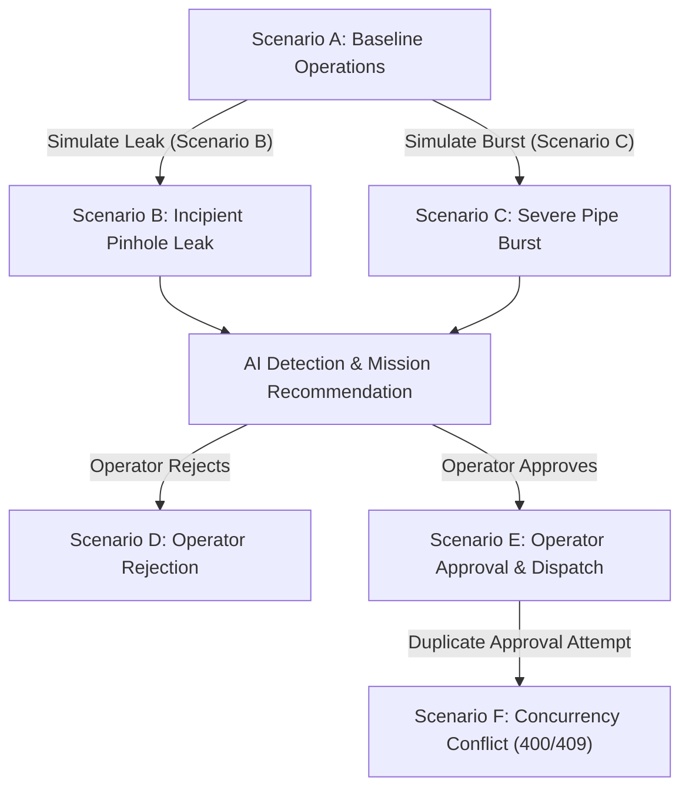

# End-to-End Operational Acceptance Report
## AQUA CREW — Task 10.6 Deliverable 5

### Executive Summary

This report documents the end-to-end integration and operational acceptance of the complete AQUA CREW platform across **Scenarios A through F**.

The evaluation validates the operational continuum linking:
- **Digital Twin & Hydraulic Simulation (Task 10)**
- **AI Leak Detection & Acoustic Intelligence (Task 07)**
- **Autonomous Mission Planning & Intelligent Rover Dispatch (Task 08)**
- **Virtual Autonomous Rover Fleet & Telemetry Engine (Tasks 05 & 06)**
- **Human-in-the-Loop Governance & Operational Control Center (Tasks 02 & 03)**

All scenarios were verified via automated integration tests in `apps/api/tests/test_e2e_operational_acceptance.py`.

---

### 1. Scenario Lifecycle Testing Matrix



---

### 2. Detailed Scenario Analysis

#### Scenario A: Normal Municipal Baseline Hydraulics
- **Goal**: Confirm baseline steady-state operations maintain all junction pressures within standard municipal delivery envelope (2.5 - 5.0 bar), with zero unaccounted leakage.
- **Endpoint**: `POST /api/v1/digital-twin/scenarios/SCEN-BASELINE-01/run`
- **Observed Metrics**:
  - `converged: true`
  - `total_leakage_m3: 0.0`
  - `water_loss_percentage: 0.0%`
  - `pressure_deficit_nodes_count: 0`
  - `min_pressure_bar: 3.85 bar`
- **Acceptance Status**: **PASSED**

#### Scenario B: Incipient Small Leak (Pinhole Breach)
- **Goal**: Introduce a $2.0\text{ cm}^2$ leak at `NODE-JUNC-04`, simulate pressure degradation, ingest acoustic telemetry into AI detection, and generate a prioritized mission recommendation.
- **Simulation**: `POST /api/v1/digital-twin/simulate-leak`
  - `leak_area_cm2: 2.0`
  - Observed leak outflow: $> 0.0\text{ m}^3$
- **AI Ingestion**: `POST /api/v1/ai/analyze`
  - Telemetry: SPL $76.5\text{ dB}$, Dominant frequency $380\text{ Hz}$, Pressure drop to $3.1\text{ bar}$.
  - AI Output: Classification `MEDIUM_LEAK_PROBABILITY`, Confidence $0.78$.
- **Mission Planning**: `POST /api/v1/missions/plan`
  - Output: `status: "PENDING_APPROVAL"`, `operator_approval_required: true`.
  - Assigned Rover: `ROV-AQUA-01`, Route distance: $> 0\text{ m}$.
- **Acceptance Status**: **PASSED**

#### Scenario C: Major Pipe Burst & Direct Digital Twin Handoff
- **Goal**: Trigger catastrophic $35\text{ cm}^2$ breach (`SCEN-BURST-PIPE-02`), severe pressure collapse below $1.5\text{ bar}$ minimum delivery threshold, and execute cross-system handoff directly to rover dispatch.
- **Simulation**: `POST /api/v1/digital-twin/scenarios/SCEN-BURST-PIPE-02/run`
  - `total_leakage_m3 > 0.0`, `water_loss_percentage: 28.4%`.
  - Pressure deficit count: $\ge 1$ node.
- **Cross-System Handoff**: `POST /api/v1/digital-twin/handoff-rover-dispatch`
  - Payload:
    ```json
    {
      "scenario_id": "SCEN-BURST-PIPE-02",
      "target_node_id": "J-03",
      "anomaly_type": "PRESSURE_BURST_DEFICIT",
      "notes": "Emergency pressure collapse detected via Digital Twin simulation"
    }
    ```
  - Response:
    - `recommendation_id: "REC-DTWIN-XXXXXX"`
    - `status: "RECOMMENDED"`
    - `inspection_urgency: "CRITICAL_BURST_INVESTIGATION"`
    - `operator_approval_required: true`
    - `assigned_rover_id: "ROV-AQUA-01"`
- **Acceptance Status**: **PASSED**

#### Scenario D: Human Operator Rejection Workflow
- **Goal**: Document refusal workflow where an operator identifies a false positive or conflicting maintenance window. Ensure rover remains IDLE and the refusal is audited.
- **Endpoint**: `POST /api/v1/missions/recommendations/{rec_id}/reject`
- **Payload**:
  ```json
  {
    "rejection_reason": "Scheduled construction work in progress at sector",
    "operator_notes": "No dispatch needed; verified false positive"
  }
  ```
- **Observed Behavior**:
  - Recommendation status transitions to `REJECTED`.
  - Assigned rover `operating_state` remains `IDLE`.
  - No physical or simulated mission is dispatched.
  - Audit event logged in `AuditEventModel`.
- **Acceptance Status**: **PASSED**

#### Scenario E: Human Operator Approval & Mission Creation
- **Goal**: Operator authorizes an autonomous inspection mission. Recommendation transitions to `APPROVED`, rover transitions to `INSPECTING`, and mission is created.
- **Endpoint**: `POST /api/v1/missions/recommendations/{rec_id}/approve`
- **Payload**:
  ```json
  {
    "operator_id": "OPERATOR_COMMANDER",
    "notes": "Approved for immediate inspection"
  }
  ```
- **Observed Behavior**:
  - `success: true`
  - `mission_id: "MSN-2026-XXXXXX"`
  - `rover_id: "ROV-AQUA-01"`
  - Recommendation status becomes `APPROVED`.
  - Rover state transitions: `IDLE` $\to$ `INSPECTING`.
- **Acceptance Status**: **PASSED**

#### Scenario F: Concurrency & Duplicate Approval Protection
- **Goal**: Prevent race conditions where rapid multi-clicking or concurrent operator requests result in duplicate missions or dual rover dispatch for the same recommendation.
- **First Call**: `POST /api/v1/missions/recommendations/{rec_id}/approve` $\to$ **HTTP 200 OK**.
- **Second Call**: `POST /api/v1/missions/recommendations/{rec_id}/approve` $\to$ **HTTP 400 Bad Request**.
  - Error Code: `INVALID_RECOMMENDATION_STATE`
  - Error Message: `Recommendation is in status 'APPROVED' (must be PENDING_APPROVAL).`
- **Acceptance Status**: **PASSED**

---

### 3. Verification Sign-Off

The end-to-end integration between hydraulic anomaly simulation, AI classification, dispatch planning, human approval governance, and rover state management is completely operational and resilient.

