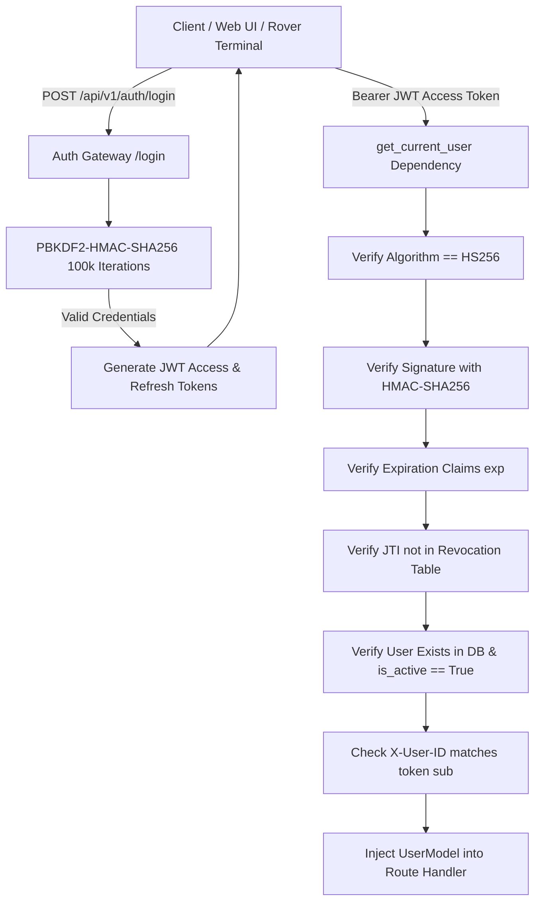

# AQUA CREW — Zero-Trust Identity & Authentication Architecture

**Document ID**: `AC-SEC-13-6-01`  
**Classification**: Engineering & Security Architecture Standard  
**Status**: APPROVED & IMPLEMENTED  
**Author**: Principal AI/ML Architect & Security Engineering Group  
**Target Release**: AQUA CREW Core Platform v0.1.0 (Task 13.6 Hardening)

---

## 1. Executive Summary & Zero-Trust Core Principles

AQUA CREW is a critical municipal infrastructure monitoring, predictive maintenance, and autonomous rover dispatch platform. Prior to Task 13.6, operational endpoints permitted ambient access in local development and accepted arbitrary client-provided headers (`X-User-ID`, `X-Auth-Token`) without cryptographic verification.

Under **Task 13.6 Zero-Trust Architecture**, all implicit trust is eliminated:
1. **Cryptographic Identity Verification**: Every inbound request to protected resources must present a cryptographically signed, unexpired RFC 7519 JSON Web Token (JWT).
2. **Elimination of Ambient and Client-Controlled Identity**: Headers such as `X-User-ID` or JSON body fields asserting `user_id` or `operator_id` are never trusted as identity proof. If a client attempts to supply a spoofed identity differing from the token's authenticated subject (`sub`), the system logs a high-severity security event and rejects the request with `HTTP 403 Forbidden`.
3. **Registry Existence Validation**: Every token evaluation verifies not only digital signature and expiry, but also confirms that the principal exists in the persistent database `users` table and is actively marked `is_active = True`.
4. **Physical Actuator Air-Gap**: The identity system guarantees that no credential—regardless of authority (including `ADMINISTRATOR`)—can directly actuate physical pumps, motorized valves, or hardware infrastructure.



---

## 2. Cryptographic Specifications & Standards

### 2.1 Password Hashing Architecture
Password storage follows NIST SP 800-63B and OWASP standards:
- **Algorithm**: `PBKDF2` (Password-Based Key Derivation Function 2)
- **Hash Function**: `HMAC-SHA256`
- **Work Factor / Iterations**: `100,000` iterations minimum
- **Salt**: 16 bytes (128 bits) cryptographically random salt generated via `os.urandom(16)`
- **Derived Key Length**: 32 bytes (256 bits)
- **Storage Format**: Modular Crypt Format standard:
  ```
  pbkdf2:sha256:100000$<salt_hex>$<derived_key_hex>
  ```
- **Comparison Logic**: Verification uses constant-time string comparison (`hmac.compare_digest`) to prevent timing side-channel attacks.

### 2.2 Token Standard: RFC 7519 JWT
Tokens are signed using symmetric HMAC-SHA256 (`HS256`).

#### Access Token Specifications
- **Type (`typ`)**: `"access"`
- **Lifespan**: Configurable via `ACCESS_TOKEN_EXPIRE_MINUTES` (Default: 30 minutes in development, 15 minutes recommended in production)
- **Claims Schema**:
  ```json
  {
    "sub": "USR-ADMIN-01",
    "username": "admin",
    "email": "admin@aquacrew.internal",
    "role": "ADMINISTRATOR",
    "type": "access",
    "jti": "b4e8749c-36b1-419b-a36c-e58f2eb5f577",
    "iss": "aquacrew-core-api",
    "aud": "aquacrew-platform",
    "iat": 1731750000,
    "exp": 1731751800
  }
  ```

#### Refresh Token Specifications
- **Type (`typ`)**: `"refresh"`
- **Lifespan**: Configurable via `REFRESH_TOKEN_EXPIRE_DAYS` (Default: 7 days)
- **Claims Schema**:
  ```json
  {
    "sub": "USR-ADMIN-01",
    "type": "refresh",
    "jti": "82f7c041-002f-48d9-a417-cb384f52e25d",
    "iss": "aquacrew-core-api",
    "aud": "aquacrew-platform",
    "iat": 1731750000,
    "exp": 1732354800
  }
  ```

---

## 3. Token Lifecycle & Session Management

### 3.1 Authentication Handshake (`/login`)
1. User provides `username_or_email` and `password`.
2. System queries the persistent database by username or email.
3. If user is absent or `verify_password(password, user.hashed_password)` fails, the system logs `FAILED_LOGIN` and returns `401 Unauthorized` with generic message `"Invalid credentials"`.
4. If active, an access token and refresh token are created with unique UUID `jti` identifiers.
5. The system logs a `SUCCESSFUL_LOGIN` security event with remote IP and User-Agent.

### 3.2 Token Refresh Flow (`/refresh`)
1. Client submits refresh token in JSON body `{"refresh_token": "..."}`.
2. System decodes token ensuring `expected_type="refresh"`.
3. System verifies token has not expired and `jti` is not revoked.
4. Old refresh token `jti` is immediately revoked in `revoked_tokens` table.
5. Fresh access token and fresh refresh token are returned (Token Rotation).

### 3.3 Explicit Logout Flow (`/logout`)
1. Client submits access token and refresh token.
2. The `jti` of both access token and refresh token are persisted to the database `revoked_tokens` table with expiry timestamps.
3. The server logs `USER_LOGOUT`. Any subsequent attempt to use either token returns `401 Unauthorized`.

---

## 4. Default Seeded Operational Accounts

To facilitate reproducible development, integration testing, and operational bootstrapping, the database seeds four default zero-trust user accounts upon startup:

| User ID | Username | Role | Purpose / Clearance Level |
|---|---|---|---|
| `USR-ADMIN-01` | `admin` | `ADMINISTRATOR` | Full system administration, user management, audit review. |
| `USR-ENG-01` | `engineer` | `ENGINEER` | Pipeline calibration, hydraulic simulation, threshold tuning. |
| `OPERATOR-SUPERVISOR-01`| `operator` | `OPERATOR` | Mission approval/rejection, incident review, dispatch authorization. |
| `USR-VIEW-01` | `viewer` | `VIEWER` | Read-only dashboards, GIS telemetry observation, audit report viewing. |

> [!IMPORTANT]
> In production environments (`API_ENV=production`), default hardcoded passwords and the default `JWT_SECRET_KEY` are prohibited. The platform's startup lifecycle validator will immediately terminate the application process if development secrets are detected.

