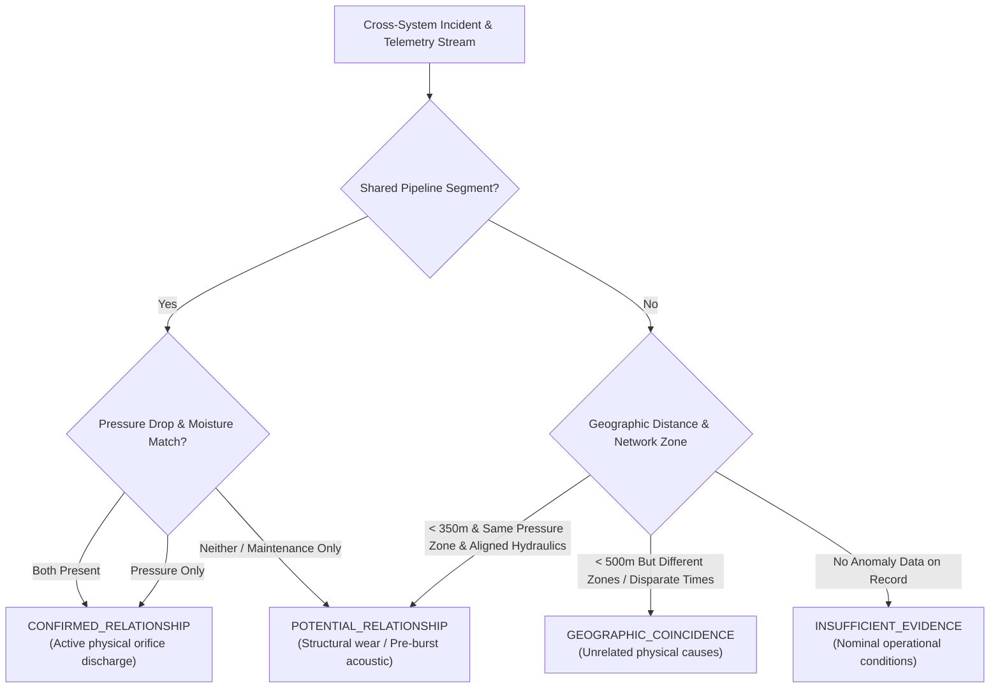

# AQUA CREW — INCIDENT CORRELATION METHODOLOGY
## Cross-System Multi-Sensor Event Correlation (Task 12 - Phase 4)

```
========================================================================================
AQUA CREW PLATFORM — CROSS-SYSTEM INCIDENT CORRELATION METHODOLOGY
Milestone: TASK 12 — Unified Operational Intelligence & Decision Support Platform
Engine: incident_correlation_service.py
Physics Rule: Never infer causal physical relationships from geographic proximity alone.
========================================================================================
```

---

## 1. The Challenge of Cross-System Telemetric Correlation

In municipal water distribution networks, dozens of sensor anomalies, alarms, and analytical model alerts occur daily across:
- **Task 07 Acoustic Models**: High-frequency hydrophone noise and sound pressure levels.
- **Task 06 Real-Time Telemetry**: Pressure drops, flow rate differentials, and ground moisture readings.
- **Task 09 Predictive Maintenance**: Asset health index drops and deterioration trends.
- **Task 10 Hydraulic Digital Twin**: Mass-balance residuals, headloss gradients, and velocity surges.
- **Task 11 Geospatial Intelligence**: Spatial incident clusters and geographic risk zones.

A critical engineering failure in automated decision support is **spurious correlation**: concluding that two events share a physical root cause simply because they occurred in the same quadrant of the city. For example, a pressure drop caused by peak morning residential demand 300 meters away from an aging cast-iron main must not be misdiagnosed as an active pipe blowout.

The AQUA CREW Cross-System Incident Correlation Engine explicitly enforces physical conservation laws, hydraulic connectivity, and temporal synchrony before attributing causal relationships.

---

## 2. The 4 Correlation Classifications

Every cross-system evaluation is classified into one of four mutually exclusive relationship categories:



### 1. `CONFIRMED_RELATIONSHIP`
- **Criteria**:
  - Must share the exact same physical pipeline segment (`primary_segment_id == related_segment_id`).
  - Co-occurrence of acoustic emission ($\text{anomaly\_score} \ge 0.60$) AND localized pressure loss ($\Delta P < -15\text{ psi}$ or $P < 45\text{ psi}$) OR moisture saturation ($>35\%$).
  - Temporal synchrony: Events occur within $\Delta t \le 24\text{ hours}$.
- **Physical Meaning**: Direct physical confirmation of pipe-wall puncture, joint separation, or active orifice water discharge.
- **Typical Metrics**: Correlation strength $0.85 - 0.98$, Uncertainty $\le 0.12$.

### 2. `POTENTIAL_RELATIONSHIP`
- **Criteria**:
  - Located on the same conduit OR an immediately connected adjacent conduit within the same pressure zone ($\text{PZ-ID}$).
  - Geodesic distance $\Delta d \le 350\text{ m}$.
  - Temporal delta $\Delta t \le 72\text{ hours}$.
  - Compatible physical mechanism (e.g. acoustic leak sound accompanied by structural embrittlement alert or upstream pump trip).
- **Physical Meaning**: Probable systemic degradation or hydraulic coupling where one failure mode accelerates another.
- **Typical Metrics**: Correlation strength $0.60 - 0.84$, Uncertainty $0.15 - 0.25$.

### 3. `GEOGRAPHIC_COINCIDENCE`
- **Criteria**:
  - Proximity is close ($\Delta d \le 500\text{ m}$), BUT:
    - Conduits reside in separate hydraulic pressure zones separated by closed isolation valves or pressure reducing valves (PRVs).
    - Events occurred at widely disparate temporal epochs ($\Delta t > 7\text{ days}$).
    - Conflicting physical signatures (e.g. localized pressure surge on PVC pipe concurrent with low-frequency rumble on Cast Iron pipe).
- **Physical Meaning**: Pure spatial coincidence. Independent root causes. No shared hydraulic or structural mechanism.
- **Typical Metrics**: Correlation strength $\le 0.35$, Uncertainty $\ge 0.40$.

### 4. `INSUFFICIENT_EVIDENCE`
- **Criteria**:
  - Segment has no active acoustic anomalies, no telemetric pressure drops, or sensor coverage is absent.
- **Physical Meaning**: Operational parameters remain within nominal baseline tolerances; data is insufficient to assert correlation.
- **Typical Metrics**: Correlation strength $\le 0.20$, Uncertainty $\ge 0.50$.

---

## 3. Mathematical Formulation of Correlation Metrics

### Geodesic Haversine Distance with Antimeridian Wrap
$$\Delta \lambda = \left(\left(\lambda_2 - \lambda_1 + \pi\right) \pmod{2\pi}\right) - \pi$$
$$a = \sin^2\left(\frac{\Delta \phi}{2}\right) + \cos(\phi_1) \cos(\phi_2) \sin^2\left(\frac{\Delta \lambda}{2}\right)$$
$$d = 2 R \cdot \text{atan2}\left(\sqrt{a}, \sqrt{1 - a}\right) \quad [R = 6,371,000\text{ m}]$$

### Correlation Strength Formulation ($S_{\text{corr}}$)
For co-occurring events on the same segment:

$$S_{\text{corr}} = \min\left(0.98, \; 0.70 + 0.20 \cdot A + 0.08 \cdot \mathbb{I}_{\text{moisture}}\right)$$

Where:
- $A \in [0.0, 1.0]$: Normalized acoustic anomaly score.
- $\mathbb{I}_{\text{moisture}} \in \{0, 1\}$: Binary indicator for elevated subterranean moisture saturation ($>35\%$).

### Uncertainty Formulation ($U$)
$$U = \max\left(0.08, \; 1.0 - S_{\text{corr}} \cdot C_{\text{sensor}}\right)$$

Where $C_{\text{sensor}}$ is the data completeness percentage of the local sensor cluster.

