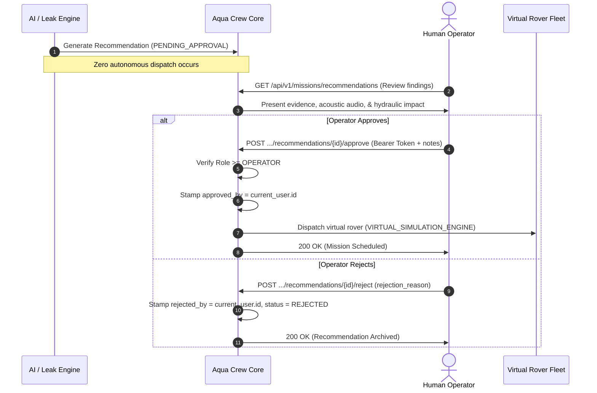

# AQUA CREW — Mission Approval Security & Human-in-the-Loop Interlock

**Document ID**: `AC-SEC-13-6-06`  
**Classification**: Operational Safety & Dispatch Authorization Standard  
**Status**: APPROVED & IMPLEMENTED  
**Target Release**: AQUA CREW Core Platform v0.1.0 (Task 13.6 Hardening)

---

## 1. Principle of Mandatory Human-in-the-Loop (HITL)

Autonomous rovers and virtual inspection fleets operate in sensitive municipal pipeline infrastructure. To prevent catastrophic failure, unintended pipe de-pressurization, or unbudgeted resource depletion, **no automated algorithm or AI model can directly dispatch a rover or execute an operational decision**.

All mission dispatches and maintenance decisions require:
1. **Authenticated Human Approval**: A valid human operator (`OPERATOR`, `ENGINEER`, or `ADMINISTRATOR`) must submit an explicit approval request.
2. **Cryptographic Identity Binding**: The identity of the approving operator is extracted directly from the verified JWT token and recorded permanently in the audit trail.
3. **Mandatory Justification**: Rejection or modification of recommendations requires a documented reason.
4. **State Guarding**: Recommendations can only be processed once; duplicate approvals return idempotent results or `409 Conflict`.

---

## 2. Protected Endpoints & Authorization Policy

### 2.1 Mission Recommendations (`/api/v1/missions/recommendations`)
- **`POST /{id}/approve`**:
  - Clearance: `OPERATOR`, `ENGINEER`, or `ADMINISTRATOR`.
  - Body: `RecommendationApprovalRequest(notes: Optional[str])`.
  - Identity Enforcement: Approver ID is recorded as `current_user.id`. Client cannot supply or spoof an arbitrary `operator_id`.
  - Action: Transitions recommendation to `APPROVED` and schedules virtual rover mission.

- **`POST /{id}/reject`**:
  - Clearance: `OPERATOR`, `ENGINEER`, or `ADMINISTRATOR`.
  - Body: `RecommendationRejectionRequest(rejection_reason: str, operator_notes: Optional[str])`.
  - Action: Sets recommendation to `REJECTED`. Rover remains `IDLE`.

### 2.2 Operational Intelligence Recommendations (`/api/v1/operational-intelligence/recommendations`)
- **`POST /{id}/approve`**:
  - Clearance: `OPERATOR`, `ENGINEER`, or `ADMINISTRATOR`.
  - Body: `OperationalDecisionRequest(decision_type="APPROVED", decision_reason="...")`.
  - Identity Enforcement: Recorded in `OperationalDecisionModel` with `operator_id = current_user.id`.

- **`POST /{id}/reject`**:
  - Clearance: `OPERATOR`, `ENGINEER`, or `ADMINISTRATOR`.
  - Body: `OperationalDecisionRequest(decision_type="REJECTED", decision_reason="...")`.

---

## 3. Tamper-Proof Approver Attribution

Prior to Task 13.6, request payloads could specify an `operator_id` string that overrode server-side attribution. In Task 13.6:
- Any `operator_id` supplied in the request JSON is completely ignored for attribution.
- The server extracts `current_user.id` from the cryptographically verified JWT token.
- Both the database decision record and the JSON response guarantee `operator_id == current_user.id`.
- The decision record includes an SHA-256 cryptographic audit hash binding `recommendation_id`, `decision_type`, `operator_id`, `timestamp`, and `decision_reason`.

---

## 4. Verification & Audit Results

Ten dedicated automated tests in `TestHumanApprovalAndMissionSecurity` confirm:
1. `test_approval_01`: Approver identity strictly matches authenticated JWT principal.
2. `test_approval_02`: Spoofed `operator_id` in request body is discarded.
3. `test_approval_03`: Viewer cannot approve mission recommendations (`403 Forbidden`).
4. `test_approval_04`: Double approval is safely guarded and idempotent.
5. `test_approval_05`: Rejection without justification is rejected with `422 Unprocessable Entity`.
6. `test_approval_06` & `07`: Unauthenticated approval/rejection returns `401 Unauthorized`.
7. `test_approval_08`: Non-existent recommendation ID returns `404 Not Found`.
8. `test_approval_09`: Cryptographic decision audit trail is recorded.
9. `test_approval_10`: Handoff dispatch endpoints return `RECOMMENDED`, never executing direct dispatch.

