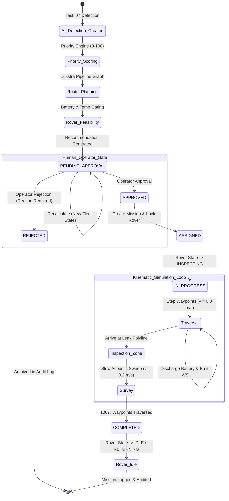

# AQUA CREW — Mission Execution & Lifecycle Workflow Specification
**Task 08 Technical Documentation — Operational State Machine & Kinematic Execution**

## 1. Overview

This document specifies the operational lifecycle, state transitions, and kinematic simulation mechanics of autonomous pipeline inspection missions in **AQUA CREW Task 08**.

The workflow enforces a strict **Human-in-the-Loop** paradigm: autonomous intelligence proposes and validates missions, but execution begins only upon explicit operator authorization.

---

## 2. End-to-End Operational Lifecycle

---

## 3. Detailed Lifecycle Phases

### Phase 1: Ingestion & Priority Scoring
- An AI leak detection record (`AiDetectionModel`) is evaluated by `MissionPriorityService`.
- Multi-criteria scoring evaluates risk severity, acoustic confidence, pressure drop, estimated flow loss, and pipe category.
- Resulting score ($0-100$) maps to `CRITICAL`, `HIGH`, `MEDIUM`, or `LOW`.

### Phase 2: Graph Route Planning & Energy Modeling
- `PipelineRoutingService` constructs the topological graph $G=(V, E)$ from GeoJSON pipeline geometries.
- Dijkstra's algorithm computes the shortest connected underground path between candidate rovers and the target coordinates.
- `RoverSelectionService` models energy requirements:
  \[
  E_{\text{total}} = E_{\text{travel}} + E_{\text{inspect}} + E_{\text{return}}
  \]
- Any candidate with projected post-mission battery $< 20.0\%$ or motor temperature $\ge 50^\circ\text{C}$ is disqualified.

### Phase 3: Recommendation Generation (`PENDING_APPROVAL`)
- A `MissionRecommendationModel` is persisted in the database.
- Details include total route distance, estimated duration, waypoints, projected battery reserves, and explainable rationale.
- The system broadcasts a `MISSION_RECOMMENDED` WebSocket event.
- The recommendation is queued on the **Autonomous Dispatch Center** dashboard.

### Phase 4: Human-in-the-Loop Operator Governance
- Operators inspect the proposed route, waypoint geometry, battery safety margins, and acoustic diagnostic logs.
- Available operator actions:
  1. **Approve**: Confirms dispatch. Transitions recommendation to `APPROVED`.
  2. **Reject**: Requires a mandatory explanation (e.g., false positive, pending scheduled overhaul). Transitions to `REJECTED`.
  3. **Recalculate**: Re-evaluates routing and rover allocation if conditions or rover locations changed.

### Phase 5: Mission Assignment & State Transition
- Upon approval, `MissionService.create_mission()` instantiates a formal `MissionModel`:
  - `status = "IN_PROGRESS"`
  - `recommendation_id` and `source_detection_id` linked
  - Polyline waypoints saved to `route_waypoints_json`
- The assigned rover's state transitions from `IDLE` to `INSPECTING`.
- `MISSION_APPROVED` and `MISSION_ASSIGNED` events are broadcast to all connected WebSocket clients.

### Phase 6: Kinematic Traversal & Progress Tracking
- The backend simulation loop (`SimulationService.update_simulation_tick()`) advances active rovers along the stored waypoints.
- Every simulation step:
  1. Rover advances along polyline segments at simulated subterranean cruising speed ($v = 0.8\text{ m/s}$).
  2. `inspected_distance_m` increments in the database.
  3. Rover battery discharges proportional to travel and acoustic listening load.
  4. Real-time progress updates are broadcast via `MISSION_PROGRESS` events.

### Phase 7: Target Zone Arrival & Mission Completion
- Upon reaching the destination coordinates, the rover executes a localized acoustic verification sweep.
- `MissionModel.status` transitions to `COMPLETED`.
- `inspected_distance_m` matches `route_distance_m` ($100\%$ progress).
- The rover transitions back to `IDLE` or enters autonomous return routing.
- The system broadcasts `MISSION_COMPLETED` and creates an audit event.

---

## 4. Failure Modes & Safety Interlocks

| Failure Scenario | Automated Safety Response |
| :--- | :--- |
| **Pipeline Disconnection** | Router refuses straight-line jump; generates explicit routing failure error. |
| **Fleet Depletion (Low Battery)** | All candidate rovers disqualified; recommendation alerts operator that recharge is required. |
| **Thermal Warning During Transit** | If motor temperature reaches $50^\circ\text{C}$, rover halts and emits emergency telemetry alert. |
| **Unapproved Dispatch Attempt** | Strict API enforcement: rovers cannot be assigned without an approved recommendation ID. |

---

## 5. Software Simulation Provenance

All mission lifecycle transitions, kinematic movements, battery drains, and acoustic sweeps are executed within the virtual simulation container.
- `is_simulated: true`
- `source: "VIRTUAL_SIMULATION_ENGINE"`

