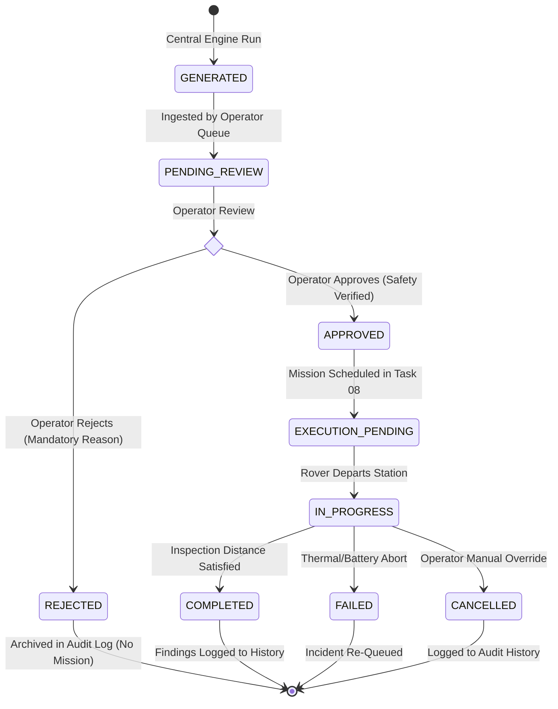

# AQUA CREW — OPERATIONAL DECISION WORKFLOW
## Human-in-the-Loop Governance, Auditability & Safety Controls (Task 12 - Phase 8)

```
========================================================================================
AQUA CREW PLATFORM — DECISION LIFECYCLE & SAFETY GOVERNANCE SPECIFICATION
Milestone: TASK 12 — Unified Operational Intelligence & Decision Support Platform
Engine: operational_decision_service.py
Core Safety Rule: Autonomous mission execution is strictly inhibited until a human
operator formally authorizes the recommendation. Real-world actuators permanently disabled.
========================================================================================
```

---

## 1. Human-in-the-Loop Philosophy

In autonomous water robotics and digital twin engineering, AI algorithms must **recommend**, but licensed human operators must **decide**. High-consequence decisions — such as scheduling subterranean inspection crawling, throttling feeder mains, or mobilizing excavation teams — carry public health, water pressure, and infrastructure consequences.

AQUA CREW enforces a strict Human-in-the-Loop (HITL) architectural pattern:
1. No virtual rover may navigate or initiate subterranean inspection without human approval.
2. Every approval or rejection is immutably logged with an operator identity, timestamp, and cryptographic audit hash.
3. Rejection requires a mandatory engineering justification reason.
4. Rejected recommendations strictly cannot create missions or command robotic resources.

---

## 2. Complete Recommendation Lifecycle State Machine



---

## 3. Decision Processing Mechanics

### 1. Operator Approval (`POST /recommendations/{id}/approve`)
When an operator approves a recommendation:
1. **Concurrency Lock**: An atomic database check verifies that `status` is currently in `GENERATED` or `PENDING_REVIEW`. If the recommendation has already been approved, rejected, or completed, an `AquaCrewException(status_code=409, code="DUPLICATE_DECISION_REJECTED")` is raised.
2. **Rover Readiness Gate**: If the recommendation requires rover inspection, the engine verifies the assigned rover:
   - Operating state must be `IDLE` or `STANDBY`.
   - Battery reserve must be $\ge 20.0\%$.
   - Motor temperature must be $< 65.0^\circ\text{C}$.
3. **Mission Creation**: Automatically provisions a `MissionModel` in `Scheduled` status via the Task 08 dispatch engine.
4. **Execution Tracking**: Initializes an `OperationalExecutionRecordModel` in stage `DISPATCH_PREPARED`.
5. **Cryptographic Audit Signature**: Computes an SHA-256 hash across the decision payload:
   $$\text{Hash} = \text{SHA256}(\text{rec\_id} : \text{type} : \text{op\_id} : \text{timestamp} : \text{reason})$$

### 2. Operator Rejection (`POST /recommendations/{id}/reject`)
When an operator rejects a recommendation:
1. **Mandatory Justification**: The `decision_reason` field must contain at least 3 non-whitespace characters. Blank or trivial submissions are rejected with `HTTP 400 (REASON_REQUIRED)`.
2. **Zero Resource Allocation**: Status transitions directly to `REJECTED`. **No mission record is created**, and no rover state is altered.
3. **Audit Persistence**: Stored permanently in `OperationalDecisionModel` for historical analysis and regulatory compliance.

---

## 4. Concurrency Protection & State Guarding

To prevent race conditions where multiple supervisors or automated background scripts attempt concurrent actions:

```python
# Atomic state guard
if rec.status in ["APPROVED", "REJECTED", "COMPLETED", "CANCELLED"]:
    raise AquaCrewException(
        status_code=409,
        code="DUPLICATE_DECISION_REJECTED",
        message=f"Recommendation '{recommendation_id}' has already been processed with status '{rec.status}'.",
    )
```

---

## 5. Audit Record Data Model

```
Table: operational_decisions
========================================================================================
Column Name              Type           Description
----------------------------------------------------------------------------------------
id                       String(64) PK  Unique decision identifier (DEC-xxxxxxxx)
recommendation_id        String(64)     Associated recommendation reference
decision_type            String(32)     APPROVED, REJECTED, OVERRIDDEN
decision_reason          Text           Mandatory engineering explanation
operator_id              String(128)    Unique operator identifier
operator_name            String(128)    Full operator name
resulting_mission_id     String(64)     Task 08 mission ID (null if rejected)
allocated_resource_id    String(64)     Assigned rover ID (null if rejected)
decision_timestamp       DateTime       UTC timestamp of authorization
audit_hash               String(128)    SHA-256 cryptographic tamper-evident hash
is_simulated             Boolean        Strictly true
source                   String(64)     VIRTUAL_SIMULATION_ENGINE
========================================================================================
```

