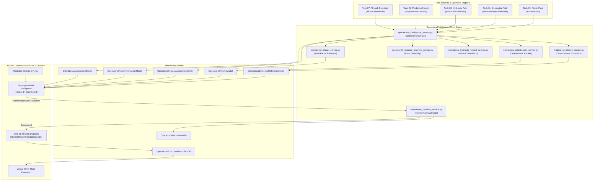

# AQUA CREW — OPERATIONAL INTELLIGENCE ARCHITECTURE
## Unified Operational Intelligence & Decision Support Platform (Task 12)

```
========================================================================================
AQUA CREW PLATFORM — SYSTEM ARCHITECTURE DOCUMENTATION
Milestone: TASK 12 — Unified Operational Intelligence & Decision Support Platform
Methodology Version: v1.0.0-unified-operational-decision
Simulation Mode: Virtual Metropolitan Infrastructure Simulation (is_simulated: true)
Provenance: VIRTUAL_SIMULATION_ENGINE
Safety Notice: Real-world physical actuator actuation is permanently disabled.
========================================================================================
```

---

## 1. Architectural Mission & Overview

Prior to Task 12, the AQUA CREW platform contained high-fidelity but domain-specialized analytical subsystems:
- **Task 03**: Operational Command Center overview metrics and alert handling.
- **Task 04**: Metropolitan Pipeline GIS Intelligence (MapLibre WebGL topology).
- **Tasks 05–06**: Virtual Autonomous Rover Fleet & real-time telemetry streaming.
- **Task 07**: AI-Powered Acoustic Leak Detection & multi-sensor anomaly classification.
- **Task 08**: Autonomous Mission Planning & Dijkstra graph routing.
- **Task 09**: Predictive Maintenance & asset health degradation modeling.
- **Task 10/10.5/10.6**: Digital Twin & Hydraulic Network Simulation (WNTR/EPANET & Todini GGA).
- **Task 11/11.5**: Infrastructure Intelligence & Geospatial Risk Prediction (DBSCAN & multi-horizon forecasts).

**Task 12** unifies these specialized engines into a single, cohesive, explainable **Operational Intelligence & Decision Support Platform**. It continuously ingests detection alarms, health slopes, hydraulic deficits, and fleet statuses to produce prioritized, human-in-the-loop operational recommendations that answer the 10 fundamental municipal water management questions.

---

## 2. Platform Component Integration Architecture



---

## 3. Dependency & Integration Matrix

| Upstream Module | Integrated Data Entities | Integration Role in Decision Engine | Reused Service / Model |
|---|---|---|---|
| **Task 03** | Network overview, active alerts, simulation status | City-wide health baselines & situational awareness | `SimulationSessionModel`, `TelemetryRecordModel` |
| **Task 04** | Polyline coordinates, GIS conduits, diameter, material | Physical infrastructure geometries & geospatial context | `PipelineSegmentModel`, GeoJSON serializers |
| **Task 05–06** | Battery %, motor temp, position, operating state | Fleet availability & safety feasibility constraints | `RoverModel`, `RoverRepository` |
| **Task 07** | Anomaly scores, leak classifications, acoustic SPL | Incident detection & pinhole localization alerts | `AiDetectionModel`, `leak_classification_service` |
| **Task 08** | Dijkstra shortest path, waypoint navigation, dispatch | Mission scheduling upon human operator sign-off | `MissionRecommendationModel`, `MissionModel` |
| **Task 09** | Health score ($0-100$), degradation slopes, risk levels | Asset condition deterioration & maintenance urgency | `PipelineHealthModel`, `PredictiveRiskModel` |
| **Task 10** | Pressure profiles, headloss gradients, flow rates | Digital twin what-if scenario impact & water loss | `HydraulicLinkModel`, `simulation_runner.py` |
| **Task 11 / 11.5** | Multi-factor vulnerability scores, DBSCAN clusters | Consequence rating & systemic spatial prioritisation | `PipelineVulnerabilityProfileModel`, `SpatialIncidentClusterModel` |

---

## 4. The 8 Operational Recommendation Categories

The central engine categorizes every candidate operational action into one of eight distinct operational categories:

1. **`IMMEDIATE_INSPECTION`**:
   - *Condition*: High vulnerability conduit ($\ge 75.0$) with substantial health deficit ($100 - H \ge 40.0$) or confirmed active pressure drop.
   - *Action*: Emergency same-day acoustic crawler patrol and ultrasonic wall thickness measurement.
2. **`URGENT_LEAK_INVESTIGATION`**:
   - *Condition*: High-confidence AI acoustic anomaly ($\ge 70.0\%$) on an arterial or critical distribution main.
   - *Action*: Immediate pin-point localization with crawling hydrophone sensor.
3. **`PREVENTIVE_MAINTENANCE`**:
   - *Condition*: Asset health index $< 55.0$ or actively deteriorating degradation slope ($\beta_1 > 0.15\text{ pts/day}$) on metallic mains.
   - *Action*: Schedule internal sleeve reinforcement, cathodic anode replacement, or pipe relining within 14–30 days.
4. **`HYDRAULIC_INVESTIGATION`**:
   - *Condition*: Elevated hydraulic headloss ($> 4.0\text{ m/km}$) or localized pressure deficit under nominal demands.
   - *Action*: Run digital twin what-if scenario to model PRV throttling or feeder re-routing.
5. **`PIPELINE_HEALTH_REVIEW`**:
   - *Condition*: Data completeness below $70\%$ or sensor baseline missing, leading to wide prediction uncertainty margins.
   - *Action*: Deploy temporary IoT telemetry logging stations to restore model confidence.
6. **`ROVER_DISPATCH_RECOMMENDED`**:
   - *Condition*: Target segment has high inspection priority and at least one rover satisfies all battery and thermal gates.
   - *Action*: Present rover route to human operator for launch sign-off.
7. **`CONTINUOUS_MONITORING`**:
   - *Condition*: Conduit exhibits nominal pressure, intact structural health, and low vulnerability.
   - *Action*: Maintain standard background 1Hz sensor polling.
8. **`HUMAN_ENGINEERING_REVIEW`**:
   - *Condition*: Complex cross-zone pressure imbalance or conflicting multi-system indicators requiring expert hydraulic review.
   - *Action*: Flag for formal utility engineering assessment before physical excavation.

---

## 5. Answering the 10 Core Operational Questions

Each generated recommendation provides structured answers to the 10 operational questions:

1. **What is happening across the network?** Synthesized in `OperationalAssessmentModel.summary_json` and displayed in the Overview KPI cards.
2. **Which pipeline segments need immediate attention?** Filtered and ranked in the `OperationalPriorityModel` queue.
3. **Which incidents are connected to infrastructure deterioration?** Evaluated by `IncidentCorrelationService` linking acoustic bursts to Task 09/11 health slopes.
4. **Which assets are at risk of failure?** Quantified via composite failure likelihood indicators ($S_{\text{inc}}$, $S_{\text{vuln}}$, $100 - H$).
5. **Which inspections should be prioritised?** Ordered by deterministic composite priority score ($0.0-100.0$) and priority tier.
6. **Which rover is suitable?** Evaluated by `OperationalResourcePlanningService` checking battery ($\ge 20\%$) and motor temperature ($< 65^\circ\text{C}$).
7. **What maintenance action is recommended?** Expressed as concrete physical engineering actions (relining, sonar scan, valve tuning).
8. **What are the expected consequences?** Quantified by `OperationalImpactService` (water loss in $\text{m}^3/\text{day}$, pressure drop delta, affected nodes).
9. **What information is missing?** Explicitly highlighted in `what_missing` and docked in `data_completeness_pct`.
10. **Which decisions require human approval?** Every single action requiring resource allocation or physical intervention requires operator sign-off; autonomous actuation is strictly inhibited.

---

## 6. Software-Only Simulation & Safety Controls

- **Simulation Isolation**: `is_simulated: true` and `source: "VIRTUAL_SIMULATION_ENGINE"` are enforced across all database tables and REST payloads.
- **Physical Actuator Safety**: The platform contains no hardware control drivers. Physical pumps, valves, and repair apparatus cannot be actuated.
- **Human-in-the-Loop Interlock**: Mission dispatch occurs only when an authorized operator executes an approval decision with a recorded justification.

