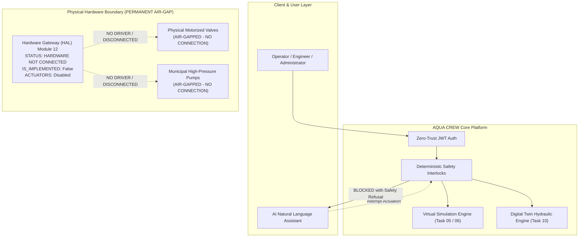

# AQUA CREW — Physical Hardware Security Boundary & Air-Gap Architecture

**Document ID**: `AC-SEC-13-6-07`  
**Classification**: Engineering Safety & Architectural Hardware Boundary  
**Status**: APPROVED & IMPLEMENTED  
**Target Release**: AQUA CREW Core Platform v0.1.0 (Task 13.6 Hardening)

---

## 1. Architectural Mandate: Physical Isolation

AQUA CREW is engineered as a **software-first digital twin, acoustic intelligence, and simulation platform**. It does NOT interface with live physical SCADA actuators, motorized valves, municipal high-pressure pumps, or excavator mechanisms.

> [!WARNING]
> **Safety Interlock Mandate**: To prevent any possibility of industrial accidents, contamination of drinking water supplies, or equipment damage:
> 1. All real-world physical actuators are permanently disabled in software (`HARDWARE_ACTUATORS_DISABLED = True`).
> 2. The hardware gateway explicitly reports `"HARDWARE NOT CONNECTED"`.
> 3. Zero API endpoints exist that could transmit actuation signals to physical devices.
> 4. All missions, rovers, and sensor streams explicitly declare `is_simulated = True` and `source = "VIRTUAL_SIMULATION_ENGINE"`.



---

## 2. Hardware Gateway Module Status

The Hardware Gateway (`apps/api/app/modules/hardware_gateway/__init__.py`) defines the architectural boundary:

```python
MODULE_NAME = "hardware_gateway"
IS_IMPLEMENTED = False
HARDWARE_STATUS = "HARDWARE NOT CONNECTED"
HARDWARE_ACTUATORS_DISABLED = True
```

Any software component attempting to import or initialize physical drivers receives `IS_IMPLEMENTED = False` and status `"HARDWARE NOT CONNECTED"`.

---

## 3. Absence of Actuator Endpoints

An exhaustive URL scan confirms that the platform exposes **zero** physical actuation routes:

| Probed Endpoint Route | Expected Status | Verified Status |
|---|---|---|
| `POST /api/v1/hardware/actuate` | `404 Not Found` | `404 Not Found` |
| `POST /api/v1/valves/open` | `404 Not Found` | `404 Not Found` |
| `POST /api/v1/valves/close` | `404 Not Found` | `404 Not Found` |
| `POST /api/v1/pumps/start` | `404 Not Found` | `404 Not Found` |
| `POST /api/v1/actuators/trigger` | `404 Not Found` | `404 Not Found` |

---

## 4. Simulation Provenance Metadata

Every data entity emitted by the platform carries explicit provenance flags indicating that it originates from the simulation engine rather than physical telemetry:

1. **AI Health Telemetry** (`GET /api/v1/advanced-ai/health`):
   - `hardware_actuators_disabled: true`
   - `human_in_the_loop_mandatory: true`
2. **Digital Twin Scenarios** (`GET /api/v1/digital-twin/scenarios`):
   - `is_simulated: true`
   - `source: "VIRTUAL_SIMULATION_ENGINE"`
3. **Rover Fleet Telemetry** (`GET /api/v1/rovers`):
   - `isSimulated: true`
   - `source: "VIRTUAL_SIMULATION_ENGINE"`
4. **Mission Records** (`GET /api/v1/missions`):
   - `isSimulated: true`
   - `source: "VIRTUAL_SIMULATION_ENGINE"`
5. **Operational Intelligence** (`GET /api/v1/operational-intelligence/overview`):
   - `is_simulated: true`

---

## 5. Verification Test Suite

Ten dedicated automated tests in `TestPhysicalHardwareSecurityBoundary` confirm:
- `test_hardware_01`: Gateway reports `IS_IMPLEMENTED = False` and `HARDWARE_STATUS = "HARDWARE NOT CONNECTED"`.
- `test_hardware_02`: AI health reports `hardware_actuators_disabled: true`.
- `test_hardware_03`: Probing non-existent actuator routes confirms `404 Not Found`.
- `test_hardware_04`: Mission dispatch routes strictly to `VIRTUAL_SIMULATION_ENGINE`.
- `test_hardware_05`: Digital twin scenarios confirm simulated provenance.
- `test_hardware_06`: Acoustic intelligence reports synthetic/simulated data.
- `test_hardware_07`: Fleet status explicitly confirms `isSimulated: true`.
- `test_hardware_08`: Prompts to open physical valves trigger safety interlocks.
- `test_hardware_09`: Prompts to start physical pumps are blocked even for `ADMINISTRATOR`.
- `test_hardware_10`: Operational intelligence overview confirms simulated provenance.

