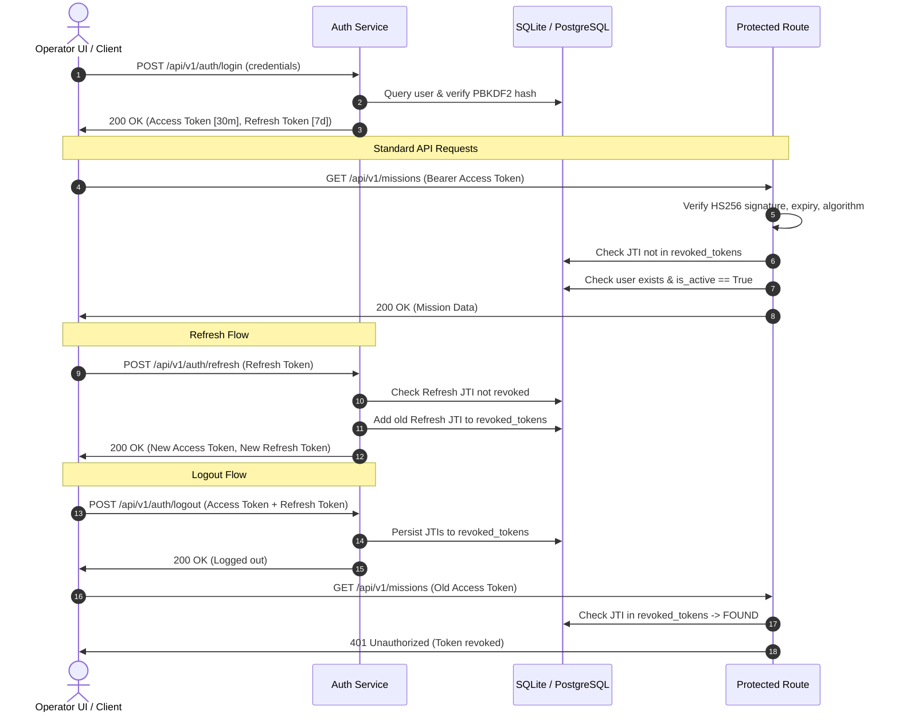

# AQUA CREW — Session and Token Security

**Document ID**: `AC-SEC-13-6-04`  
**Classification**: Cryptographic Session Lifecycle Standard  
**Status**: APPROVED & IMPLEMENTED  
**Target Release**: AQUA CREW Core Platform v0.1.0 (Task 13.6 Hardening)

---

## 1. Overview & Threat Model

In industrial supervisory control and data acquisition (SCADA) and water infrastructure management systems, persistent session hijacking or replay attacks pose critical risks. If an operator's token is compromised, an attacker could attempt unauthorized mission approvals, sensor tampering, or network sabotage.

AQUA CREW addresses these risks through:
1. **Short-Lived Access Tokens**: Minimizes the window of exposure for compromised bearer credentials.
2. **Rotating Refresh Tokens**: Limits refresh token reuse; every refresh consumes the old refresh token and issues a new pair.
3. **Explicit JTI Revocation**: Enables immediate revocation on logout or suspected breach.
4. **Deactivated Account Invalidation**: Real-time DB registry checks ensure deactivated users cannot use unexpired tokens.

---

## 2. Token Architecture & Verification Flow



---

## 3. Cryptographic Token Structure

Each token contains an RFC 7519 compliant JSON payload:

```json
{
  "sub": "OPERATOR-SUPERVISOR-01",
  "username": "operator",
  "email": "operator@aquacrew.internal",
  "role": "OPERATOR",
  "type": "access",
  "jti": "5a4f7830-4e2b-4265-8b39-165b530c885e",
  "iss": "aquacrew-core-api",
  "aud": "aquacrew-platform",
  "iat": 1731750000,
  "exp": 1731751800
}
```

### Cryptographic Invariants Enforced:
- **Algorithm Lockdown**: Only symmetric `HS256` is permitted. Tokens signed with `none` or asymmetric public keys are rejected with `TokenAlgorithmNotAllowedError`.
- **Audience & Issuer Validation**: Tokens must match `iss="aquacrew-core-api"` and `aud="aquacrew-platform"`.
- **Signature Integrity**: Signatures are evaluated using HMAC-SHA256 with constant-time equality checks. Tampered headers or payloads immediately fail with `TokenInvalidSignatureError`.

---

## 4. Revocation Table Schema

Revoked tokens are recorded in the `revoked_tokens` table:

```sql
CREATE TABLE revoked_tokens (
    id VARCHAR(64) PRIMARY KEY,
    jti VARCHAR(64) NOT NULL UNIQUE,
    user_id VARCHAR(64) NOT NULL,
    token_type VARCHAR(32) NOT NULL,
    revoked_at TIMESTAMP WITH TIME ZONE DEFAULT CURRENT_TIMESTAMP,
    expires_at TIMESTAMP WITH TIME ZONE NOT NULL,
    reason VARCHAR(128)
);
CREATE INDEX ix_revoked_tokens_jti ON revoked_tokens (jti);
```

### Automatic Purge Policy:
Records in `revoked_tokens` whose `expires_at` is older than the current timestamp may be purged by maintenance jobs without security degradation, since the token's standard `exp` claim would reject it naturally.

---

## 5. Security Audit Logging

All token events are logged to the persistent `security_audit_events` table:

- `SUCCESSFUL_LOGIN`: Records user ID, IP address, user-agent, and issued JTIs.
- `FAILED_LOGIN`: Records attempted username/email, client IP, and failure reason.
- `TOKEN_REFRESH`: Records previous and rotated token JTIs.
- `USER_LOGOUT`: Records explicitly revoked token JTIs.
- `TOKEN_EXPIRED`: Records expired token presentation attempts.
- `UNAUTHORIZED_ACCESS`: Records attempts to access endpoints without authorization.
- `IDENTITY_SPOOFING_ATTEMPT`: Records attempts to supply mismatched client headers.

