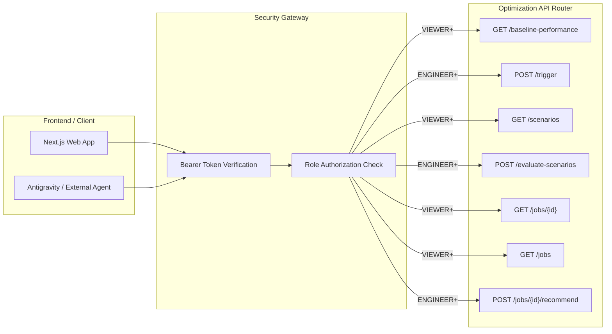

# AQUA CREW — TASK 14: API & FRONTEND INTEGRATION GUIDE

## 1. REST API Specification (`/api/v1/optimization`)

All network optimization services are accessible via the FastAPI backend mounted under `/api/v1/optimization`. All endpoints require JWT authentication and enforce Zero-Trust Role-Based Access Control (RBAC).



---

## 2. Endpoint Catalog & Contract Specifications

### 2.1 Get Baseline Performance
- **Path**: `GET /api/v1/optimization/baseline-performance`
- **Role Requirement**: `VIEWER`, `OPERATOR`, `ENGINEER`, `ADMINISTRATOR`
- **Query Parameters**:
  - `network_id` (string, default: `"NET-METRO-01"`)
  - `duration_hours` (integer, default: 24)
  - `tariff_usd_per_kwh` (float, optional)
- **Response**: `NetworkPerformanceReport` (5 metric categories: pressure, hydraulic, water loss, energy, reliability).

### 2.2 Trigger Optimization Run
- **Path**: `POST /api/v1/optimization/trigger`
- **Role Requirement**: `ENGINEER`, `ADMINISTRATOR` (Returns 403 Forbidden for `VIEWER`)
- **Request Body**:
```json
{
  "network_id": "NET-METRO-01",
  "scenario_id": "SCEN-BASELINE-01",
  "objective_profile": "BALANCED_OPERATION",
  "algorithm": "DIFFERENTIAL_EVOLUTION",
  "max_evaluations": 25,
  "random_seed": 42,
  "electricity_tariff_usd_per_kwh": 0.14
}
```
- **Response**: `OptimizationJobDetailResponse` containing job metadata, baseline comparison, top 25 evaluated candidates, and non-dominated Pareto frontier solutions.

### 2.3 List Standard Operational Scenarios
- **Path**: `GET /api/v1/optimization/scenarios`
- **Role Requirement**: `VIEWER` or higher
- **Response**: Array of 10 scenario definitions with parameter overrides.

### 2.4 Multi-Scenario Evaluation Matrix
- **Path**: `POST /api/v1/optimization/evaluate-scenarios`
- **Role Requirement**: `ENGINEER`, `ADMINISTRATOR`
- **Request Body**:
```json
{
  "network_id": "NET-METRO-01",
  "scenario_ids": ["SCEN-01-NOMINAL", "SCEN-02-PEAK", "SCEN-03-OFFPEAK"],
  "candidate_variables": {
    "pump_speed_P1": 0.88,
    "prv_setting_PRV01": 2.9
  }
}
```
- **Response**: Comprehensive matrix detailing hydraulic pass/fail status, pressure bounds, and energy metrics per scenario.

### 2.5 Emit Operator Recommendation
- **Path**: `POST /api/v1/optimization/jobs/{job_id}/recommend`
- **Role Requirement**: `ENGINEER`, `ADMINISTRATOR`
- **Request Body**:
```json
{
  "candidate_id": "CAND-002",
  "operator_notes": "Approved for night-shift pressure reduction trial in DMA 02."
}
```
- **Response**: Audit-logged recommendation event with SHA-256 payload digest.

---

## 3. Frontend Optimization Command Center (`/app/optimization`)

The frontend application provides a responsive operator dashboard built in Next.js 14 and Tailwind CSS (`apps/web/src/components/optimization/NetworkOptimizationView.tsx`):

### UI Component Layout
1. **Header & Control Bar**:
   - Network selector (`NET-METRO-01`)
   - Objective Profile selector (`BALANCED_OPERATION`, `ENERGY_EFFICIENCY`, `LEAKAGE_REDUCTION`, `PRESSURE_STABILITY`)
   - Evaluation budget slider ($10 - 100$ evaluations)
   - "Execute Optimization" trigger button with role badge indicator
2. **KPI Summary Cards**:
   - **Water Loss Recovery**: Baseline vs. Optimized leakage ($m^3/\text{day}$) with percentage savings badge.
   - **Energy Conservation**: Baseline vs. Optimized pump energy (kWh) and percentage reduction.
   - **Hydraulic Head Balance**: Min pressure, max pressure, and deficit node counts.
   - **Demand Satisfaction**: Guaranteed consumer fulfillment percentage ($100\%$).
3. **Interactive Pareto Frontier Scatter Chart**:
   - Visualizes non-dominated candidates across Energy (X-axis) vs. Water Loss (Y-axis).
   - Color-coded points denoting Pareto status (Optimal = Emerald, Dominated = Slate).
   - Tooltip displaying pump speed, PRV setpoint, and weighted score.
4. **Candidate Inspection Table**:
   - Sortable listing of evaluated configurations with rank, variables, scores, and verification status.
   - One-click "Inspect" modal opening full pressure distribution graphs.
5. **Operator Recommendation & Sign-Off Modal**:
   - Allows certified engineers to attach shift notes and log cryptographic recommendation audit records.

---

## 4. AI Assistant Integration (`OperationalAIAssistant`)

The optimization engine is seamlessly connected to the platform AI Assistant (Task 13):
- **Intent Recognition**: Detects queries regarding pump schedules, pressure reduction, or energy optimization (e.g., *"How can we lower pump energy in DMA 01 without starving pressure?"*).
- **Context Retrieval**: `OperationalContextRetrievalService` retrieves the latest optimization job metrics and baseline comparisons.
- **Evidence-Grounded Reasoning**: AI answers are grounded in exact numerical candidate variables, citing specific pump speed ratios ($s = 0.88$) and PRV setpoints ($2.9\text{ bar}$) with zero hallucination.

