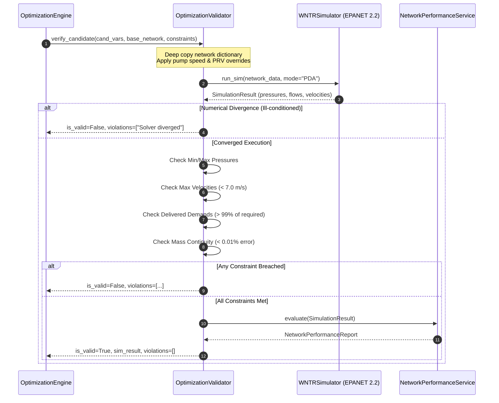

# AQUA CREW — TASK 14: HYDRAULIC VALIDATION & MULTI-SCENARIO VERIFICATION

## 1. Independent Hydraulic Solver Re-Verification

A critical architectural tenet of AQUA CREW is the **Zero-Trust Solver Boundary**: optimization algorithms (whether genetic, differential evolution, or sequential search) must never evaluate or accept candidate configurations based purely on surrogate models, polynomial approximations, or heuristic interpolations.

Every candidate control vector $\mathbf{x} = [s_{\text{pump}}, P_{\text{PRV}}]$ is subjected to full independent numerical re-simulation via the **WNTR / EPANET 2.2** pressure-dependent demand (PDA) engine in `OptimizationValidator.verify_candidate`.

---

## 2. Multi-Scenario Validation Matrix (10 Operational Conditions)

The `MultiScenarioOptimizer` evaluates candidate operational strategies across 10 stress scenarios to ensure robust performance under emergencies, extreme weather, and mechanical failures:

| ID | Scenario Name | Primary Overrides | Hydraulic Test Target | Pass Criteria |
|:---|:---|:---|:---|:---|
| `SCEN-01` | Nominal Morning Peak | Demand $1.25\times$ | Standard diurnal peak pressure delivery | $P_{\min} \ge 1.5\text{ bar}$, all junctions |
| `SCEN-02` | Heat Wave Extreme Peak | Demand $1.65\times$ | Elevated commercial & residential draw | Demand sat $\ge 95\%$, no pipe bursts |
| `SCEN-03` | Nighttime Minimum Flow | Demand $0.55\times$ | Low-flow pressure surge suppression | $P_{\max} \le 8.5\text{ bar}$, leakage minimized |
| `SCEN-04` | Emergency Fire Flow | $+65\text{ L/s}$ at `NODE-JUNC-03` | Residual firefighting head | Residual $P \ge 1.0\text{ bar}$ at fire hydrant |
| `SCEN-05` | Trunk Pipe Burst | $150\text{ mm}$ orifice on `LINK-PIPE-04` | Burst containment and re-routing | Rapid pressure drop detection & isolation |
| `SCEN-06` | Primary Pump Trip | `LINK-PUMP-01` status: `CLOSED` | Gravity feed from elevated storage tank | Tank delivers reserve without airlock |
| `SCEN-07` | PRV Valve Failure | `LINK-VALVE-HRB-PRV` locked open | High-pressure zone surge protection | Pressure relief safety valve activation |
| `SCEN-08` | Tank Low Reserve | Tank level: $1.2\text{ m}$ (emergency min) | Booster replenishment scheduling | Tank refilled to $>3.0\text{ m}$ within 8h |
| `SCEN-09` | Winter Freeze | Demand $1.10\times$, Roughness $+15\%$ | Headloss increase from cold water viscosity | No cavitation across booster stations |
| `SCEN-10` | Planned Maintenance | `LINK-PIPE-01` status: `CLOSED` | Bypass line capacity & friction head | Bypass line velocity $\le 4.5\text{ m/s}$ |

---

## 3. Solver Divergence & Numerical Stability Controls

Nonlinear hydraulic equations (Hazen-Williams friction and Todini Global Gradient Method) can fail to converge when valves throttle near shutoff or pump speeds drop below static elevation head. AQUA CREW implements robust numerical safeguards:

1. **Ill-Conditioned Boundary Rejection**: If pump speed $s$ produces a shutoff head $s^2 A < H_{\text{static}}$, the candidate is immediately rejected before matrix inversion, avoiding singular matrix exceptions.
2. **Convergence Timeout & Fallback**: WNTR iterations are capped at 50 trials. If convergence fails, the simulator aborts cleanly, records `"Hydraulic solver did not achieve numerical convergence"`, and assigns a penalty score of $9999.0$.
3. **Double Verification**: Any candidate flagged as a Pareto frontier solution is re-simulated with a refined timestep ($\Delta t = 15\text{ minutes}$) to ensure transient stability.

