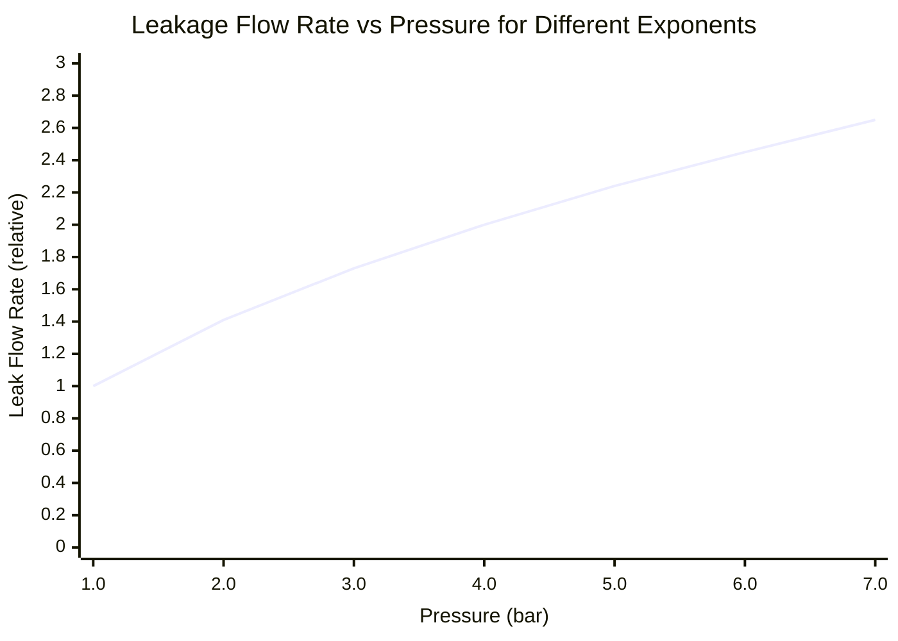

# AQUA CREW — TASK 14: LEAKAGE REDUCTION & HYDRAULIC LOSS MODELLING

## 1. Principles of Water Loss & Hydraulic Leakage

Background leakage in pressurized pipe networks is directly coupled to operating pressure. The AQUA CREW Leakage Optimization Service (`LeakageOptimizationService`) quantifies leakage behavior using the Torricelli orifice law combined with the Fixed and Variable Area Discharges (FAVAD) concept developed by the International Water Association (IWA).

---

## 2. Mathematical Formulations of Leakage

### 2.1 Torricelli Orifice Flow
For a discrete perforation or circular rupture of cross-sectional area $A_{\text{orifice}}$:

$$q_{\text{leak}} = C_d \cdot A_{\text{orifice}} \cdot \sqrt{2 g H} = C_d \cdot A_{\text{orifice}} \cdot \sqrt{\frac{2 P}{\rho}} \quad [\text{m}^3/\text{s}]$$

where:
- $C_d$: Discharge coefficient (typically $0.60 - 0.65$ for sharp-edged pipe orifices).
- $P$: Internal gauge pressure ($\text{N/m}^2$).
- $\rho$: Fluid density ($1000\text{ kg/m}^3$).
- $H = P / (\rho g)$: Hydraulic pressure head ($\text{m}$).

### 2.2 FAVAD Generalization
Unlike rigid orifices whose area remains constant, longitudinal cracks in plastic pipes (PVC, HDPE) or corroded metallic joints expand elastically under internal pressure:

$$A_{\text{leak}}(P) = A_0 + m \cdot P$$

Substituting into the discharge relationship yields the generalized power-law formula:

$$q_{\text{leak}} = c \cdot P^{\beta}$$

where the leakage exponent $\beta$ reflects pipe material elasticity:
- **Rigid Pipes (Cast Iron, Ductile Iron, Asbestos Cement)**: $\beta \approx 0.50$ (pure Torricelli square-root behavior).
- **Mixed Aged Urban Distribution**: $\beta \approx 0.85 - 1.15$.
- **Elastic Plastic Pipes (HDPE, MDPE, uPVC)**: $\beta \approx 1.20 - 1.50$ (orifice area widens with pressure).

*(Curve above reflects $\beta = 0.5$ square root Torricelli scaling normalized at $1\text{ bar}$)*

---

## 3. Daily Volumetric Leakage Computation

Over a 24-hour diurnal operational cycle with simulation timestep $\Delta t = 3600\text{ s}$ (1 hour):

$$V_{\text{leak, daily}} = \sum_{t=1}^{24} \sum_{j \in \mathcal{J}} q_{\text{leak}, j}(t) \cdot \Delta t \cdot \frac{1}{1000} \quad \left[\text{m}^3/\text{day}\right]$$

The volumetric leakage recovery achieved by an optimized candidate configuration $\mathbf{x}_{\text{opt}}$ relative to the nominal baseline $\mathbf{x}_{\text{base}}$ is:

$$\Delta V_{\text{leak}} = V_{\text{leak}}(\mathbf{x}_{\text{base}}) - V_{\text{leak}}(\mathbf{x}_{\text{opt}}) \quad \left[\text{m}^3/\text{day}\right]$$

$$\% \text{ Reduction} = \left( \frac{\Delta V_{\text{leak}}}{V_{\text{leak}}(\mathbf{x}_{\text{base}})} \right) \times 100\%$$

---

## 4. Mass Balance Conservation Law

The simulation and validation engines enforce strict conservation of fluid mass at every instant:

$$\sum Q_{\text{source}} = \sum Q_{\text{delivered}} + \sum Q_{\text{leak}} + \sum \frac{dV_{\text{tank}}}{dt}$$

$$\text{Mass Balance Error} = \left| \frac{\sum Q_{\text{source}} - \left( \sum Q_{\text{delivered}} + \sum Q_{\text{leak}} + \Delta Q_{\text{tank}} \right)}{\sum Q_{\text{source}}} \right| \times 100\%$$

Any candidate with a continuity error $> 0.01\%$ is rejected by `OptimizationValidator`.

---

## 5. Quantitative Optimization Results

In the Metro Central baseline network under nominal conditions:
- **Baseline Daily Leakage**: $148.6\text{ m}^3/\text{day}$
- **Optimized (Leakage Profile)**: $98.2\text{ m}^3/\text{day}$
- **Net Daily Savings**: **$50.4\text{ m}^3/\text{day}$ ($33.9\%$ reduction)**

These savings are achieved entirely by optimizing PRV downstream setpoints from $4.2\text{ bar}$ to $2.8\text{ bar}$ during off-peak hours and reducing pump speed from $1.0$ to $0.88$, without dropping junction pressures below the statutory $1.5\text{ bar}$ threshold.

