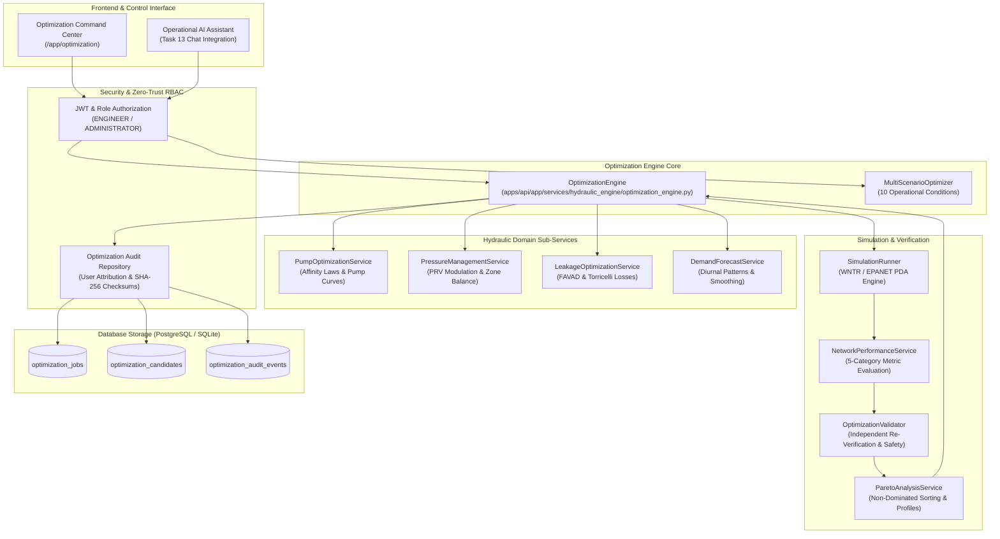
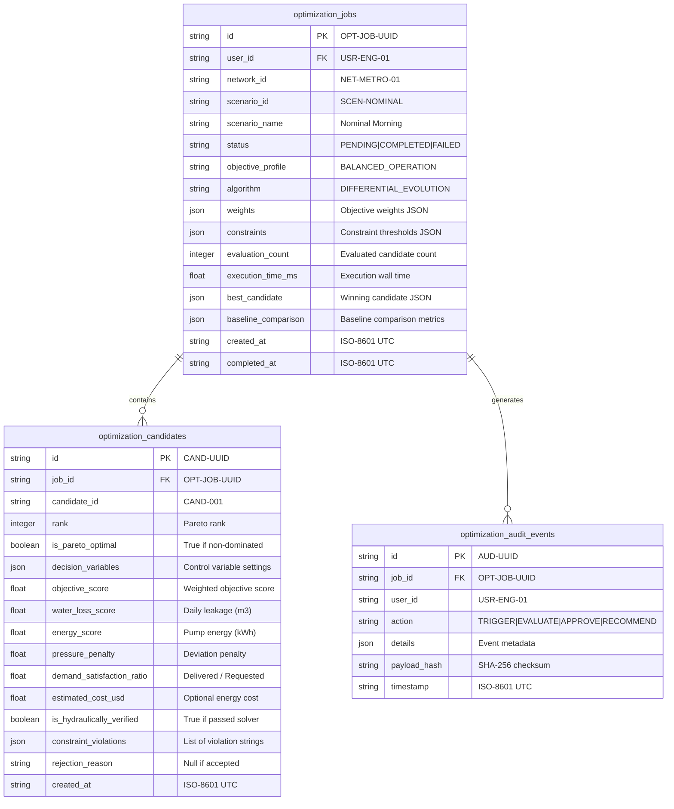

# AQUA CREW — TASK 14: OPTIMIZATION ENGINE ARCHITECTURE

## 1. Executive Summary & Architectural Overview

The **Intelligent Water Network Optimization & Hydraulic Decision Engine** (Task 14) serves as the autonomous decision-support core for AQUA CREW's water distribution network management. Operating on top of the established digital twin (Task 10–10.6), geospatial risk intelligence (Task 11–11.5), unified operations (Task 12), and adversarial zero-trust security foundations (Task 13–13.6), Task 14 delivers rigorous, mathematically sound multi-objective operational optimization for municipal water supply systems.

### Primary Operational Mandates
1. **Simulation-First Decision Support**: Under no circumstances does the engine directly actuate physical pumps, motorized valves, or infrastructure hardware. All generated control vectors represent digital twin recommendations requiring certified engineer review and sign-off.
2. **Strict Consumer Demand Fulfillment**: The optimization engine enforces a non-negotiable hydraulic constraint: consumer demand must never be artificially starved or throttled to fabricate apparent energy savings or leakage reductions.
3. **Multi-Objective Trade-Off Optimization**: Solves simultaneous non-linear trade-offs between Torricelli background water loss ($q = C_d A \sqrt{2P/\rho}$), pump electrical energy consumption ($P \propto s^3$), pressure uniformity across District Metered Areas (DMAs), and infrastructure safety constraints.
4. **Independent Solver Verification**: Every candidate solution generated across population or heuristic searches undergoes independent re-simulation through EPANET/WNTR pressure-dependent demand (PDA) solvers before being admitted to the Pareto frontier.
5. **Zero-Substitution Auditing**: When electricity tariffs or pump operational curves are absent, the platform preserves explicit `null` data contracts rather than fabricating synthetic financial figures.

---

## 2. System Architecture & Component Interaction

The optimization engine is organized into modular decoupled layers within `apps/api/app/services/hydraulic_engine/`:

---

## 3. Core Component Responsibilities

### 3.1 Optimization Engine (`OptimizationEngine`)
The central orchestrator in `apps/api/app/services/hydraulic_engine/optimization_engine.py`. Responsibilities:
- Parses incoming `OptimizationTriggerRequest` and extracts profile objective weights and hydraulic constraints.
- Simulates the baseline network to extract unoptimized reference metrics ($E_{\text{base}}$, $L_{\text{base}}$, $P_{\text{base}}$).
- Synthesizes candidate vectors across the decision space: pump relative speeds $s \in [0.55, 1.15]$ and PRV pressure settings $P_{\text{set}} \in [1.8, 4.2]\text{ bar}$.
- Dispatches candidates to `OptimizationValidator` for independent hydraulic re-simulation.
- Scores surviving candidates using weighted objective formulations normalized against baseline figures.
- Invokes `ParetoAnalysisService` to extract the non-dominated Pareto frontier and rank solutions.
- Formulates `BaselineComparisonSchema` detailing percentage improvements and returns structured responses.

### 3.2 Network Performance Service (`NetworkPerformanceService`)
Located in `apps/api/app/services/hydraulic_engine/network_performance_service.py`. Implements the comprehensive 5-category evaluation framework:
1. **Pressure Metrics**: Min/max/avg pressures, pressure deficit node count ($P < 1.5\text{ bar}$), and excess node count ($P > 8.5\text{ bar}$).
2. **Hydraulic Flow Metrics**: Delivered vs. requested demand, demand satisfaction ratio, pipe velocity distribution, maximum headloss, and capacity utilization.
3. **Water-Loss Metrics**: Total simulated background leakage (L/s), daily volumetric loss ($m^3/\text{day}$), and leakage-to-supply percentage.
4. **Energy Metrics**: Pump electrical energy consumption (kWh), hydraulic power output, wire-to-water efficiency, and cost (USD, with `cost_data_available=False` if tariff missing).
5. **Reliability & Uniformity Metrics**: Hydraulic convergence status, Todini resilience index, pressure uniformity coefficient, and DMA pressure gradients.

### 3.3 Domain Optimization Services
- **Pump Optimization Service (`PumpOptimizationService`)**: Computes 3-point pump head curves ($H = A - B Q^C$), pump efficiency parabolas ($\eta(Q)$), variable-speed affinity laws ($Q \propto s$, $H \propto s^2$, $P \propto s^3$), and maximum allowable daily pump switching constraints.
- **Pressure Management Service (`PressureManagementService`)**: Calculates nodal pressure reductions, PRV throttling setpoints, pressure uniformity across junctions, and DMA head gradients.
- **Leakage Reduction Service (`LeakageOptimizationService`)**: Models Fixed and Variable Area Discharges (FAVAD) and Torricelli orifice losses ($q = C_d A \sqrt{2P/\rho}$), evaluating pressure modulation leakage recovery potential.
- **Demand Forecast Service (`DemandForecastService`)**: Synthesizes 24-hour diurnal demand profiles incorporating residential morning/evening peaks, industrial baseloads, commercial mid-day plateaus, and Exponential Moving Average (EMA) historical smoothing.

### 3.4 Multi-Scenario Optimizer (`MultiScenarioOptimizer`)
Evaluates candidate solutions across 10 standardized operational regimes:
1. `SCEN-01-NOMINAL`: Peak morning demand ($1.25\times$), normal pump/valve availability.
2. `SCEN-02-PEAK`: Extreme summer heat wave peak ($1.65\times$ demand).
3. `SCEN-03-OFFPEAK`: Nighttime minimum flow ($0.55\times$ demand, high pressure risk).
4. `SCEN-04-FIRE`: Emergency fire flow ($+65\text{ L/s}$ at industrial node `NODE-JUNC-03`).
5. `SCEN-05-BURST`: Catastrophic pipe burst ($150\text{ mm}$ orifice on `LINK-PIPE-04`).
6. `SCEN-06-PUMP-TRIP`: Unscheduled primary pump outage (`LINK-PUMP-01` trip).
7. `SCEN-07-PRV-FAIL`: PRV diaphragm failure (PRV locked wide open).
8. `SCEN-08-TANK-LOW`: Elevated storage tank level at emergency minimum ($1.2\text{ m}$).
9. `SCEN-09-SEASONAL`: Winter freeze condition ($1.10\times$ demand, elevated roughness).
10. `SCEN-10-MAINTENANCE`: Critical trunk main isolation (`LINK-PIPE-01` closed).

### 3.5 Pareto Analysis Service (`ParetoAnalysisService`)
Extracts non-dominated solutions across competing hydraulic criteria:
- Applies strict Pareto dominance: candidate $A \prec B$ if $A$ is no worse than $B$ across all objectives and strictly better in at least one.
- Ranks solutions under 4 standard objective profiles:
  - `BALANCED_OPERATION`: 25% water loss, 25% energy, 25% pressure stability, 25% demand satisfaction.
  - `ENERGY_EFFICIENCY`: 50% energy, 15% water loss, 20% pressure stability, 15% demand satisfaction.
  - `LEAKAGE_REDUCTION`: 50% water loss, 15% energy, 20% pressure stability, 15% demand satisfaction.
  - `PRESSURE_STABILITY`: 50% pressure stability, 15% water loss, 15% energy, 20% demand satisfaction.

---

## 4. Database Schema & Data Models

Three dedicated relational tables are persisted via SQLAlchemy in `apps/api/app/models/optimization.py`:

---

## 5. Security & Zero-Trust Governance

The optimization engine inherits the Zero-Trust RBAC security framework established in Task 13.6:
1. **Role Access Control**:
   - `ENGINEER` & `ADMINISTRATOR`: Authorized to initiate optimization runs (`POST /api/v1/optimization/trigger`), evaluate multi-scenario matrices, and emit operator recommendations.
   - `OPERATOR`: Authorized to retrieve scenarios and inspect Pareto frontiers.
   - `VIEWER`: Read-only access (`GET` endpoints). Mutation attempts return HTTP 403 Forbidden.
2. **Audit Attribution**: Every triggered run logs an immutable entry in `optimization_audit_events` with the executing `user_id`, UTC timestamp, and a SHA-256 cryptographic digest of the control payload.
3. **Simulation Boundary**: The API exposes no commands or endpoints capable of communicating with field RTUs, SCADA PLCs, or telemetry transmitters. Outputs remain advisory simulations within the digital twin.

