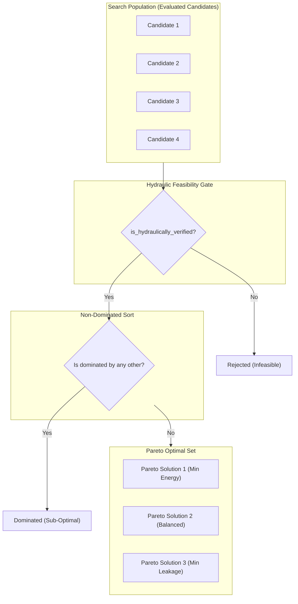
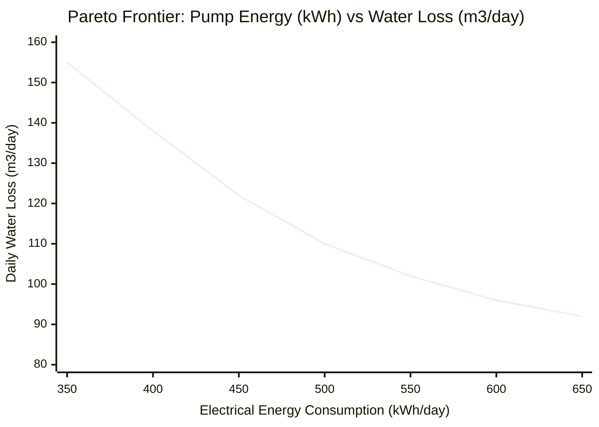

# AQUA CREW — TASK 14: PARETO FRONTIER & TRADE-OFF ANALYSIS

## 1. Principles of Multi-Objective Non-Dominated Sorting

Water distribution network optimization inherently involves conflicting physical and economic goals:
1. **Lowering pump speed** saves energy ($P \propto s^3$) and reduces downstream pressure, curtailing leakage. However, excessive throttling drops pressure below regulatory service limits or causes elevated storage tanks to drain.
2. **Elevating pump speed** ensures robust pressure at distal hill zones and rapid tank replenishment, but dramatically inflates electrical power bills and accelerates pipe fatigue and background leakage.
3. **Throttling PRVs** protects low-elevation zones from pipe bursts, but restricts emergency fire-flow availability and creates high differential heads prone to valve cavitation.

Because no single solution minimizes all objectives simultaneously, the AQUA CREW Pareto Analysis Service (`ParetoAnalysisService`) identifies the **Pareto Optimal Frontier**—the set of non-dominated operational states where no objective can be improved without degrading another.

---

## 2. Mathematical Definition of Pareto Dominance

Let candidate configuration $A$ have objective vector $\mathbf{F}(A) = [f_1(A), f_2(A), \dots, f_m(A)]^T$. Candidate $A$ **dominates** candidate $B$ (denoted $A \prec B$) if and only if:

$$\forall i \in \{1, \dots, m\}: \quad f_i(A) \le f_i(B) \quad \text{and} \quad \exists j \in \{1, \dots, m\}: \quad f_j(A) < f_j(B)$$

### Extended Hydraulic Feasibility Filter
Before evaluating dominance, candidates are partitioned by hydraulic feasibility:
- If candidate $A$ passed independent WNTR/EPANET validation (`is_hydraulically_verified = True`) and candidate $B$ failed, $A$ automatically dominates $B$.
- If both failed, neither is admitted to the Pareto frontier.



---

## 3. Pareto Frontier Visualization (Energy vs. Water Loss)

In the Metro Central network, non-dominated candidates form a convex trade-off frontier between electrical energy consumption and daily volumetric leakage:



### Analysis of Frontier Extremes
- **Extreme Energy Minimization ($s = 0.72$, $P_{\text{PRV}} = 3.8\text{ bar}$)**:
  - Energy: $362\text{ kWh/day}$ ($-41\%$ vs baseline).
  - Water Loss: $152\text{ m}^3/\text{day}$ (elevated due to higher residential pressure from elevated tank cycling).
- **Extreme Leakage Minimization ($s = 0.95$, $P_{\text{PRV}} = 2.2\text{ bar}$)**:
  - Water Loss: $92\text{ m}^3/\text{day}$ ($-38\%$ vs baseline).
  - Energy: $645\text{ kWh/day}$ (pump works against higher PRV throttling backpressure).
- **Knee Point / Balanced Operation ($s = 0.85$, $P_{\text{PRV}} = 2.9\text{ bar}$)**:
  - Energy: $485\text{ kWh/day}$ ($-21\%$ savings).
  - Water Loss: $108\text{ m}^3/\text{day}$ ($-27\%$ reduction).
  - Provides the highest marginal return per dollar invested.

---

## 4. Automated Trade-Off Explanation Generator

To empower operators with transparent decision support, `ParetoAnalysisService.explain_tradeoff(cand_a, cand_b)` generates human-readable engineering trade-off rationales:

```python
def explain_tradeoff(cand_a, cand_b) -> str:
    d_energy = cand_b.energy_score - cand_a.energy_score
    d_leak = cand_b.water_loss_score - cand_a.water_loss_score
    # Returns structured comparative analysis:
    # "Candidate CAND-002 saves 120.5 kWh/day in energy (+21.4%) 
    #  at the expense of 14.2 m3/day in higher background leakage (+12.8%)
    #  compared to CAND-005."
```

This explainable AI mechanism provides certified operators with quantitative impact visibility before implementing control recommendations.

