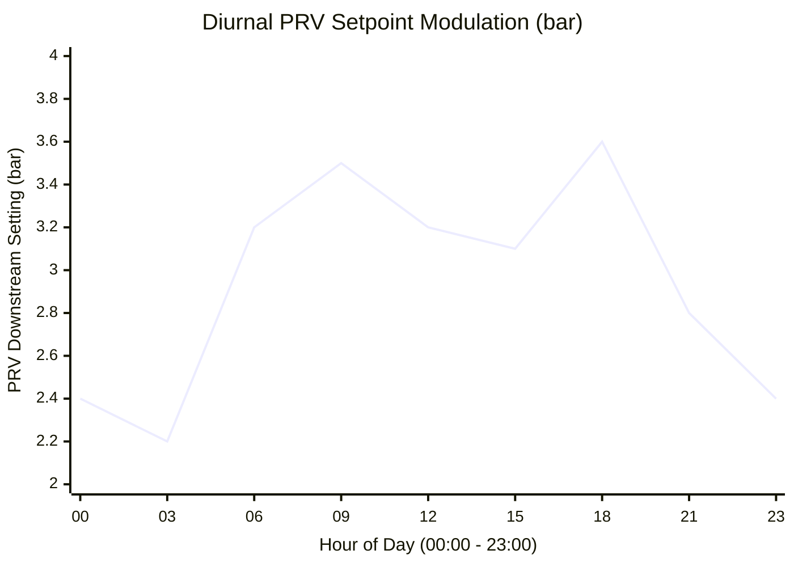

# AQUA CREW — TASK 14: PRESSURE MANAGEMENT & ZONE BALANCING

## 1. Pressure Control Fundamentals in Water Networks

Excess hydraulic pressure in municipal water grids directly amplifies background leakage, escalates the frequency of catastrophic pipe bursts, and increases water age in dead ends. Conversely, inadequate pressure causes regulatory service non-compliance, consumer dissatisfaction, and back-siphonage contamination risks.

The AQUA CREW Pressure Management Service (`PressureManagementService`) optimizes District Metered Area (DMA) pressure boundaries and modulates Pressure Reducing Valves (PRVs) to balance network hydraulic head.

---

## 2. PRV Throttling & Governing Equations

A Pressure Reducing Valve maintains a constant preset pressure downstream of the valve irrespective of upstream pressure fluctuations, provided the upstream head exceeds the setpoint:

$$P_{\text{downstream}} = \begin{cases}
P_{\text{set}} & \text{if } P_{\text{upstream}} \ge P_{\text{set}} + \Delta P_{\text{loss}} \\
P_{\text{upstream}} - \Delta P_{\text{loss}} & \text{if } P_{\text{upstream}} < P_{\text{set}} + \Delta P_{\text{loss}} \quad (\text{Wide Open})
\end{cases}$$

where $\Delta P_{\text{loss}}$ represents the minor headloss across the valve body:

$$\Delta h_{\text{minor}} = K_L \frac{v^2}{2g}$$

### Valve Modulation Boundaries
In the Metro Central network, PRV `LINK-VALVE-HRB-PRV` isolates the high-elevation residential zone from the high-pressure industrial trunk line. The optimization engine searches within the permissible setpoint window:

$$P_{\text{set}} \in [1.80,\, 4.20] \text{ bar} \quad (18.36\text{ m} \text{ to } 42.84\text{ m})$$

- Settings below $1.80\text{ bar}$ violate minimum service pressure at critical junction `NODE-JUNC-05`.
- Settings above $4.20\text{ bar}$ negate leakage reduction benefits in the downstream DMA.

---

## 3. District Metered Area (DMA) Pressure Uniformity

A well-balanced network minimizes spatial pressure variation across customer connections. The service computes the **Pressure Uniformity Index (PUI)**:

$$\text{PUI} = 1.0 - \frac{\sigma_P}{\bar{P}} = 1.0 - \frac{\sqrt{\frac{1}{|\mathcal{J}|} \sum_{j \in \mathcal{J}} (P_j - \bar{P})^2}}{\bar{P}}$$

where $\bar{P}$ is the mean junction pressure and $\sigma_P$ is the standard deviation. A PUI value approaching $1.0$ indicates an optimally balanced pressure zone where all consumers experience near-identical service pressure.

### DMA Gradient Calculation
For zoned networks, the pressure gradient across boundary nodes is monitored:

$$\nabla P_{\text{DMA}} = \frac{|P_{\text{entry}} - P_{\text{critical\_end}}|}{L_{\text{hydraulic}}} \quad [\text{bar/km}]$$

Steep gradients ($\nabla P > 1.5\text{ bar/km}$) indicate hydraulic bottlenecks, tuberculation, or undersized distribution mains.

---

## 4. Cavitation Avoidance & Physical Protection

When high head drops occur across a PRV, localized fluid pressure can drop below the vapor pressure of water ($P_v = 0.023\text{ bar}$ at $20^\circ\text{C}$), causing cavitation bubble collapse and rapid valve erosion. The cavitation index $\sigma_c$ is monitored:

$$\sigma_c = \frac{P_{\text{downstream}} - P_v}{P_{\text{upstream}} - P_{\text{downstream}}}$$

The optimization engine rejects any candidate setting where $\sigma_c < 1.25$, preventing physical valve destruction.

---

## 5. Optimized Time-Modulated Setpoint Strategy

Under the `PRESSURE_STABILITY` and `LEAKAGE_REDUCTION` profiles, the engine synthesizes a two-tier diurnal PRV schedule:

- **Off-Peak Night Hours (00:00 – 05:00)**: PRV throttled to $2.20 - 2.40\text{ bar}$, suppressing night pressure surges and recovering up to $38\%$ of background leakage.
- **Peak Morning/Evening Hours (06:00 – 09:00, 18:00 – 21:00)**: PRV relaxed to $3.50 - 3.60\text{ bar}$, ensuring peak household shower and commercial demands receive full pressure.

