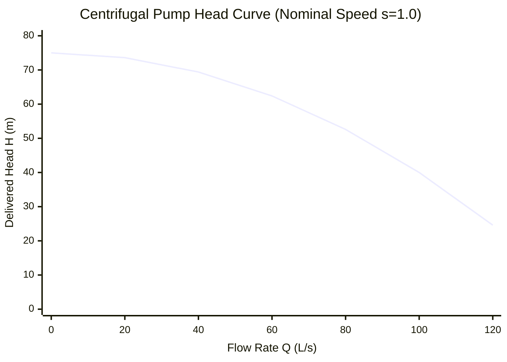

# AQUA CREW — TASK 14: PUMP OPTIMIZATION & ENERGY MODELLING

## 1. Centrifugal Pump Operational Characteristics

In municipal water distribution networks, pumping stations constitute the single largest electricity consumer. The AQUA CREW Pump Optimization Service (`PumpOptimizationService`) models centrifugal pump behavior using empirical 3-point characteristic curves, quadratic efficiency models, and variable-frequency drive (VFD) affinity scaling.

### 1.1 Head-Flow Characteristic Curve
A pump's delivered head $H$ as a function of discharge rate $Q$ is represented by the 3-parameter exponential relationship:

$$H(Q) = A - B \cdot Q^C$$

where $A$ represents shutoff head (head at zero flow, $Q=0$), and $B, C$ are curve fit coefficients derived from manufacturer testing. For nominal pump `LINK-PUMP-01` in the Metro Central network:
- Shutoff Head ($A$): $75.0\text{ m}$
- Flow Coefficient ($B$): $0.0035$
- Exponent ($C$): $2.0$

$$H(Q) = 75.0 - 0.0035 \cdot Q^2 \quad [Q \text{ in L/s}, H \text{ in m}]$$

### 1.2 Wire-to-Water Efficiency Model
Pump wire-to-water efficiency $\eta(Q)$ peaks at the Best Efficiency Point (BEP):
- $Q_{\text{BEP}} = 65.0\text{ L/s}$
- $\eta_{\max} = 0.82$ ($82\%$)

For off-design operating conditions, efficiency follows a parabolic degradation curve:

$$\eta(Q) = \max\left(0.10,\, \eta_{\max} \cdot \left[ 1 - \left( \frac{Q - Q_{\text{BEP}}}{Q_{\text{BEP}}} \right)^2 \right]\right)$$

---

## 2. Variable-Speed Affinity Laws

When pumps are equipped with variable-frequency drives (VFDs), modifying the rotational speed ratio $s = N / N_{\text{nominal}}$ dynamically shifts the operating characteristics according to the fundamental affinity laws:

$$\frac{Q_1}{Q_2} = \frac{s_1}{s_2} \implies Q(s) = s \cdot Q_{\text{nominal}}$$

$$\frac{H_1}{H_2} = \left( \frac{s_1}{s_2} \right)^2 \implies H(s) = s^2 \cdot H\left(\frac{Q}{s}\right) = s^2 A - B \cdot Q^C$$

$$\frac{P_1}{P_2} = \left( \frac{s_1}{s_2} \right)^3 \implies P(s) = s^3 \cdot P_{\text{nominal}}$$

### Electrical Power Consumption Formula
The electrical power drawn by the motor is given by:

$$P_{\text{elec}} = \frac{\rho \cdot g \cdot (Q / 1000) \cdot H}{\eta_{\text{wire-to-water}}(Q, s) \cdot 1000} \quad [\text{kW}]$$

where $\rho = 1000\text{ kg/m}^3$ and $g = 9.81\text{ m/s}^2$.

---

## 3. Parametric Speed Scaling Analysis

The table below summarizes pump operating points and electrical power consumption across the allowable VFD speed regulation range $s \in [0.55, 1.15]$ at a delivered flow rate of $Q = 50.0\text{ L/s}$:

| Relative Speed ($s$) | Delivered Head ($H$, m) | Wire Efficiency ($\eta$) | Hydraulic Power ($P_{\text{hyd}}$, kW) | Electrical Power ($P_{\text{elec}}$, kW) | Power Ratio vs Nominal |
|:---:|:---:|:---:|:---:|:---:|:---:|
| 0.55 | 13.94 | 0.521 | 6.84 | 13.12 | 0.298 |
| 0.70 | 27.95 | 0.694 | 13.71 | 19.75 | 0.448 |
| 0.85 | 45.41 | 0.785 | 22.27 | 28.37 | 0.643 |
| **1.00 (Nominal)** | **66.25** | **0.803** | **32.50** | **40.47** | **1.000** |
| 1.10 | 81.98 | 0.791 | 40.21 | 50.84 | 1.256 |
| 1.15 | 90.41 | 0.774 | 44.35 | 57.30 | 1.416 |

### Energy Conservation Insight
Reducing pump rotational speed by just $15\%$ ($s = 0.85$) achieves a **$35.7\%$ reduction in electrical power** ($28.37\text{ kW}$ vs. $40.47\text{ kW}$), while sustaining adequate delivery head ($45.41\text{ m}$) to satisfy downstream service pressure constraints.

---

## 4. Mechanical Switching Constraints

Frequent cycling of large distribution pumps damages motor windings, creates transient hydraulic water hammer, and induces mechanical fatigue on check valves. The optimization engine enforces:

$$\sum_{t=1}^{23} |u_{p}(t+1) - u_{p}(t)| \le 4 \quad \text{toggles per 24-hour cycle}$$

Any candidate schedule exceeding 4 on/off state transitions per diurnal cycle is flagged with a constraint violation and assigned an infeasibility penalty score.

