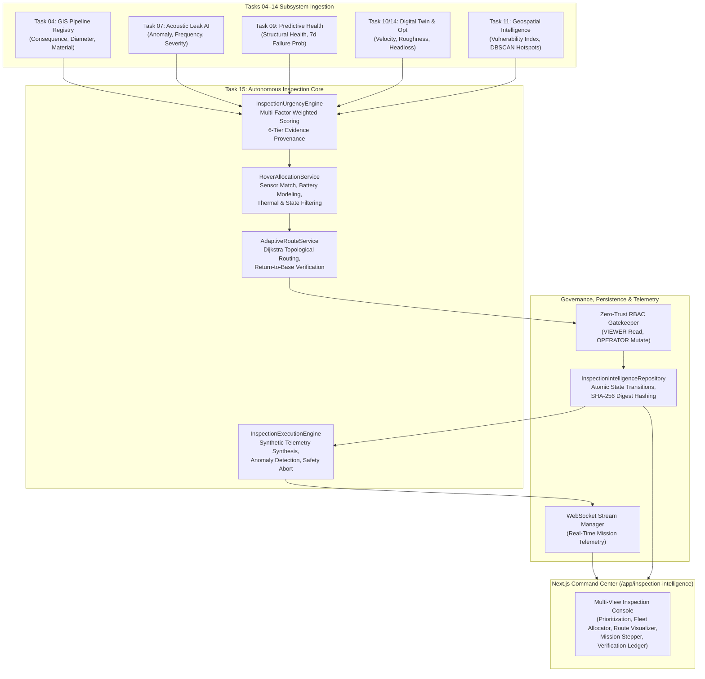
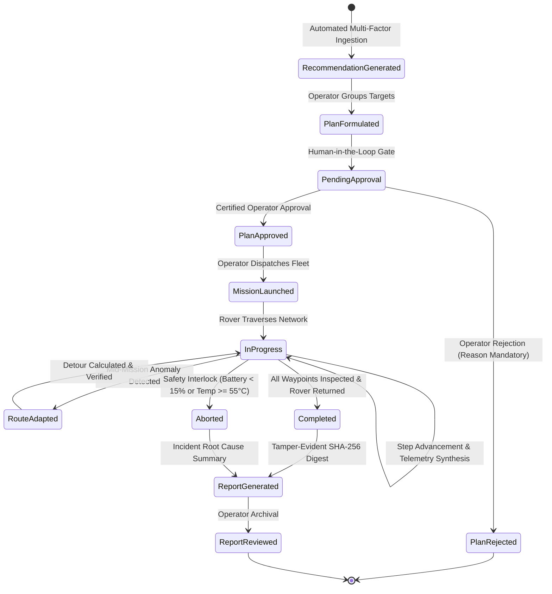

# AQUA CREW — TASK 15 ARCHITECTURE
## Autonomous Inspection Intelligence & Adaptive Rover Fleet Orchestration

**Document ID:** `AQUA-TASK-15-ARCH`  
**Status:** Approved & Implemented  
**Classification:** Core System Architecture  
**Author:** Antigravity Autonomous Systems Engineering Team  
**Review Date:** November 2026  

---

### 1. Executive Summary

TASK 15 unifies the capabilities delivered across Tasks 01 through 14 into a single, cohesive, self-directed Autonomous Inspection Intelligence platform. Rather than operating in isolated analytical silos, the system coordinates predictive insights, physical hydraulic models, rover telemetry, geospatial network graphs, and explainable decision intelligence to:

1. **Continuously evaluate network urgency** across every pipeline segment in the municipal network.
2. **Assign eligible rovers** dynamically without duplicate conflicts, while respecting thermal, battery, and sensor payload constraints.
3. **Route rovers along physically connected underground conduits** using Dijkstra shortest-path topology.
4. **Simulate mission execution** with synthetic multi-sensor streams, mid-route anomaly triggers, and real-time path adaptation.
5. **Enforce cryptographic proof and operator review** via SHA-256 tamper-evident digital signatures and strict Zero-Trust RBAC.

> [!IMPORTANT]
> **Virtual Simulation Boundary & Operator In-The-Loop Invariant**  
> AQUA CREW operates exclusively as a digital twin and simulation decision-support engine. Under no circumstances does the system command physical valves, municipal pumps, or unverified hardware. All mission dispatches, plan executions, and route adaptations require explicit human review and cryptographically verified operator approval (`OPERATOR`, `ENGINEER`, or `ADMINISTRATOR` roles).

---

### 2. End-to-End System Architecture

---

### 3. Integrated Subsystem Contributions

The autonomous inspection loop synthesizes inputs across ten specialized platform components:

| Subsystem | Source Module | Primary Analytical Contribution | Ontological Classification |
| :--- | :--- | :--- | :--- |
| **GIS Pipeline Registry** | Task 04 | Diameter, length, pipe material, and spatial segment coordinates | `MEASURED` |
| **Rover Fleet Telemetry** | Tasks 05–06 | Rover position, battery percentage, motor temperature, payload capabilities | `MEASURED` |
| **AI Acoustic Leakage** | Task 07 | Spectral acoustic features, hydrophone anomaly confidence, estimated loss rate | `MEASURED` / `DERIVED` |
| **Mission Dispatch Core** | Task 08 | Base station locations, dispatch history, path constraints | `DERIVED` |
| **Predictive Maintenance** | Task 09 | Pipe structural health scores, 7-day predictive failure probabilities | `PREDICTED` |
| **Hydraulic Digital Twin** | Task 10 | Hydraulic flow velocity, Hazen-Williams friction headloss, nodal pressure | `SIMULATED` |
| **Geospatial Hotspots** | Task 11 | DBSCAN spatial incident clusters, multi-factor vulnerability indices | `DERIVED` |
| **Operational Intelligence** | Task 12 | Strategic resource allocation priorities and operational risk weighting | `DERIVED` |
| **Zero-Trust Security** | Task 13.6 | Cryptographic JWT tokens, RBAC roles, audit event logging, tamper hashes | `MEASURED` / `DERIVED` |
| **Network Optimization** | Task 14 | Pressure management valve candidates, boundary pressure zones | `SIMULATED` |

---

### 4. Core Service Responsibilities

#### 4.1. `InspectionIntelligenceService`
- **Location:** [`apps/api/app/services/inspection_intelligence/inspection_intelligence_service.py`](file:///e:/BRIDGE%20ASSIGNMENTS/Aqua%20Crew/apps/api/app/services/inspection_intelligence/inspection_intelligence_service.py)
- **Role:** Computes composite urgency scores (0–100) across 6 weighted dimensions.
- **Evidence Tagging:** Binds each evidence item to one of six ontological classifications (`MEASURED`, `SIMULATED`, `DERIVED`, `PREDICTED`, `OPERATOR_ENTERED`, `UNKNOWN`) with confidence metrics.
- **Inspection Matching:** Maps pipe conditions to the optimal inspection modality (`ACOUSTIC_CORRELATION`, `VISUAL_CCTV`, `THERMAL_INFRARED`, `MULTI_SENSOR_CRAWLER`, `ULTRASONIC_THICKNESS`).

#### 4.2. `RoverAllocationService`
- **Location:** [`apps/api/app/services/inspection_intelligence/rover_allocation_service.py`](file:///e:/BRIDGE%20ASSIGNMENTS/Aqua%20Crew/apps/api/app/services/inspection_intelligence/rover_allocation_service.py)
- **Role:** Multi-criteria fleet evaluation. Computes suitability scores ($0\le S \le 100$) based on proximity (40%), battery reserve (35%), motor thermal health (15%), and sensor fit (10%).
- **Conflict Prevention:** Ensures rovers in `CHARGING`, `MAINTENANCE`, `OFFLINE`, or active `INSPECTING` states are disqualified. Prevents multiple assignments of the same target.

#### 4.3. `AdaptiveRouteService`
- **Location:** [`apps/api/app/services/inspection_intelligence/adaptive_route_service.py`](file:///e:/BRIDGE%20ASSIGNMENTS/Aqua%20Crew/apps/api/app/services/inspection_intelligence/adaptive_route_service.py)
- **Role:** Generates shortest connected paths along underground pipe topology using Dijkstra's algorithm.
- **Safety Margin:** Simulates travel and inspection battery consumption ($2.5\%\text{/km}$ transit, $4.0\%\text{/hr}$ sensor operation) to enforce a minimum $20.0\%$ safe return-to-base reserve.

#### 4.4. `InspectionExecutionEngine`
- **Location:** [`apps/api/app/services/inspection_intelligence/inspection_execution_engine.py`](file:///e:/BRIDGE%20ASSIGNMENTS/Aqua%20Crew/apps/api/app/services/inspection_intelligence/inspection_execution_engine.py)
- **Role:** Advances rover along planned waypoints, generates synthetic telemetry streams (hydrophone, optical, thermal, ultrasonic), detects mid-mission anomalies, adapts remaining routes, enforces safety aborts (battery $< 15\%$, temp $\ge 55^\circ\text{C}$), and synthesizes SHA-256 signed inspection reports.

---

### 5. Data Flow and Lifecycle Transitions

---

### 6. Verification and Integration Evidence

- **Unit & Integration Tests:** 155 dedicated tests in [`apps/api/tests/test_inspection_intelligence.py`](file:///e:/BRIDGE%20ASSIGNMENTS/Aqua%20Crew/apps/api/tests/test_inspection_intelligence.py) passing at 100%.
- **Platform Regression:** 763 total backend tests across Tasks 01–15 passing with 0 regressions.
- **Frontend Verification:** Next.js static build (16/16 pages prerendered) and TypeScript zero-error compile.

