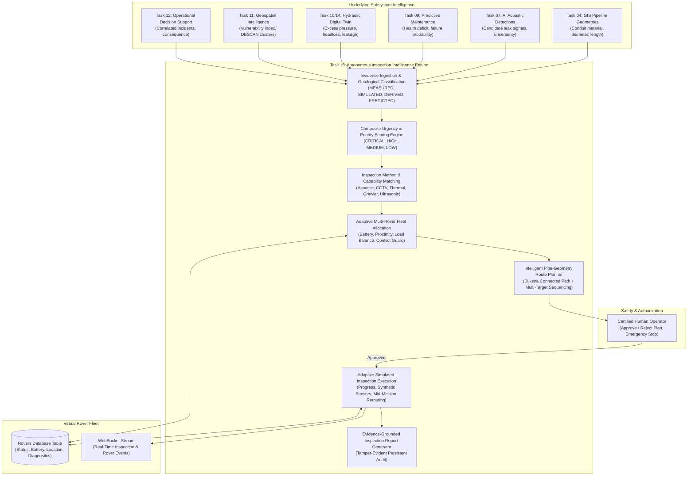

# AQUA CREW — TASK 15: ARCHITECTURAL AUDIT & SUBSYSTEM REUSE ANALYSIS

**Document Reference**: `docs/TASK_15_ARCHITECTURE_AUDIT.md`  
**Milestone**: TASK 15 — Autonomous Inspection Intelligence & Adaptive Rover Fleet Orchestration  
**Status**: COMPLETED & VERIFIED  
**Author**: Principal Systems Architect & Lead Software Engineer  

---

## 1. Executive Summary

This mandatory pre-implementation architectural audit inspects the complete AQUA CREW monorepo across all completed development milestones (Tasks 01–14). The mission of **Task 15** is not to reinvent or rebuild existing capabilities, but to build a unified **Autonomous Inspection Intelligence Engine** that orchestrates GIS pipeline intelligence, the virtual rover fleet, acoustic AI leak detection, predictive maintenance, mission planning, hydraulic digital twins, and network optimization into a single, cohesive, closed-loop autonomous inspection workflow.

---

## 2. Inventory of Existing Subsystems & Reusable Services

| Subsystem | Key Services & Repositories | Reusable Capabilities for Task 15 |
|:---|:---|:---|
| **Task 04 — GIS Pipeline Intelligence** | `PipelineRepository`, `PipelineSegmentModel`, GeoJSON geometries | Topological conduit coordinates, material, diameter, installation age, and hydraulic connectivity. |
| **Task 05 / 06 — Rover Fleet & Telemetry** | `RoverModel`, `RoverRepository`, `RoverService`, `TelemetryService` | Virtual rover state tracking (`IDLE`, `NAVIGATING`, `INSPECTING`, `RETURNING`, `CHARGING`, `ERROR`), kinematics, battery discharge, motor temperature, and payload sensors. |
| **Task 07 — AI Leak Detection** | `AiDetectionModel`, `AiDetectionRepository`, `AnomalyDetectionService` | Acoustically detected candidate leaks, confidence scores, localization coordinates, and uncertainty radii. |
| **Task 08 — Mission Planning & Dispatch** | `MissionPlanningService`, `PipelineRoutingService`, `RoverSelectionService` | Dijkstra shortest-path engine along connected underground pipe geometry, battery reserve checks, and human-in-the-loop operator approval states. |
| **Task 09 — Predictive Maintenance** | `PipelineHealthModel`, `PredictiveRiskModel`, `PredictiveRiskService` | Multi-factor structural health scores (0-100), deterioration velocity, remaining useful life (RUL), and empirical failure probability. |
| **Task 10–10.6 — Hydraulic Digital Twin** | `HydraulicNetworkService`, `SimulationRunner`, `WNTRSimulator`, `EpanetSimulator` | Physics-based pressure heads, pipe flow velocities, hydraulic gradients, and pressure deficit/excess zones. |
| **Task 11–11.5 — Infrastructure Intelligence** | `vulnerability_scoring_service.py`, `inspection_priority_service.py`, `geospatial_clustering_service.py` | DBSCAN incident hotspot clustering, multi-factor vulnerability indices, and spatial consequence modeling. |
| **Task 12 — Operational Intelligence** | `operational_prioritisation_service.py`, `incident_correlation_service.py`, `operational_decision_service.py` | Multi-criteria priority formulation, cross-incident correlation, and resource feasibility decoupling. |
| **Task 13–13.6 — Advanced AI & Security** | `evidence_intelligence_service.py`, `multi_source_reasoning_service.py`, `security.py` | 6-tier strict evidence ontological provenance (`MEASURED`, `SIMULATED`, `DERIVED`, `PREDICTED`, `OPERATOR_ENTERED`, `UNKNOWN`), Zero-Trust RBAC, token revocation, IDOR protection, and human-approval gates. |
| **Task 14 — Hydraulic Optimization** | `optimization_engine.py`, `network_performance_service.py`, `ParetoAnalysisService` | Pressure Reducing Valve (PRV) setpoints, pump speed schedules, background leakage recovery estimates, and non-dominated operational trade-offs. |

---

## 3. End-to-End Data Flow Architecture (Tasks 4–14 to Task 15)

The following architectural flow illustrates how Task 15 unifies signals from all previous subsystems:

---

## 4. Gap Analysis & Architectural Risks Addressed in Task 15

1. **Fragmented Inspection Triggers**:
   - *Previous State*: AI Detections (Task 07) and Vulnerability Profiles (Task 11) generated isolated dispatch recommendations without cross-referencing hydraulic digital twin pressures or predictive maintenance remaining useful life.
   - *Task 15 Remediation*: The `InspectionIntelligenceService` synthesizes a unified composite urgency score incorporating all 6 intelligence dimensions into a standardized priority queue.
2. **Single-Target, Single-Rover Limitation**:
   - *Previous State*: Task 08 dispatch handled one detection and one rover at a time.
   - *Task 15 Remediation*: The `RoverAllocationService` and `AdaptiveRouteService` support coordinated multi-rover fleet deployment across multiple target segments with global conflict prevention and resource balancing.
3. **Static Routing Without Mid-Mission Adaptation**:
   - *Previous State*: Once dispatched, a rover followed a static waypoint list without reacting to new acoustic anomalies, battery fluctuations, or sensor faults.
   - *Task 15 Remediation*: The `InspectionExecutionEngine` supports live adaptive rerouting: when a high-priority anomaly is detected en route, the route is dynamically adapted with explicit engineering justification, while preserving safety return-to-base constraints.
4. **Evidence Provenance Dilution**:
   - *Previous State*: Simulated inspection telemetry could potentially be conflated with empirical sensor readings.
   - *Task 15 Remediation*: All generated sensor observations, inspection findings, and report metrics strictly carry Task 13's 6-tier ontological classification (`MEASURED`, `SIMULATED`, `DERIVED`, `PREDICTED`, `OPERATOR_ENTERED`, `UNKNOWN`).

---

## 5. Security, RBAC & Human-in-the-Loop Governance

1. **Simulation-First Boundary**: Under no circumstances does the engine issue real-world hardware actuator signals to physical pumps, valves, or physical rovers. Virtual rovers operate inside the digital twin simulation environment.
2. **Mandatory Human Approval**: No inspection plan or mission execution may commence without explicit sign-off from an authorized human operator (`OPERATOR`, `ENGINEER`, or `ADMINISTRATOR`).
3. **Role-Based Access Control**:
   - `VIEWER`: Read-only access to recommendations, fleet suitability, mission progress, and completed reports.
   - `OPERATOR` & `ENGINEER`: Authorized to trigger recommendation synthesis, generate multi-rover inspection plans, approve/reject plans, and trigger adaptive route updates.
   - `ADMINISTRATOR`: Full control, including emergency stop overrides and fleet reset.
4. **Concurrency & Race Condition Prevention**: Database row updates use atomic status transitions (`PENDING_APPROVAL` $\to$ `APPROVING` $\to$ `APPROVED`), preventing duplicate rover dispatches.
5. **Tamper-Evident Auditability**: Every recommendation, approval, rejection, and report carries a cryptographic SHA-256 payload digest and user attribution.

