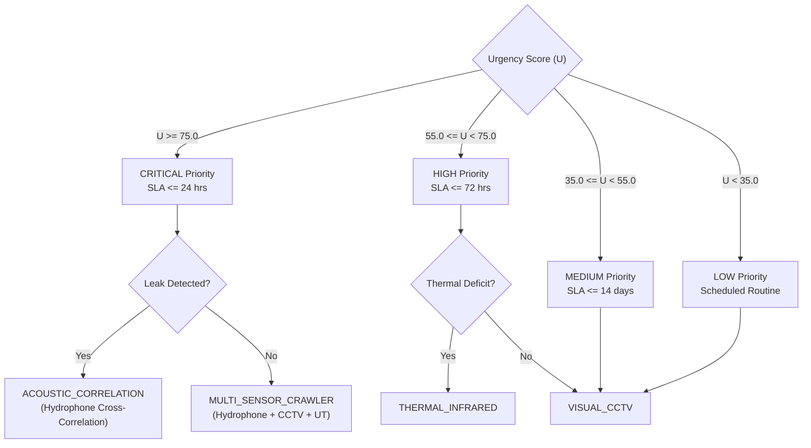
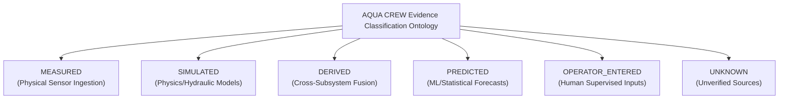

# AQUA CREW — TASK 15 INSPECTION ENGINE
## Mathematical Formulation, Evidence Ontology & Simulated Execution

**Document ID:** `AQUA-TASK-15-ENGINE`  
**Status:** Approved & Implemented  
**Scope:** Urgency Calculation, Evidence Ontology, Simulation Mechanics  
**Author:** Antigravity Autonomous Systems Engineering Team  
**Review Date:** November 2026  

---

### 1. Mathematical Formulation of Composite Urgency

To prevent uncoordinated, reactive inspections, AQUA CREW evaluates municipal conduits through an objective, multi-criteria urgency score $U \in [0, 100]$. Each pipeline segment $i$ is assessed across six orthogonal dimensions:

$$U_i = \sum_{k=1}^6 w_k \cdot S_{i,k}$$

where the calibrated engineering weights satisfy $\sum_{k=1}^6 w_k = 1.00$:

| Dimension ($k$) | Metric Name | Weight ($w_k$) | Data Subsystem Source |
| :--- | :--- | :---: | :--- |
| 1 | Active AI Acoustic Leakage | $0.25$ | Task 07 (AI Leak Detection) |
| 2 | Infrastructure Vulnerability Index | $0.20$ | Task 11 (Geospatial Risk Intelligence) |
| 3 | Predictive Degradation Rate | $0.20$ | Task 09 (Predictive Maintenance) |
| 4 | Network Physical Consequence | $0.15$ | Task 04 (GIS Pipeline Registry) |
| 5 | Hydraulic Digital Twin Stress | $0.10$ | Task 10 / Task 14 (Hydraulics & Optimization) |
| 6 | Spatial Incident Cluster Proximity | $0.10$ | Task 11 (DBSCAN Spatial Hotspots) |

---

### 2. Dimension Formulations

#### 2.1. Network Physical Consequence ($S_1$)
Large-diameter arterial conduits carry higher catastrophic consequence upon rupture compared to local reticulation lines:
$$S_{\text{consequence}} = \min\left(100.0, \, \frac{D_{\text{mm}}}{600.0} \times 100.0\right)$$
where $D_{\text{mm}}$ is nominal internal diameter. A $600\text{ mm}$ primary trunk yields $S_1 = 100.0$; a $300\text{ mm}$ line yields $S_1 = 50.0$.

#### 2.2. Infrastructure Vulnerability Index ($S_2$)
Ingested directly from Task 11 multi-factor pipeline vulnerability models (incorporating pipe age, material fragility, soil corrosivity, and depth-to-invert):
$$S_{\text{vulnerability}} = V_{\text{score}} \in [0.0, 100.0]$$
Defaults to $45.0$ if no prior vulnerability assessment exists.

#### 2.3. Predictive Degradation Rate ($S_3$)
Synthesizes pipe structural health deficit $(100 - H)$ with the 7-day predictive failure probability $P_{7\text{d}} \in [0, 1]$:
$$S_{\text{degradation}} = \min\left(100.0, \, (100.0 - H) \cdot 0.7 + (P_{7\text{d}} \cdot 100.0) \cdot 0.3\right)$$
where $H$ is the structural health score ($0\le H \le 100$). A conduit with $H = 40.0$ and $P_{7\text{d}} = 0.35$ produces $S_3 = (60 \cdot 0.7) + (35 \cdot 0.3) = 42.0 + 10.5 = 52.5$.

#### 2.4. Active AI Acoustic Leak Detection ($S_4$)
Evaluates verified acoustic hydrophone anomalies from Task 07:
$$S_{\text{leak}} = \min\left(100.0, \, c_{\text{det}} \cdot 50.0 + (a_{\text{det}} \cdot 100.0) \cdot 0.5\right)$$
where $c_{\text{det}}$ is detection confidence ($0.0 \le c_{\text{det}} \le 1.0$) and $a_{\text{det}}$ is isolation forest anomaly score ($0.0 \le a_{\text{det}} \le 1.0$). If no unverified or confirmed detections exist, $S_4 = 10.0$ (nominal baseline).

#### 2.5. Hydraulic Digital Twin Stress ($S_5$)
Models physical hydraulic friction and flow stresses from the EPANET/WNTR digital twin:
$$S_{\text{hydraulic}} = \min\left(100.0, \, \max\left(20.0, \, (150.0 - C_{\text{HW}}) \cdot 0.8 + \frac{D_{\text{mm}}}{10.0} \cdot 0.2\right)\right)$$
where $C_{\text{HW}}$ is the Hazen-Williams roughness coefficient ($140$ for smooth modern ductile iron, $\le 80$ for heavily tuberculated cast iron). Severe tuberculation ($C_{\text{HW}} = 70$) and large diameter ($D = 600\text{ mm}$) generate high friction loss and velocity stress: $(80 \cdot 0.8) + (60 \cdot 0.2) = 64.0 + 12.0 = 76.0$.

#### 2.6. Spatial Incident Cluster Proximity ($S_6$)
Calculates whether the conduit falls inside a DBSCAN spatial hotspot:
$$S_{\text{cluster}} = \begin{cases} 80.0 & \text{if segment intersects active incident cluster} \\ 25.0 & \text{otherwise} \end{cases}$$

---

### 3. Priority Thresholds & Method Mapping

Composite urgency is partitioned into four operational priority tiers:

| Urgency Score ($U$) | Priority Category | Operational SLA | Inspection Method Assigned |
| :---: | :---: | :---: | :--- |
| $U \ge 75.0$ | `CRITICAL` | $\le 24$ hours | `ACOUSTIC_CORRELATION` (if leak suspected) or `MULTI_SENSOR_CRAWLER` |
| $55.0 \le U < 75.0$ | `HIGH` | $\le 72$ hours | `THERMAL_INFRARED` or `ACOUSTIC_CORRELATION` |
| $35.0 \le U < 55.0$ | `MEDIUM` | $\le 14$ days | `VISUAL_CCTV` |
| $U < 35.0$ | `LOW` | Routine review | `VISUAL_CCTV` |

---

### 4. 6-Tier Ontological Evidence Classification

Every piece of data that contributes to recommendations, plans, or reports is explicitly tagged with one of six immutable ontological classifications:

1. **`MEASURED`:** Physical asset attributes or telemetry directly captured (e.g., GIS pipe diameter, rover battery sensor reading, raw hydrophone SPL).
2. **`SIMULATED`:** Outputs generated by physics-based simulation models (e.g., EPANET friction headloss, virtual rover distance advancement, synthetic leak acoustic spectrum).
3. **`DERIVED`:** Calculated metrics resulting from multi-source formulas (e.g., composite urgency score, rover suitability ranking, shortest Dijkstra path).
4. **`PREDICTED`:** Inferences from statistical, survival, or machine-learning models (e.g., pipe degradation slope, 7-day failure probability, Weibull remaining life).
5. **`OPERATOR_ENTERED`:** Manual directives or annotations supplied by certified human supervisors (e.g., plan approval notes, rejection justifications, mission sign-offs).
6. **`UNKNOWN`:** Inputs lacking cryptographic provenance or telemetry origin tracking (flagged immediately for operator review).

---

### 5. Simulated Execution Engine Mechanics

#### 5.1. Stepping and Traversal
During execution, the rover advances along pre-computed underground pipe waypoints. For a step increment $\Delta d$ (constrained to $10.0\text{ m} \le \Delta d \le 500.0\text{ m}$):
- Cumulative distance is updated: $d_{\text{traversed}} \leftarrow d_{\text{traversed}} + \Delta d$.
- Progress percentage: $P = \min\left(100.0, \, \frac{d_{\text{traversed}}}{d_{\text{total}}} \times 100.0\right)$.
- Coordinates are interpolated along the piecewise linear waypoint path.

#### 5.2. Telemetry Synthesis
At each step, synthetic observations are generated with explicit `SIMULATED` provenance:
- **Hydrophone (RMS Acoustic Energy):** Baseline $0.02$ to $0.05\text{ V}_{\text{rms}}$; jumps to $> 0.35\text{ V}_{\text{rms}}$ when an anomaly is present.
- **Optical (Illumination/Clarity):** $85.0$ to $95.0\text{ lux}$ interior conduit illumination.
- **Thermal (Temperature Differential):** Conduit wall delta $0.15$ to $0.45\text{ K}$; drops $> 1.5\text{ K}$ at active pressurized water leakage zones.
- **Ultrasonic (Wall Thickness):** $8.5$ to $12.0\text{ mm}$ ductile iron thickness; drops $< 6.0\text{ mm}$ at internal corrosion pits.

#### 5.3. Dynamic Route Adaptation
When an anomaly is detected mid-mission ($P \in [40\%, 60\%]$), the execution engine triggers a route adaptation:
1. Calculates detour coordinates offset from the pipe centerline.
2. Checks remaining battery capacity against the return-to-base safety reserve.
3. Inserts detour waypoint into remaining route.
4. Records adaptation event with timestamp and rationale in `adaptation_history`.

#### 5.4. Safety Abort Interlocks
The execution engine enforces automatic safety aborts:
- **Critical Battery Abort:** Triggered if rover battery drops below $15.0\%$.
- **Thermal Overheat Abort:** Triggered if motor temperature reaches or exceeds $55.0^\circ\text{C}$.
- **Abort Action:** Mission status transitions to `ABORTED`, rover state resets to `IDLE` with assigned mission cleared, and an emergency event is logged.

