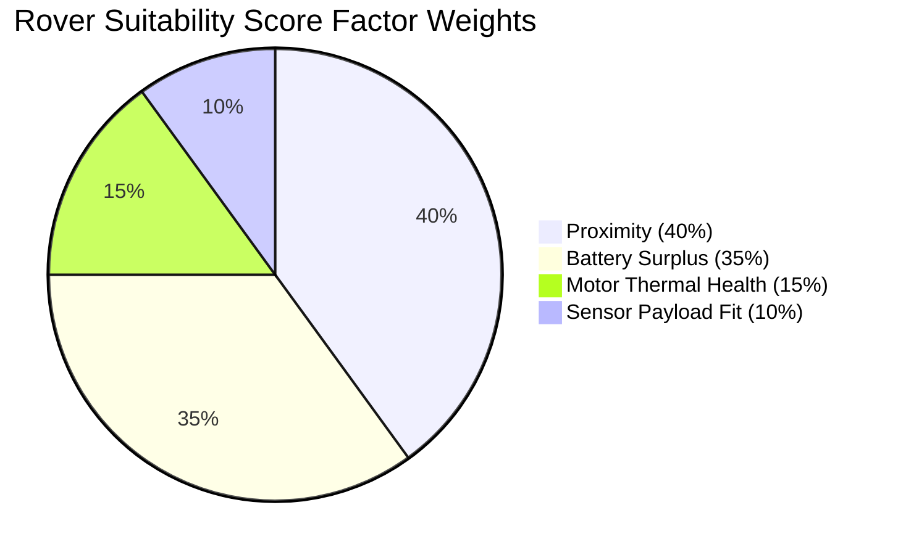
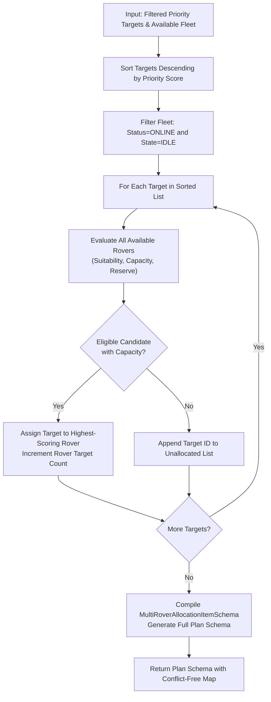

# AQUA CREW — TASK 15 ROVER COORDINATION
## Multi-Rover Allocation, Topological Routing & Battery Safety Reserves

**Document ID:** `AQUA-TASK-15-ROVER-COORD`  
**Status:** Approved & Implemented  
**Scope:** Fleet Ranking, Conflict Prevention, Dijkstra Graph Routing, Battery Reserves  
**Author:** Antigravity Autonomous Systems Engineering Team  
**Review Date:** November 2026  

---

### 1. Fleet Allocation & Rover Suitability Scoring

AQUA CREW manages a heterogeneous fleet of autonomous virtual crawling and acoustic crawlers. To ensure safe, cost-effective mission dispatch, the `RoverAllocationService` computes a composite **Suitability Score** $S \in [0, 100]$ for each rover relative to candidate inspection targets:

$$S = 0.40 \cdot S_{\text{prox}} + 0.35 \cdot S_{\text{batt}} + 0.15 \cdot S_{\text{temp}} + 0.10 \cdot S_{\text{sensor}}$$

#### 1.1. Factor Formulations

1. **Proximity Score ($S_{\text{prox}}$):**
   $$S_{\text{prox}} = \max\left(0.0, \, 100.0 - 15.0 \cdot d_{\text{km}}\right)$$
   where $d_{\text{km}}$ is the Great Circle distance from rover's current base location to target ingress station. A rover $1\text{ km}$ away scores $85.0$; at $6.67\text{ km}$, $S_{\text{prox}} = 0$.

2. **Battery Surplus Score ($S_{\text{batt}}$):**
   $$S_{\text{batt}} = \min\left(100.0, \, \max\left(0.0, \, B_{\text{projected\_reserve}}\right)\right)$$
   Rewards rovers that maintain substantial battery buffer above the mandatory $20.0\%$ safety reserve after accounting for round-trip travel and target inspection duration.

3. **Motor Thermal Health Score ($S_{\text{temp}}$):**
   $$S_{\text{temp}} = \max\left(0.0, \, (50.0 - T_{\text{motor}}) \cdot 4.0\right)$$
   Cool motors ($25^\circ\text{C}$) receive the maximum score ($100.0$). Approaching the $50^\circ\text{C}$ operational ceiling linearly reduces the score to $0.0$.

4. **Sensor Payload Fit ($S_{\text{sensor}}$):**
   $$S_{\text{sensor}} = \begin{cases} 100.0 & \text{if rover carries all required sensors} \\ 0.0 & \text{otherwise} \end{cases}$$

---

### 2. Disqualification Criteria (Zero-Tolerance Gates)

A rover is classified as **ineligible** ($S = 0.0$) if any of the following boundary conditions are violated:

| Disqualification Condition | Threshold / Value | Rationale |
| :--- | :---: | :--- |
| **Connection Status** | `OFFLINE` | Rover telemetry link severed; communication loss. |
| **Operating State** | $\ne$ `IDLE` (e.g. `INSPECTING`, `MAINTENANCE`, `CHARGING`) | Rover actively deployed or unavailable. |
| **Active Mission Assignment** | `assigned_mission_id` is set | Prevents mission conflict and duplicate allocation. |
| **Initial Battery Charge** | $< 25.0\%$ | Insufficient capacity for minimal underground deployment. |
| **Motor Temperature** | $> 50.0^\circ\text{C}$ | Prevents motor winding thermal runaway under pipe friction. |
| **Payload Capability Match** | Missing required sensor | Cannot fulfill inspection modality (e.g. hydrophone, UT). |
| **Projected Return Reserve** | $< 20.0\%$ | Violates safe return-to-base emergency reserve margin. |

---

### 3. Coordinated Multi-Rover Allocation Algorithm

When formulating an inspection plan covering multiple priority targets, targets are allocated sequentially without overlapping assignments:

**Key Invariant:** No rover is assigned more than `max_targets_per_rover` (default 3), and no target is assigned to more than one rover.

---

### 4. Underground Pipeline Graph Routing (Dijkstra)

Virtual rovers traverse underground conduits strictly along actual pipeline geometry rather than unconstrained aerial lines.

#### 4.1. Topological Graph Construction
1. **Quantized Junction Snapping:** Coordinates along pipeline polyline features are quantized to 4 decimal places (~$11\text{ m}$ spatial resolution) to create topological junctions:
   $$\text{node\_key} = \left(\text{round}(\lambda, 4), \, \text{round}(\phi, 4)\right)$$
2. **Adjacency Mapping:** Each line segment connecting two coordinates $[c_1, c_2]$ forms bidirectional edges in graph $G = (V, E)$ weighted by Haversine distance:
   $$w(e) = \text{haversine\_distance\_m}(c_1, c_2)$$

#### 4.2. Shortest Path Search
The algorithm snaps rover base coordinates and target coordinates to their nearest topological nodes:
- Uses a priority queue (min-heap) exploring $\min(\text{distance})$ to target junction.
- Reconstructs intermediate waypoints along all traversed pipeline segments.
- Handles same-segment movement: if start and destination snap to the same junction but coordinates differ, direct segment distance is applied without routing detours.

#### 4.3. Unreachable Target Detection
If a target coordinate cannot be snapped to the pipeline network within a $300\text{ m}$ tolerance, or if no connected path exists in $G$ connecting base station to target, the target is flagged as `unreachable_targets` and omitted from rover assignments.

---

### 5. Battery Consumption & Return-to-Base Safety Modeling

Underground water conduit environments impose high frictional drag on crawler tracks. The energy consumption model accounts for both transit movement and stationary sensor acquisition:

$$E_{\text{total}} = E_{\text{travel}} + E_{\text{inspect}}$$

$$E_{\text{travel}} = \left(\frac{d_{\text{total\_m}}}{1000.0}\right) \times 2.5\% \quad [\% \text{ battery per km}]$$

$$E_{\text{inspect}} = \left(\frac{t_{\text{inspect\_s}}}{3600.0}\right) \times 4.0\% \quad [\% \text{ battery per hour}]$$

**Return-to-Base Feasibility Condition:**
$$B_{\text{initial}} - E_{\text{total}} \ge 20.0\%$$

If the projected reserve drops below $20.0\%$, the route is rejected, and the target is deemed infeasible for that specific rover.

