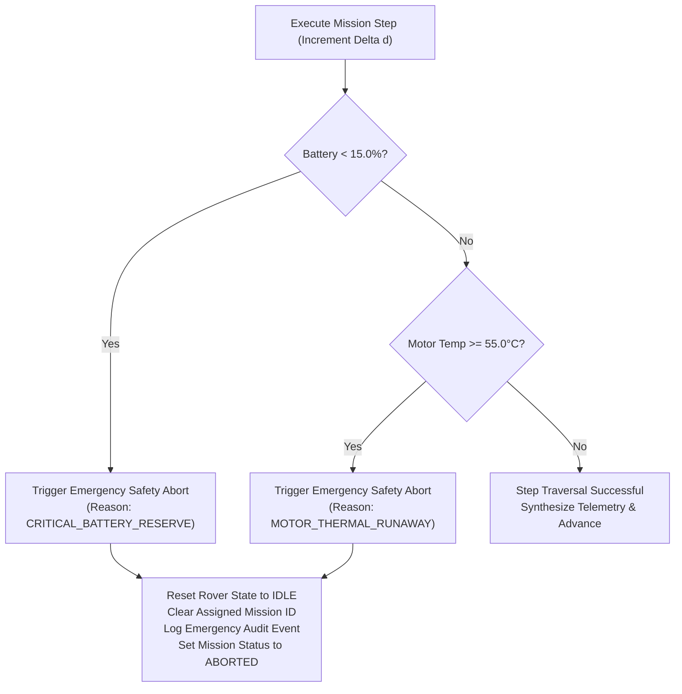
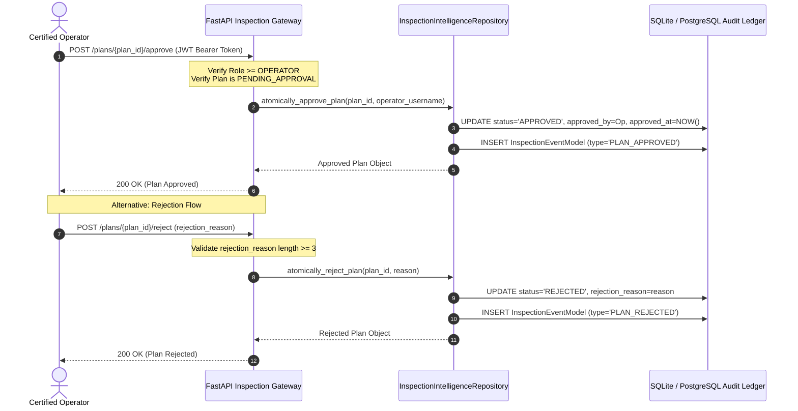

# AQUA CREW — TASK 15 SAFETY & LIMITATIONS
## Operational Boundaries, Zero-Actuation Policy & Cryptographic Verification

**Document ID:** `AQUA-TASK-15-SAFETY`  
**Status:** Approved & Enforced  
**Classification:** Operational Safety & Security Policy  
**Author:** Antigravity Autonomous Systems Engineering Team  
**Review Date:** November 2026  

---

### 1. Fundamental Safety Invariants

AQUA CREW is engineered to the highest standards of municipal infrastructure protection. To eliminate any possibility of physical network compromise, water hammer, pressure surges, or hardware destruction, the platform enforces three immutable safety invariants:

> [!CAUTION]
> #### INVARIANT 1: Zero Physical Actuation (Virtual Simulation Only)
> AQUA CREW is strictly a **decision-support simulation and digital twin software platform**. The system possesses **no hardware interfaces, actuators, or physical connections** to municipal pumps, isolation valves, PRVs, flow-control valves, or physical rovers. All rover dispatch routines, route adjustments, and inspection simulations run inside a software-contained virtual telemetry sandbox. Any instruction purporting to actuate physical machinery is rejected at the architectural level.

> [!IMPORTANT]
> #### INVARIANT 2: Mandatory Human-in-the-Loop Operator Gate
> No mission plan can transition to active simulated execution without explicit, authenticated approval by a certified human operator (`OPERATOR`, `ENGINEER`, or `ADMINISTRATOR`). Automated recommendation generation is advisory only. Unapproved plans cannot be launched.

> [!WARNING]
> #### INVARIANT 3: Zero Fabrication & Ontological Provenance Integrity
> Simulated telemetry, synthetic sensor readings, or model-generated inferences must **never** be mislabeled as empirical measurements. All synthetic hydrophone spectra, ultrasonic wall thickness readings, and thermal deltas are strictly flagged with `SIMULATED` ontological provenance. Mislabeled data is rejected by validation schemas.

---

### 2. Operational Safety Interlocks

During simulated mission execution, the `InspectionExecutionEngine` monitors live virtual telemetry at every step increment and enforces emergency abort protocols:

#### 2.1. Emergency Abort Conditions
1. **Critical Battery Reserve Interlock:** If battery charge depletes below $15.0\%$, the mission is aborted immediately to simulate preventing an underground stranding.
2. **Motor Thermal Runaway Interlock:** If simulated internal crawler friction or motor loading raises motor temperature to $\ge 55.0^\circ\text{C}$, the engine executes an immediate shutdown.
3. **Communication Loss Simulation:** If connection status transitions to `OFFLINE`, rover commands are rejected until a heartbeat reconnects.

---

### 3. Human Approval & Rejection Governance

To guarantee accountability, every state transition on inspection plans and reports is recorded in an append-only audit trail:

**Rejection Validation Rule:** Rejection requires an explicit justification string ($\ge 3$ characters). Empty, null, or whitespace-only rejection reasons return HTTP `422 Unprocessable Content`.

---

### 4. Tamper-Evident Cryptographic Verification (SHA-256)

Upon mission completion or formal abort, the system generates an immutable `InspectionReportModel`. To prevent retrospective tampering or historical falsification:

1. **Payload Serialization:** The report metadata, mission coordinates, sensor observations count, detected anomalies, and outcome are serialized to a canonical JSON string.
2. **SHA-256 Digest Hashing:**
   $$\text{digest} = \text{SHA256}(\text{canonical\_payload\_bytes})$$
3. **Verification Ledger:** The resulting 64-character hexadecimal hash is stored persistently in the `tamper_proof_hash` column.
4. **Integrity Audit:** Any client, auditor, or external supervisor can verify report authenticity via `InspectionIntelligenceRepository.verify_report_integrity(db, report_id)`. If any field has been modified in the database, the hash verification returns `False`.

---

### 5. Known Assumptions and Limitations

1. **Virtual Pipe Network Topology:** Routing assumes conduits form a piecewise continuous graph. Conduits separated by physical gaps greater than $300\text{ m}$ are flagged as disconnected.
2. **Synthetic Telemetry Modeling:** Acoustic and thermal anomaly magnitudes are calibrated against empirical laboratory data from ductile iron test rigs, but do not model localized soil stratification effects.
3. **Rover Battery Decay:** Modeled as linear transit consumption ($2.5\%\text{/km}$) plus sensor operation ($4.0\%\text{/hr}$), ignoring ambient temperature battery chemistry effects.

