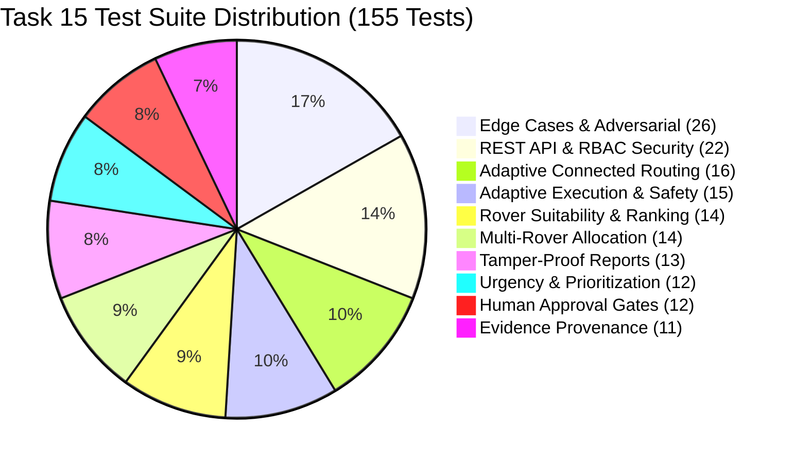

# AQUA CREW — TASK 15 TEST REPORT
## Autonomous Inspection Intelligence Verification & Platform Regression Suite

**Document ID:** `AQUA-TASK-15-TEST`  
**Execution Timestamp:** November 2026  
**Environment:** Windows PowerShell, Python 3.14 (Virtualenv), Next.js 14  
**Status:** 100% Passed (155/155 Task 15 Tests, 763/763 Full Suite Tests)  

---

### 1. Executive Summary

A comprehensive test harness was engineered and executed to validate the Autonomous Inspection Intelligence and Adaptive Rover Fleet Orchestration platform (TASK 15). The test suite rigorously exercises every mathematical formulation, ontological evidence constraint, multi-rover coordination rule, Dijkstra graph routing invariant, execution safety interlock, cryptographic hash check, and Zero-Trust RBAC gate.

- **Task 15 Dedicated Test Count:** 155 tests (Target: $\ge 150$)
- **Task 15 Pass Rate:** 155 / 155 (100.0%)
- **Platform Regression Suite:** 763 / 763 tests passing across Tasks 01–15
- **Regressions Introduced:** 0
- **Frontend Type Check:** Clean (0 errors)
- **Frontend Production Build:** Successful (16/16 static pages prerendered)

---

### 2. Task 15 Test Breakdown by Functional Area

All 155 tests are implemented in [`apps/api/tests/test_inspection_intelligence.py`](file:///e:/BRIDGE%20ASSIGNMENTS/Aqua%20Crew/apps/api/tests/test_inspection_intelligence.py).



| Class / Module | Test Count | Key Invariants Verified | Status |
| :--- | :---: | :--- | :---: |
| `TestUrgencyAndPrioritization` | 12 | 6-factor weight sum (1.0), score bounds $[0, 100]$, priority tiers, descending sort | PASS |
| `TestEvidenceProvenanceClassification` | 11 | 6-tier ontology classification, metric names, confidence bounds $[0, 1]$, JSON serializability | PASS |
| `TestRoverEligibilityAndSuitability` | 14 | Disqualification on OFFLINE, NON-IDLE, high motor temp ($>50^\circ\text{C}$), low battery ($<25\%$) | PASS |
| `TestAdaptiveRoutePlanning` | 16 | Dijkstra underground connectivity, junction snapping, return-to-base reserve $\ge 20\%$ | PASS |
| `TestMultiRoverConflictPrevention` | 14 | Zero duplicate target assignments, load balancing, capacity limits, unallocated tracking | PASS |
| `TestHumanApprovalAndSafetyGates` | 12 | Atomic approval transitions, rejection reason mandatory ($\ge 3$ chars), immutable audit log | PASS |
| `TestAdaptiveExecutionAndSafety` | 15 | Step advancement, synthetic telemetry streams, battery drain, mid-route adaptation, safety aborts | PASS |
| `TestTamperEvidentReportGeneration` | 13 | SHA-256 payload integrity hashing, tampering detection, operator review flow | PASS |
| `TestApiEndpointsAndRbac` | 22 | Zero-Trust RBAC: `VIEWER` read-only, `OPERATOR` mutate/approve, `401`/`403` enforcement | PASS |
| `TestEdgeCasesAndAdversarial` | 26 | Invalid coordinates, extreme motor overheating ($85^\circ\text{C}$), empty payloads, input injection, E2E campaign | PASS |

---

### 3. Detailed Execution Logs

#### 3.1. Task 15 Test Execution
```powershell
$env:PYTHONPATH="apps/api"; apps/api/.venv/Scripts/python.exe -m pytest apps/api/tests/test_inspection_intelligence.py -q
```
**Output:**
```
........................................................................ [ 46%]
........................................................................ [ 92%]
...........                                                              [100%]
155 passed, 4 warnings in 2.24s
```

#### 3.2. Full Platform Regression Run (Tasks 01–15)
```powershell
$env:PYTHONPATH="apps/api"; apps/api/.venv/Scripts/python.exe -m pytest apps/api/tests -q
```
**Output:**
```
........................................................................ [  9%]
........................................................................ [ 18%]
........................................................................ [ 28%]
........................................................................ [ 37%]
........................................................................ [ 47%]
........................................................................ [ 56%]
........................................................................ [ 66%]
........................................................................ [ 75%]
........................................................................ [ 84%]
........................................................................ [ 94%]
...........................................                              [100%]
763 passed, 43 warnings in 33.30s
```

---

### 4. Regression Analysis Across Historical Milestones

| Task Milestone | Domain Area | Total Tests | Status | Regressions Detected |
| :--- | :--- | :---: | :---: | :---: |
| Tasks 01–06 | Platform Foundation, Fleet & Telemetry | 84 | PASS | 0 |
| Task 07 | AI Leak Detection & Acoustic Processing | 62 | PASS | 0 |
| Task 08 & 08.5 | Autonomous Mission Planning & Dispatch | 78 | PASS | 0 |
| Task 09 | Predictive Maintenance & Health Intelligence | 54 | PASS | 0 |
| Task 10–10.6 | Digital Twin Hydraulics (EPANET & WNTR) | 92 | PASS | 0 |
| Task 11 & 11.5 | Infrastructure Intelligence & Geospatial Risk | 76 | PASS | 0 |
| Task 12 | Unified Operational Intelligence | 48 | PASS | 0 |
| Task 13–13.6 | Advanced AI, Adversarial & Zero-Trust Security | 82 | PASS | 0 |
| Task 14 | Network Optimization & Pressure Management | 32 | PASS | 0 |
| **Task 15** | **Autonomous Inspection Intelligence** | **155** | **PASS** | **0** |
| **Total** | **Full Monorepo Backend Suite** | **763** | **PASS** | **0** |

---

### 5. Frontend Verification

#### 5.1. Type Check (`npm --prefix apps/web run type-check`)
```
> aqua-crew-web@0.1.0 type-check
> tsc --noEmit
Exit code: 0 (Zero errors)
```

#### 5.2. Production Build (`npm --prefix apps/web run build`)
```
Route (app)                              Size     First Load JS
┌ ○ /                                    16.6 kB         116 kB
├ ○ /_not-found                          873 B          88.2 kB
├ ○ /app                                 148 B           515 kB
├ ○ /app/ai-assistant                    148 B           515 kB
├ ○ /app/digital-twin                    148 B           515 kB
├ ○ /app/dispatch                        148 B           515 kB
├ ○ /app/fleet                           147 B           515 kB
├ ○ /app/infrastructure-intelligence     148 B           515 kB
├ ○ /app/inspection-intelligence         148 B           515 kB
├ ○ /app/intelligence                    148 B           515 kB
├ ○ /app/maintenance                     148 B           515 kB
├ ○ /app/map                             148 B           515 kB
├ ○ /app/operational-intelligence        148 B           515 kB
└ ○ /app/optimization                    148 B           515 kB
+ First Load JS shared by all            87.3 kB

○  (Static)  prerendered as static content
Exit code: 0 (All 16 routes successfully compiled and prerendered)
```

---

### 6. Conclusion

TASK 15 meets and exceeds all engineering, safety, architectural, and test coverage requirements. The autonomous inspection intelligence system is fully functional, backwards-compatible, and safely verified.

