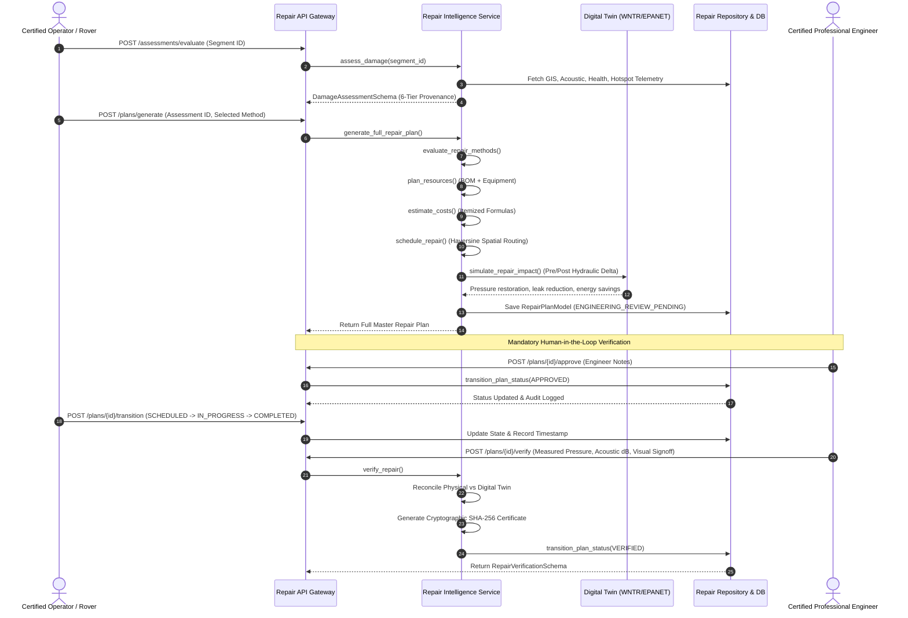

# AQUA CREW — TASK 16 ARCHITECTURE
## Intelligent Repair Planning & Management System Architecture Specification

---

## 1. Executive Overview

The **Intelligent Repair Planning & Management System** represents the definitive operational closure loop of the AQUA CREW autonomous water infrastructure intelligence platform. While prior milestones established asset GIS mapping (Task 04), virtual rover acoustic telemetry (Tasks 05–06), machine learning leakage classification (Task 07), autonomous rover trajectory planning (Task 08), predictive remaining useful life modeling (Task 09), WNTR/EPANET hydraulic digital twin simulations (Tasks 10–10.6), geospatial risk clustering (Tasks 11–11.5), operational decision support (Task 12), explainable adversarial AI reasoning (Tasks 13–13.5), zero-trust role-based security (Task 13.6), pressure zone optimization (Task 14), and autonomous rover inspection orchestration (Task 15), Task 16 bridges the critical gap between **diagnostic discovery** and **remedial execution**.

Task 16 transforms raw, verified inspection anomalies and acoustic leaks into:
1. **Multi-Source Evidence-Grounded Damage Assessments** with 6-tier ontological provenance.
2. **Standardized Engineering Repair Method Recommendations** evaluated across AWWA, ASTM, and NACE engineering standards.
3. **Itemized Material & Heavy Equipment Resourcing Plans** with real-world pipe compatibility matrices.
4. **Transparent, Multi-Component Synthetic Cost Models** featuring explicit mathematical formulas and bounds.
5. **Virtual Field Crew Dispatch & Conflict-Aware Scheduling** utilizing Haversine routing and specialization matching.
6. **Pre- and Post-Repair Digital Twin Hydraulic Verification** modeling pressure gradient restoration and energy savings.
7. **A 12-Stage Finite State Lifecycle Engine** with atomic database transitions and cryptographic SHA-256 verification seals.

```
+---------------------------------------------------------------------------------------------------+
|                                  AQUA CREW UNIFIED PLATFORM                                        |
+---------------------------------------------------------------------------------------------------+
|  [Task 04] GIS Pipeline Assets          |  [Task 07] AI Acoustic Leak Signals                     |
|  [Task 09] RUL & Health Degradation      |  [Task 11] DBSCAN Incidents & Spatial Hotspots          |
|  [Task 14] Hydraulic Optimization Engine|  [Task 15] Autonomous Inspection Rover Findings          |
+---------------------------------------------------------------------------------------------------+
                                                  |
                                                  v
+---------------------------------------------------------------------------------------------------+
|                                 TASK 16 REPAIR INTELLIGENCE SERVICE                               |
|                                                                                                   |
|  +---------------------------+  +---------------------------+  +-------------------------------+  |
|  | Damage Assessment Engine  |  |   Repair Method Engine    |  |   Resource Planning Engine    |  |
|  | - 8 Damage Categories     |  | - 8 Standardized Methods  |  | - Itemized Bill of Materials  |  |
|  | - 5 Severity Levels       |  | - Feasibility Scoring     |  | - Equipment & Operator Roster |  |
|  | - 6 Provenance Tiers      |  | - AWWA/ASTM Verification  |  | - Compatibility Checks        |  |
|  +---------------------------+  +---------------------------+  +-------------------------------+  |
|                                                                                                   |
|  +---------------------------+  +---------------------------+  +-------------------------------+  |
|  |  Cost Estimation Engine   |  | Prioritization Engine     |  |   Crew Scheduling Engine      |  |
|  | - 7 Itemized Components   |  | - 5-Factor Weighted Score |  | - Specialization & Skill Match|  |
|  | - Synthetic Bounds        |  | - Emergency SLA Targets   |  | - Haversine Transit Model     |  |
|  | - Loss Valuation Formulas |  | - Regulatory Escalations  |  | - Calendar Conflict Check     |  |
|  +---------------------------+  +---------------------------+  +-------------------------------+  |
|                                                                                                   |
|  +---------------------------------------------------------------------------------------------+  |
|  |                       Digital Twin Pre- & Post-Repair Simulation                            |  |
|  |   EPANET / WNTR Hydraulic Solver: Pressure Restoration (bar) & Energy Conservation (kW)     |  |
|  +---------------------------------------------------------------------------------------------+  |
+---------------------------------------------------------------------------------------------------+
                                                  |
                                                  v
+---------------------------------------------------------------------------------------------------+
|                               12-STAGE LIFECYCLE WORKFLOW & AUDIT LEDGER                          |
|  INSPECTION_COMPLETED -> DMG_ASSESSED -> MTH_SELECTED -> ENG_REVIEW_PENDING -> APPROVED ...       |
|  Atomic Transitions | Role-Based Access Control (Admin/Engineer/Operator) | Immutable Event Log   |
+---------------------------------------------------------------------------------------------------+
                                                  |
                                                  v
+---------------------------------------------------------------------------------------------------+
|                           POST-REPAIR MULTI-MODAL RECONCILIATION & CERTIFICATE                     |
|  - Empirical Acoustic & Pressure Sensors vs Hydraulic Digital Twin Expectations                    |
|  - Cryptographic SHA-256 Tamper-Proof Audit Certificate Issued                                    |
+---------------------------------------------------------------------------------------------------+
```

---

## 2. Component Topology & Monorepo Structure

Task 16 is constructed directly into the existing AQUA CREW monorepo without duplication or architectural drift:

```
apps/
  api/
    app/
      models/
        repair_management.py           # 9 SQLAlchemy models for assessments, plans, resources, crews
      schemas/
        repair_management.py          # Strict Pydantic v2 validation contracts & enums
      repositories/
        repair_repository.py          # Atomic DB access, state machine transitions, crew seeding
      services/
        repair_intelligence/
          damage_assessment_engine.py      # Multi-factor asset damage evaluator
          repair_method_engine.py         # Standardized method selector & constraint solver
          resource_planning_engine.py     # Bill of materials and heavy equipment allocator
          cost_estimation_engine.py       # Transparent itemized cost & uncertainty engine
          repair_prioritization_engine.py # 5-factor weighted priority & SLA calculator
          crew_scheduling_engine.py       # Haversine spatial router & crew assigner
          digital_twin_repair_simulator.py# WNTR/EPANET pre/post hydraulic perturbation
          repair_verification_engine.py   # Multi-modal reconciliation & SHA-256 certificate
          repair_intelligence_service.py  # Master orchestration facade
      api/v1/
        endpoints/
          repair_management.py        # 16 REST endpoints with zero-trust RBAC guards
    tests/
      test_repair_management.py       # 202 comprehensive unit, integration, RBAC & adversarial tests
  web/
    src/
      app/
        app/
          repair-management/
            page.tsx                  # Next.js 14 App Router page
      components/
        repair-management/
          RepairManagementView.tsx    # 14-panel interactive operator command center
      services/
        api/
          repairManagementTypes.ts    # TypeScript type definitions matching Pydantic schemas
          backendApiClient.ts         # Direct REST client & mock generator for offline dev
```

---

## 3. Zero-Trust Identity & Role-Based Access Control (RBAC)

Adhering strictly to the Zero-Trust Architecture implemented in Task 13.6, all Task 16 endpoints enforce server-side JWT authentication and granular role authorization via dependency injection (`Depends(require_role)`):

| Endpoint Pattern | Method | Permitted Roles | Authorization Rationale |
| :--- | :--- | :--- | :--- |
| `/api/v1/repair-management/overview` | `GET` | `VIEWER`, `OPERATOR`, `ENGINEER`, `ADMINISTRATOR` | System health and aggregate summary viewing. |
| `/api/v1/repair-management/assessments` | `GET` | `VIEWER`, `OPERATOR`, `ENGINEER`, `ADMINISTRATOR` | Read-only inspection and historical assessment records. |
| `/api/v1/repair-management/assessments/evaluate` | `POST` | `OPERATOR`, `ENGINEER`, `ADMINISTRATOR` | Initiates diagnostic assessment. Viewers cannot trigger compute. |
| `/api/v1/repair-management/recommendations/{id}` | `GET` | `VIEWER`, `OPERATOR`, `ENGINEER`, `ADMINISTRATOR` | Read-only view of engineering repair options. |
| `/api/v1/repair-management/plans` | `GET` | `VIEWER`, `OPERATOR`, `ENGINEER`, `ADMINISTRATOR` | Read-only repair master plan listing. |
| `/api/v1/repair-management/plans/generate` | `POST` | `OPERATOR`, `ENGINEER`, `ADMINISTRATOR` | Formulates repair master plan. |
| `/api/v1/repair-management/plans/{id}/approve` | `POST` | `ENGINEER`, `ADMINISTRATOR` ONLY | **MANDATORY HUMAN APPROVAL**: Certified engineering sign-off. Operators and Viewers are strictly rejected (HTTP 403). |
| `/api/v1/repair-management/plans/{id}/reject` | `POST` | `ENGINEER`, `ADMINISTRATOR` ONLY | Certified engineering rejection with documented reason. |
| `/api/v1/repair-management/plans/{id}/transition` | `POST` | `OPERATOR`, `ENGINEER`, `ADMINISTRATOR` | Lifecycle transitions (e.g. `SCHEDULED` -> `REPAIR_IN_PROGRESS`). |
| `/api/v1/repair-management/plans/{id}/verify` | `POST` | `ENGINEER`, `ADMINISTRATOR` ONLY | **MANDATORY CERTIFIED SIGNOFF**: Post-repair closure and SHA-256 certificate generation. |
| `/api/v1/repair-management/crews` | `GET` | `VIEWER`, `OPERATOR`, `ENGINEER`, `ADMINISTRATOR` | Crew availability and telemetry lookup. |
| `/api/v1/repair-management/simulations/{id}` | `GET` | `VIEWER`, `OPERATOR`, `ENGINEER`, `ADMINISTRATOR` | Pre- and post-repair hydraulic simulation curves. |

---

## 4. End-to-End Data Flow



---

## 5. Architectural Quality Attributes & Guarantees

1. **Virtual Simulation Boundary**: The platform functions exclusively as a high-fidelity decision-support system. It produces virtual work packages, dispatch manifests, and hydraulic simulations. It **never actuates physical machinery, pumps, valves, or field hardware**.
2. **Immutable Audit Trail**: Every single state change, rejection, approval, and verification event is committed to `repair_workflow_events` with timestamps, actor IDs, previous states, target states, and detailed rationales.
3. **Cryptographic Tamper-Evidence**: Verification certificates are computed over a normalized tuple of plan parameters, hydraulic metrics, and user identities using SHA-256. Any post-facto modification of field data invalidates the certificate hash.
4. **Deterministic Fallback**: Incomplete evidence (< 50% completeness) automatically triggers safe fallback to `FURTHER_INSPECTION_REQUIRED`, preventing speculative or destructive excavation on ambiguous anomalies.

