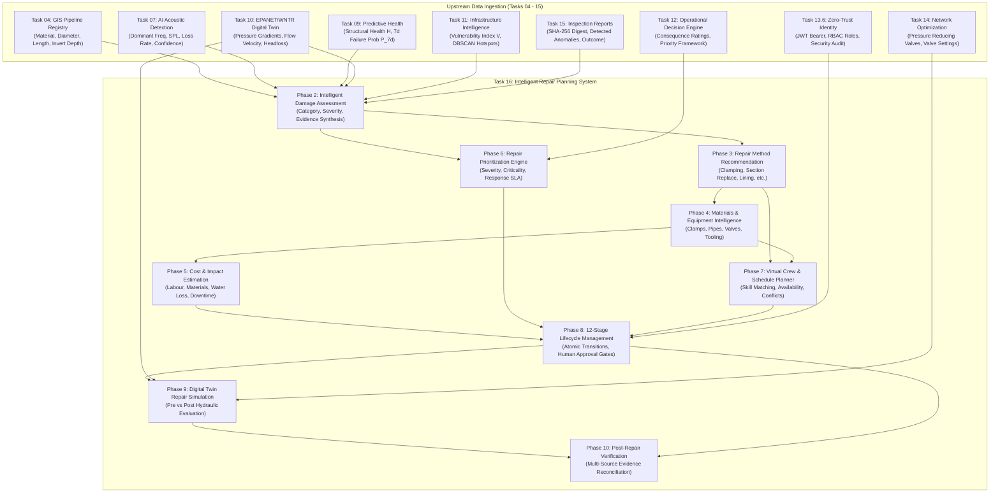

# AQUA CREW — TASK 16 ARCHITECTURE AUDIT
## Pre-Implementation System Audit & Cross-Module Data Flow Trace

**Document ID:** `AQUA-TASK-16-AUDIT`  
**Execution Timestamp:** November 2026  
**Status:** Audit Completed  
**Author:** Antigravity Autonomous Systems Engineering Team  
**Scope:** Architecture Analysis, Dependency Ingestion, Gap Identification for Task 16  

---

### 1. Architectural Context & Objective

AQUA CREW is an advanced software-first autonomous water leakage detection, infrastructure inspection, predictive maintenance, and operational decision-support platform. With the completion of **Tasks 01 through 15**, the platform possesses full-spectrum telemetry, predictive health, hydraulic digital twin simulation, geospatial risk prediction, adversarial security, and autonomous inspection orchestration.

**Mission for Task 16:** Develop an intelligent, evidence-grounded **Repair Planning & Management System** that transforms verified inspection findings (from Task 15 inspection reports and historical data) into structured damage assessments, engineering repair recommendations, material and equipment plans, transparent cost/impact estimates, crew schedules, digital twin repair simulation what-ifs, and post-repair verification workflows.

---

### 2. Cross-Subsystem Traceability (Tasks 04–15)

---

### 3. Detailed Subsystem Audit & Reusability Matrix

| Subsystem | Existing Models / Tables | Available Services & Repositories | Direct Reusability in Task 16 | Architectural Gaps & Additions Needed |
| :--- | :--- | :--- | :--- | :--- |
| **Task 04: GIS Pipeline Registry** | `PipelineSegmentModel` (`pipeline_segments`) | `PipelineRepository` | Ingest conduit diameter, material, length, pressure zone, nominal PSI | Missing pipe installation age / manufacture date in some default records; fallback to material lifecycle models. |
| **Task 07: AI Leak Detection** | `AiDetectionModel` (`ai_detections`) | `AiOrchestrationService`, `LeakLocalizationService` | Anomaly score, classification, confidence, estimated loss (L/h), localization radius | Need programmatic correlation between inspection report anomalies and AI detections. |
| **Task 09: Predictive Maintenance** | `PipelineHealthModel`, `PredictiveRiskModel` | `PipelineHealthService`, `PredictiveRiskService` | Structural health score ($H$), 7-day failure probability ($P_{7\text{d}}$), degradation rate | Health deficit used to calibrate damage severity and structural degradation risks. |
| **Task 10: Hydraulic Digital Twin** | `HydraulicNetworkModel`, `HydraulicNodeModel`, `HydraulicLinkModel`, `SimulationScenarioModel`, `SimulationRunModel`, `ScenarioComparisonModel` | `SimulationRunner`, `WNTREngine`, `TodiniGlobalGradientSolver`, `ScenarioManagerService` | Hydraulic simulation runner, node pressures, link flows, scenario diffing | Add dedicated repair what-if scenarios (e.g. restoring roughness, closing isolated sections, repairing leaks). |
| **Task 11: Infrastructure Intelligence** | `PipelineVulnerabilityProfileModel`, `SpatialIncidentClusterModel` | `RiskAssessmentService` | Multi-factor vulnerability index ($V_{\text{score}}$), DBSCAN incident clusters | Ingest into repair priority calculation to elevate conduits in frequent burst zones. |
| **Task 12: Operational Intelligence** | `OperationalAssessmentModel`, `OperationalRecommendationModel` | `OperationalDecisionService` | Consequence scoring, operational trade-off matrices | Distinct separation: inspection priority vs. repair priority. |
| **Task 13.6: Zero-Trust Security & RBAC** | `UserModel`, `TokenRevocationModel`, `SecurityAuditEventModel` | `UserRepository`, `get_current_user`, `require_role` | Strict RBAC (`VIEWER` read-only, `OPERATOR`/`ENGINEER`/`ADMINISTRATOR` for approvals and mutations) | Add specialized `ENGINEER` role requirement for technical repair plan approvals and damage overrides. |
| **Task 14: Network Optimization** | `OptimizationJobModel`, `OptimizationCandidateModel` | `OptimizationEngine`, `PressureManagementService` | Pressure reduction valve candidates to mitigate stress on damaged conduits | Link repair plans with pressure management recommendations to mitigate pre-repair leaks. |
| **Task 15: Inspection Intelligence** | `InspectionReportModel`, `InspectionPlanModel`, `InspectionExecutionModel`, `InspectionEventModel` | `InspectionIntelligenceRepository`, `InspectionIntelligenceService` | Source inspection reports, detected anomalies, sensor observations, SHA-256 payload digest | Bridge completed inspection reports into the damage assessment and repair planning pipeline. |

---

### 4. Identified Architectural Gaps for Task 16

1. **Absence of Repair Lifecycle Persistence**:
   - Currently, there are no database models tracking damage assessments, repair recommendations, resource allocations, cost estimates, or virtual crew schedules.
   - *Resolution*: Implement 9 dedicated SQLAlchemy models (`RepairAssessmentModel`, `RepairRecommendationModel`, `RepairPlanModel`, `RepairResourceModel`, `RepairCostEstimateModel`, `RepairCrewModel`, `RepairScheduleModel`, `RepairWorkflowEventModel`, `RepairVerificationModel`).

2. **Absence of Engineering Damage Assessment Engine**:
   - Need an intelligence service to evaluate physical damage category (`PIPE_LEAK`, `PIPE_BURST`, `JOINT_FAILURE`, `CORROSION`, `STRUCTURAL_CRACK`, `PRESSURE_DAMAGE`, `VALVE_FAILURE`, `UNKNOWN_DAMAGE`) and severity (`LOW`, `MODERATE`, `HIGH`, `CRITICAL`, `UNDETERMINED`) without converting AI predictions into unverified physical diagnoses.

3. **Material Compatibility & Resource Catalog**:
   - Need a catalog of standard repair materials (split-sleeve clamps, ductile iron couplings, CIPP lining, gate valves, sacrificial zinc anodes) cross-referenced against pipe diameter ($D_{\text{mm}}$), material (Ductile Iron, Cast Iron, Steel, PVC, HDPE, Concrete), and nominal pressure class.

4. **Transparent Cost and Water Loss Impact Model**:
   - Need an itemized cost calculation engine that reports exact formulas, unit costs, labour rates, equipment rentals, water loss financial impacts, downtime costs, and contingency buffers with 6-tier ontological labeling (`MEASURED`, `SIMULATED`, `DERIVED`, `PREDICTED`, `OPERATOR_ENTERED`, `UNKNOWN`).

5. **Distinct Repair Prioritization Formula**:
   - Must not conflate inspection urgency with repair priority. Repair priority incorporates public safety, traffic disruption, water loss severity, and customer service interruption.

6. **12-Stage Finite State Machine Workflow**:
   - Enforce rigorous backend state machine transitions (`INSPECTION_COMPLETED` $\to$ `DAMAGE_ASSESSED` $\to$ `REPAIR_RECOMMENDED` $\to$ `ENGINEERING_REVIEW_PENDING` $\to$ `APPROVED` $\to$ `RESOURCE_PLANNED` $\to$ `SCHEDULED` $\to$ `REPAIR_IN_PROGRESS` $\to$ `REPAIR_COMPLETED` $\to$ `VERIFICATION_PENDING` $\to$ `VERIFIED` $\to$ `CLOSED`), with human rejection and on-hold capabilities.

7. **Digital Twin Pre/Post Repair Simulation**:
   - Enable simulation of network condition before repair (active leak perturbation, elevated pipe roughness) versus post-repair (leak removed, C-factor restored to 140), computing restored pressure, saved water volume ($\text{m}^3$), and saved pump energy.

8. **Post-Repair Multi-Source Verification**:
   - Reconcile post-repair hydrophone acoustic streams, flow meter readings, pressure sensors, and visual inspection evidence before declaring a repair `VERIFIED_SUCCESS`.

---

### 5. Architectural Invariants & Safety Interlocks

1. **Virtual Simulation Sandbox Only**:
   AQUA CREW does not command physical machinery, field crews, municipal valves, or pumps. All crew dispatches and scheduling are virtual planning records.
2. **Mandatory Human-in-the-Loop Gate**:
   No repair plan or status transition to `APPROVED` or `SCHEDULED` can occur automatically. Explicit sign-off by a certified engineer (`ENGINEER` or `ADMINISTRATOR`) is mandatory.
3. **Ontological Provenance Guarantee**:
   All cost estimates, damage severities, and simulation outcomes must declare their exact data source and classification. Unknown values must be explicitly marked `UNKNOWN` rather than guessed.
4. **Tamper-Evident Audit Logging**:
   Every workflow transition, approval, rejection, and verification is recorded with authenticated user ID, timestamp, reason, and SHA-256 hash.

