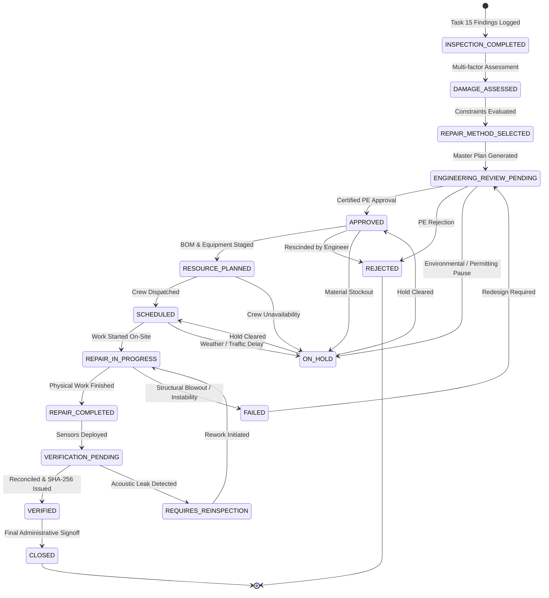

# AQUA CREW — TASK 16 WORKFLOW
## 12-Stage Lifecycle State Machine, Virtual Crew Scheduling & Audit Ledger

---

## 1. 12-Stage Repair Lifecycle State Machine

Repair master plans progress through a strictly regulated 12-stage lifecycle. Each transition is governed by atomic database transactions, role authorization, and state validation in `RepairRepository.transition_plan_status`.



### 1.1 Enumerated Lifecycle States (12 Stages)

1. **`INSPECTION_COMPLETED`**: Anomaly discovered and logged by acoustic survey or Task 15 autonomous rover.
2. **`DAMAGE_ASSESSED`**: Pipe geometry, damage category, severity tier, and 6-tier provenance tagged.
3. **`REPAIR_METHOD_SELECTED`**: AWWA/ASTM method feasibility scored and primary method chosen.
4. **`ENGINEERING_REVIEW_PENDING`**: Plan formulated; awaiting certified Professional Engineer sign-off.
5. **`APPROVED`**: Formally authorized by a certified Professional Engineer (`ENGINEER` or `ADMINISTRATOR`).
6. **`RESOURCE_PLANNED`**: Materials reserved, equipment requisitioned, and staging verified.
7. **`SCHEDULED`**: Virtual repair crew assigned with calculated transit route and confirmed window.
8. **`REPAIR_IN_PROGRESS`**: Virtual field crew active on-site; excavation and mechanical installation underway.
9. **`REPAIR_COMPLETED`**: Mechanical install completed; trench backfilled; initial repressurization executed.
10. **`VERIFICATION_PENDING`**: Telemetry and hydro-acoustic sensors deployed for empirical validation.
11. **`VERIFIED`**: Empirical pressure and acoustic readings reconcile with digital twin expectations; cryptographic SHA-256 certificate issued.
12. **`CLOSED`**: Post-repair documentation archived into permanent utility GIS ledger.

**Alternative & Exception Branches**:
- **`REJECTED`**: Terminated by a certified engineer with mandatory written justification.
- **`ON_HOLD`**: Temporarily paused due to severe weather, missing permits, or road moratorium.
- **`FAILED`**: Catastrophic failure during repair execution requiring immediate hydraulic redesign.
- **`REQUIRES_REINSPECTION`**: Residual acoustic vibration or pressure anomaly detected during post-repair check.

---

## 2. Finite State Transition Rules

The state transition matrix enforced by `RepairRepository` prohibits out-of-order execution or unauthorized state skipping:

| Current Status | Allowed Target Statuses | Required Minimum Role | Transition Notes |
| :--- | :--- | :--- | :--- |
| `INSPECTION_COMPLETED` | `DAMAGE_ASSESSED`, `ON_HOLD`, `REJECTED` | `OPERATOR` | Advances from rover inspection. |
| `DAMAGE_ASSESSED` | `REPAIR_METHOD_SELECTED`, `ON_HOLD`, `REJECTED` | `OPERATOR` | Feasibility evaluation step. |
| `REPAIR_METHOD_SELECTED` | `ENGINEERING_REVIEW_PENDING`, `ON_HOLD`, `REJECTED` | `OPERATOR` | Plan formulation. |
| `ENGINEERING_REVIEW_PENDING` | `APPROVED`, `REJECTED`, `ON_HOLD` | `ENGINEER` | **Mandatory Certified Review**. |
| `APPROVED` | `RESOURCE_PLANNED`, `SCHEDULED`, `REJECTED`, `ON_HOLD` | `OPERATOR` | Logistics staging. |
| `RESOURCE_PLANNED` | `SCHEDULED`, `ON_HOLD` | `OPERATOR` | Crew scheduling. |
| `SCHEDULED` | `REPAIR_IN_PROGRESS`, `ON_HOLD`, `CANCELLED` | `OPERATOR` | Work initiation. |
| `REPAIR_IN_PROGRESS` | `REPAIR_COMPLETED`, `FAILED`, `ON_HOLD` | `OPERATOR` | On-site execution. |
| `REPAIR_COMPLETED` | `VERIFICATION_PENDING`, `REQUIRES_REINSPECTION` | `OPERATOR` | Handover to quality assurance. |
| `VERIFICATION_PENDING` | `VERIFIED`, `REQUIRES_REINSPECTION`, `FAILED` | `ENGINEER` | **Mandatory Certified Sign-off**. |
| `REQUIRES_REINSPECTION` | `REPAIR_IN_PROGRESS`, `FAILED`, `ON_HOLD` | `OPERATOR` | Rework cycle. |
| `VERIFIED` | `CLOSED` | `ADMINISTRATOR` | Administrative archiving. |
| `ON_HOLD` | `APPROVED`, `SCHEDULED`, `ENGINEERING_REVIEW_PENDING` | `OPERATOR` | Resumption from pause. |
| `FAILED` | `ENGINEERING_REVIEW_PENDING`, `CLOSED` | `ENGINEER` | Re-assessment required. |
| `CLOSED` | *None (Terminal)* | — | Immutable closed record. |

---

## 3. Virtual Crew Scheduling Engine

The Crew Scheduling Engine (`CrewSchedulingEngine`) models realistic field logistics without physical actuation:

### 3.1 Crew Roster & Specializations

Four pre-configured municipal virtual repair crews are seeded with distinct trade specializations:

```
1. CREW-MECH-01: Metro Rapid Mechanical Repair Crew
   - Specialization: PIPELINE_MECHANICAL
   - Key Skills: Split-sleeve clamping, joint resealing, emergency isolation, hot-tapping
   - Base Depot: Manhattan Works Yard (40.7128° N, -74.0060° W)

2. CREW-HEAVY-02: Trunk Line Replacement Squad
   - Specialization: HEAVY_EXCAVATION
   - Key Skills: Trench shoring, 20T crane handling, large diameter jointing, thrust blocks
   - Base Depot: Midtown Heavy Yard (40.7180° N, -74.0120° W)

3. CREW-LINING-03: Trenchless CIPP Rehabilitation Unit
   - Specialization: TRENCHLESS_REHABILITATION
   - Key Skills: CIPP inversion, UV curing, robotic lateral reinstatement, epoxy spray
   - Base Depot: Brooklyn Terminal (40.7050° N, -74.0010° W)

4. CREW-VALVE-04: Valves & Hydraulic Controls Team
   - Specialization: VALVE_AND_PRESSURE
   - Key Skills: PRV calibration, gate valve overhaul, actuator servicing, surge relief
   - Base Depot: Queens Hydraulic Shop (40.7220° N, -74.0040° W)
```

### 3.2 Haversine Distance & Transit Duration Modeling

Transit distance between the crew base depot $(\text{lat}_1, \text{lng}_1)$ and the work site $(\text{lat}_2, \text{lng}_2)$ is computed via the Great Circle Haversine formula:

$$a = \sin^2\left(\frac{\Delta \phi}{2}\right) + \cos(\phi_1)\cos(\phi_2)\sin^2\left(\frac{\Delta \lambda}{2}\right)$$
$$d_{\text{km}} = 2 R_{\text{earth}} \cdot \arctan2\left(\sqrt{a}, \; \sqrt{1-a}\right)$$

Where $R_{\text{earth}} = 6371.0\text{ km}$. Transit duration assumes an average urban utility response speed of $35.0\text{ km/h}$ with a minimum mobilization floor of 15 minutes:

$$T_{\text{transit, hours}} = \max\left(0.25, \; \frac{d_{\text{km}}}{35.0}\right)$$

### 3.3 Calendar Conflict Detection

The engine cross-references the proposed work window $[T_{\text{start}}, T_{\text{end}}]$ against active assignments in `repair_schedules`. If an overlapping active repair is detected on the same crew, `has_schedule_conflicts` is flagged as `True`, generating detailed dispatch alert notes for operational reassignment.

---

## 4. Immutable Audit Ledger (`repair_workflow_events`)

Every lifecycle transition automatically persists an append-only audit event in `repair_workflow_events`:
- `event_id`: Unique cryptographic identifier.
- `repair_plan_id`: Foreign key to target repair master plan.
- `from_status`: Originating lifecycle state.
- `to_status`: Resulting lifecycle state.
- `user_id`: Authenticated user executing the change.
- `reason`: Mandatory operational justification or engineering note.
- `details_json`: Structured context payload (such as verification IDs or cost delta).
- `created_at`: ISO 8601 UTC timestamp.

