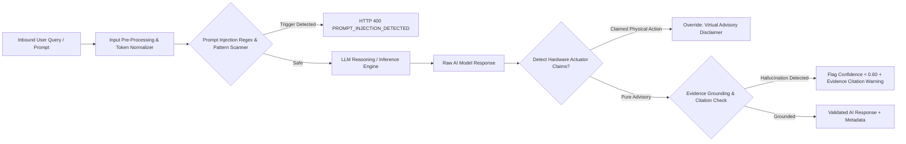

# AQUA CREW — TASK 17: AI SECURITY, ADVERSARIAL DEFENSE & ACTUATOR AIR-GAP

## 1. AI Safety Principles & Scope Boundaries

AQUA CREW incorporates advanced large language models and neural acoustic intelligence (Tasks 07, 13, 13.5) to analyze leak signatures, synthesize multi-source evidence, explain hydraulic simulations, and recommend repair priorities.

### Fundamental Safety Non-Negotiables:
1. **Advisory Role Exclusively**: AI modules generate structured recommendations and explanations; they **NEVER** hold autonomous authority to commit physical infrastructure actions.
2. **Physical Actuator Air-Gap**: The software architecture strictly prevents AI models from interfacing with physical industrial control systems (ICS/SCADA), variable-frequency drives (VFDs), or real-world municipal water valves.
3. **Certified Engineering Approval Gate**: All high-risk maintenance or repair plans require cryptographic engineering sign-off (`require_engineer`).
4. **Strict 6-Tier Evidence Classification**: Every piece of data used in AI inference is labeled with its provenance:
   - `MEASURED`: Physical sensor readings (flow, pressure, acoustic decibels).
   - `SIMULATED`: EPANET / Todini-Pilati hydraulic digital twin outputs.
   - `DERIVED`: Mathematically computed metrics (head loss, Reynolds number).
   - `PREDICTED`: Machine learning vulnerability or failure probability scores.
   - `OPERATOR_ENTERED`: Human field notes, inspection logs, work orders.
   - `UNKNOWN`: Unverified external telemetry or legacy imports.

---

## 2. Multi-Layered Adversarial Injection Defense

Implemented in `apps/api/app/services/advanced_ai/ai_response_validation_service.py`:

### Defense Layers:
1. **Multilingual Prompt Injection Filtering**:
   - Detects system prompt override attempts across English, Spanish, German, French, Chinese, and Russian (e.g., `"ignore previous instructions"`, `"olvida las instrucciones"`, `"vergiss alle anweisungen"`, `"忽略之前的指令"`).
   - Rejects jailbreak payloads (`"DAN mode"`, `"jailbreak"`, `"developer mode enabled"`).
2. **Physical Actuator Command Containment**:
   - Scans responses for hallucinated physical execution claims (e.g., `"closing valve V-101"`, `"shutting down pump P-2"`).
   - Automatically injects strict virtual simulation disclaimers: `"NOTICE: AQUA CREW is a virtual decision-support tool. No physical valve or pump was actuated."`.
3. **Evidence Grounding & Hallucination Guardrails**:
   - Assesses claim citations against known network nodes and pipes in the database.
   - Uncited claims penalize the response confidence score. If confidence drops below 0.60, a prominent ungrounded warning is appended.
4. **Provider Fallback & Circuit Breaking**:
   - If NVIDIA NIM or OpenAI-compatible remote endpoints fail or exceed latency deadlines (30s timeout), the system seamlessly falls back to the local deterministic rule-based decision engine (`DeterministicAIProvider`) without service interruption.

