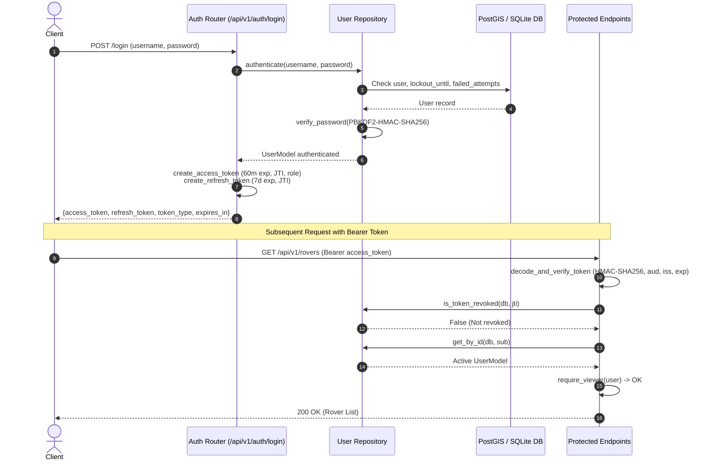

# AQUA CREW — TASK 17: AUTHENTICATION, IDENTITY & ROLE-BASED ACCESS CONTROL (RBAC)

## 1. Authentication Framework & Standards

AQUA CREW implements a zero-trust cryptographic identity service complying with NIST SP 800-63B guidelines and RFC 7519 / RFC 7515 specifications.

### Password Security (NIST SP 800-63B)
- **Algorithm**: PBKDF2 with HMAC-SHA256, 100,000 hashing iterations, 16-byte cryptographically secure random salt.
- **Complexity Requirements**:
  - Minimum 8 characters in length.
  - At least one uppercase Latin letter (`A-Z`).
  - At least one lowercase Latin letter (`a-z`).
  - At least one numeric digit (`0-9`).
  - At least one special symbol (`[!@#$%^&*(),.?":{}|<>\-_]`).
- **Brute-Force & Credential Stuffing Defense**:
  - Tracking failed login attempts in `users.failed_login_attempts`.
  - Upon 5 consecutive failed login attempts, the account is automatically locked for 15 minutes (`users.locked_until = now() + 15m`).
  - Authentications during lockout period are immediately rejected with `AccountLockedException` indicating remaining lockout duration.
  - Administrative unlock is supported via `POST /api/v1/auth/users/{user_id}/unlock`.

---

## 2. JWT Cryptographic Token Management



### Token Structure
1. **Header**:
   ```json
   {
     "alg": "HS256",
     "typ": "JWT"
   }
   ```
2. **Payload Claims**:
   - `sub`: Unique system user ID (e.g., `USR-ADMIN-01`, `OPERATOR-SUPERVISOR-01`).
   - `username`: Account username.
   - `email`: User official contact email.
   - `role`: Role string (`VIEWER`, `OPERATOR`, `ENGINEER`, `ADMINISTRATOR`).
   - `type` / `token_type`: `access` (60 minutes) or `refresh` (7 days).
   - `iss`: `aqua-crew-auth`.
   - `aud`: `aqua-crew-api`.
   - `jti`: Unique cryptographically random identifier (`JTI-<32-HEX-CHARS>`).
   - `iat`: Issued-at Unix timestamp.
   - `nbf`: Not-before Unix timestamp.
   - `exp`: Expiration Unix timestamp.
3. **Signature**:
   `HMAC-SHA256(secret_key, base64url(header) + "." + base64url(payload))`

### Single-Use Refresh Token Rotation & Blacklisting
- Upon invoking `POST /api/v1/auth/refresh`, the presented refresh token is immediately blacklisted in `token_revocations` with reason `"token_refresh_rotation"`.
- A brand-new access token and refresh token pair is issued.
- If an adversary attempts to replay an old refresh token, it is rejected with HTTP 401 Unauthorized (`"Token has been revoked or invalidated."`).

---

## 3. Strict Role-Based Access Control (RBAC) Matrix

The platform enforces 4 hierarchical operational roles:
1. **VIEWER**: Read-only observation of network state, telemetry, and analytics.
2. **OPERATOR**: Field operations, rover mission dispatch, simulation pause/resume, and telemetry logging.
3. **ENGINEER**: Hydraulic modeling, scenario execution, pipe vulnerability modification, and repair plan approval.
4. **ADMINISTRATOR**: User account management, security configuration, role modification, account unlocking, and global session revocation.

### Endpoint Role Authorization Matrix

| Endpoint Route | HTTP Method | Minimum Required Role | Description |
| :--- | :---: | :---: | :--- |
| `/api/v1/auth/login` | `POST` | Public | Authenticates credentials and issues token pair |
| `/api/v1/auth/refresh` | `POST` | Public | Single-use rotation of refresh token |
| `/api/v1/auth/logout` | `POST` | Authenticated | Revokes current access token JTI |
| `/api/v1/auth/me` | `GET` | `VIEWER` | Returns authenticated user profile |
| `/api/v1/auth/users` | `GET` / `POST` | `ADMINISTRATOR` | Lists or provisions system users |
| `/api/v1/auth/users/{id}/unlock` | `POST` | `ADMINISTRATOR` | Clears account lockout and resets failed counter |
| `/api/v1/auth/users/{id}/revoke-sessions` | `POST` | `ADMINISTRATOR` | Immediately invalidates all tokens for a user |
| `/api/v1/auth/audit-logs` | `GET` | `ADMINISTRATOR` | Reviews security audit events |
| `/api/v1/health/*` | `GET` | Public | Probes for container orchestration and uptime |
| `/api/v1/metrics` / `/metrics` | `GET` | Public | Prometheus monitoring metrics exposition |
| `/api/v1/rovers` | `GET` | `VIEWER` | Lists active rover fleet |
| `/api/v1/rovers/{id}` | `GET` | `VIEWER` | Rover telemetry details |
| `/api/v1/rovers/{id}/commands` | `POST` | `OPERATOR` | Dispatches simulated command to rover |
| `/api/v1/missions` | `GET` | `VIEWER` | Lists fleet missions |
| `/api/v1/missions` | `POST` | `OPERATOR` | Creates and plans a rover mission |
| `/api/v1/missions/{id}/assign` | `POST` | `OPERATOR` | Assigns rover to mission (with atomic concurrency guard) |
| `/api/v1/simulation/state` | `GET` | `VIEWER` | Observes virtual simulation status |
| `/api/v1/simulation/start` | `POST` | `OPERATOR` | Starts virtual simulation loop |
| `/api/v1/simulation/pause` | `POST` | `OPERATOR` | Pauses virtual simulation loop |
| `/api/v1/digital-twin/scenarios/run` | `POST` | `ENGINEER` | Executes EPANET hydraulic simulation |
| `/api/v1/digital-twin/calibrate` | `POST` | `ENGINEER` | Calibrates hydraulic digital twin parameters |
| `/api/v1/repair-management/assessments` | `POST` | `ENGINEER` | Performs engineering structural assessment |
| `/api/v1/repair-management/plans/{id}/approve` | `POST` | `ENGINEER` | Certified engineering sign-off on repair plan |
| `/api/v1/advanced-ai/chat` | `POST` | `VIEWER` | Evidence-grounded conversational intelligence |
| `/api/v1/advanced-ai/conversations/{id}` | `GET` | `VIEWER` (with IDOR) | Reads conversation owned by user or admin |
| `/api/v1/ws/telemetry` | `WS` | `VIEWER` | Real-time telemetry feed |

---

## 4. Insecure Direct Object Reference (IDOR) Protection

Object-level access control is enforced via `verify_resource_ownership`:
```python
def verify_resource_ownership(
    current_user: UserModel,
    resource_owner_id: Optional[str],
    resource_type: str = "RESOURCE",
    allow_roles: Optional[List[str]] = None,
) -> None:
    if not resource_owner_id:
        return
    if current_user.id == resource_owner_id:
        return
    if current_user.role == "ADMINISTRATOR":
        return
    if allow_roles and current_user.role in allow_roles:
        return

    raise HTTPException(
        status_code=status.HTTP_403_FORBIDDEN,
        detail=f"Access denied: You do not own this {resource_type} and lack administrative privileges.",
    )
```
- Users are prohibited from querying or modifying entities (e.g. AI conversations, mission drafts) belonging to other operators unless granted explicit role override or administrator status.
- Failed IDOR attempts generate tamper-evident security audit entries.

