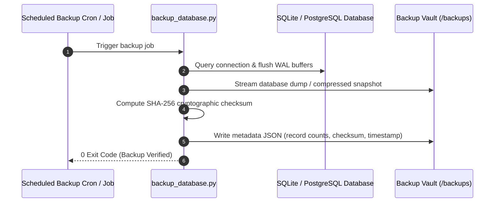

# AQUA CREW — TASK 17: BACKUP, RESTORE & DISASTER RECOVERY (DR)

## 1. RPO & RTO Objectives

As a municipal infrastructure intelligence platform, AQUA CREW targets the following Disaster Recovery Service Level Agreements (SLAs):
- **Recovery Point Objective (RPO)**: **$\le 1$ Hour** (Maximum acceptable data loss window).
- **Recovery Time Objective (RTO)**: **$\le 15$ Minutes** (Maximum allowable downtime during restoration).

---

## 2. Automated Backup Strategy

The backup subsystem is provided via automated utility scripts in `apps/api/scripts/`:
- **Backup Script**: `apps/api/scripts/backup_database.py`
- **Restore Script**: `apps/api/scripts/restore_database.py`

### Backup Lifecycle & Cryptographic Integrity:


### Supported Storage Targets:
1. **SQLite (Development/Edge)**:
   - Atomic database copy via Python `sqlite3.backup()` API, avoiding write-lock contention.
   - Generation of accompanying `.meta.json` file recording SHA-256 hash, byte size, and entity counts (`users`, `rovers`, `missions`, `pipelines`).
2. **PostgreSQL 16 (Production)**:
   - Uses `pg_dump -Fc --blobs` for compressed custom binary format.
   - Supports Point-In-Time-Recovery (PITR) via continuous Write-Ahead Log (WAL) archiving to encrypted S3 / GCS buckets.

---

## 3. Restoration & Verification Procedures

### Verification Before Overwrite:
The restoration engine in `restore_database.py` enforces safety checks before executing a restore:
1. Validates that the target backup file exists on disk.
2. Reads the companion `.meta.json` metadata file.
3. Computes the real-time SHA-256 checksum of the backup archive and compares it with `metadata["sha256"]`. If checksum mismatch occurs, restoration halts immediately with `IntegrityError` to prevent loading corrupted data.
4. Creates a safety backup of the current database before applying the restoration.

### Manual Restoration Playbook:
```bash
# 1. Inspect available backups
ls -la apps/api/backups/

# 2. Execute checksum-verified restore
python apps/api/scripts/restore_database.py apps/api/backups/aquacrew_backup_20261116_190000.db

# 3. Verify health probes
curl -I http://localhost:8000/api/v1/health/readiness
```

---

## 4. Disaster Recovery Scenarios & Runbooks

| Incident Type | Failure Scenario | Recovery Procedure |
| :--- | :--- | :--- |
| **Node Crash / Hardware Loss** | Kubernetes worker node host hardware failure | Pods reschedule onto surviving nodes via replica set. EBS / PersistentVolume re-attaches automatically. |
| **Database Corruption** | Accidental table truncation or corrupt write | Halt API traffic $\to$ Run `restore_database.py` with latest verified backup $\to$ Replay WAL logs $\to$ Restart API. |
| **Ransomware / Key Compromise** | Secret key or database access compromise | Revoke all active sessions via `POST /api/v1/auth/users/{id}/revoke-sessions` $\to$ Rotate `JWT_SECRET_KEY` in environment $\to$ Restore database from offline air-gapped backup. |

