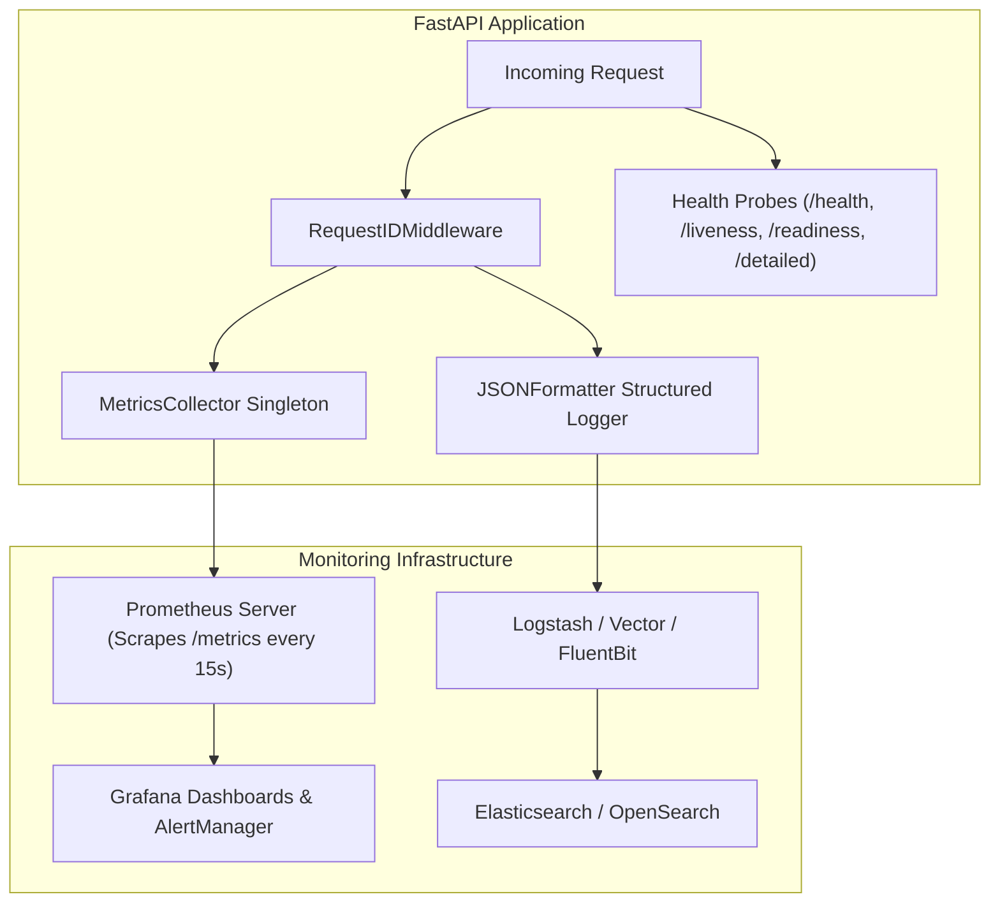

# AQUA CREW — TASK 17: OBSERVABILITY, STRUCTURED LOGGING & METRICS

## 1. Observability Architecture Overview

AQUA CREW incorporates comprehensive observability across metrics, logs, and health probes, enabling site reliability engineers and operators to monitor telemetry flow, error budgets, and system health in real time.



---

## 2. Structured JSON Logging

Implemented in `apps/api/app/core/logging.py`:
When `LOG_FORMAT="json"` is configured (default in production environments), log output is serialized into standardized JSON Lines:

```json
{
  "timestamp": "2026-11-16T19:22:15.123456Z",
  "level": "INFO",
  "logger": "aqua_crew.simulation",
  "message": "Simulation tick completed. 5 rovers updated.",
  "request_id": "8f9a1b2c-3d4e-5f6a-7b8c-9d0e1f2a3b4c",
  "module": "simulation_service",
  "line": 142
}
```

### Key Fields:
- `timestamp`: ISO-8601 UTC timestamp with microsecond precision.
- `level`: Log severity (`DEBUG`, `INFO`, `WARNING`, `ERROR`, `CRITICAL`).
- `logger`: Subsystem identifier (`aqua_crew.api`, `aqua_crew.auth`, `aqua_crew.websocket`, `aqua_crew.digital_twin`).
- `message`: Human-readable log narrative.
- `request_id`: Correlated request identifier propagating end-to-end.
- `exception`: Full sanitized traceback formatted on errors.

---

## 3. Prometheus Metrics Exposition

Exposed via standard OpenMetrics text format at `/metrics` and `/api/v1/metrics`:

### Metric Definitions:
| Metric Name | Type | Labels | Purpose |
| :--- | :---: | :--- | :--- |
| `aqua_http_requests_total` | Counter | `method`, `endpoint`, `status` | Total incoming HTTP requests across all status codes |
| `aqua_active_websocket_connections` | Gauge | — | Current count of live connected WebSocket clients |
| `aqua_total_websocket_connections` | Counter | — | Cumulative total of WebSocket connections opened |
| `aqua_simulation_ticks_total` | Counter | — | Total physics engine execution cycles |
| `aqua_active_rovers_count` | Gauge | — | Number of rovers in non-OFFLINE states |
| `aqua_active_missions_count` | Gauge | — | Number of missions currently in PROGRESS |
| `aqua_uptime_seconds` | Counter | — | Total uptime of the API service in seconds |

### Sample Prometheus Exposition Format:
```text
# HELP aqua_http_requests_total Total HTTP requests handled
# TYPE aqua_http_requests_total counter
aqua_http_requests_total{endpoint="/api/v1/rovers",method="GET",status="200"} 542
aqua_http_requests_total{endpoint="/api/v1/auth/login",method="POST",status="200"} 89
aqua_http_requests_total{endpoint="/api/v1/auth/login",method="POST",status="429"} 12

# HELP aqua_active_websocket_connections Current active WebSocket connections
# TYPE aqua_active_websocket_connections gauge
aqua_active_websocket_connections 8

# HELP aqua_uptime_seconds Application uptime in seconds
# TYPE aqua_uptime_seconds counter
aqua_uptime_seconds 48291.4
```

---

## 4. Health & Orchestration Probes

Located in `apps/api/app/api/v1/endpoints/health.py`:

1. **Liveness Probe (`GET /api/v1/health/liveness`)**:
   - Status code: `200 OK`
   - Purpose: Verifies the process is responsive and event loop is healthy. Used by Kubernetes `livenessProbe` to trigger pod restart if deadlock occurs.
2. **Readiness Probe (`GET /api/v1/health/readiness`)**:
   - Status code: `200 OK` (Healthy) or `503 Service Unavailable` (Unhealthy)
   - Purpose: Pings database connection pool. If database is unreachable, returns 503 so ingress stops routing traffic to this replica.
3. **Deep Diagnostic Probe (`GET /api/v1/health/detailed`)**:
   - Status code: `200 OK`
   - Purpose: Returns operational status of database, rover fleet, simulation engine, and system resource memory consumption.

