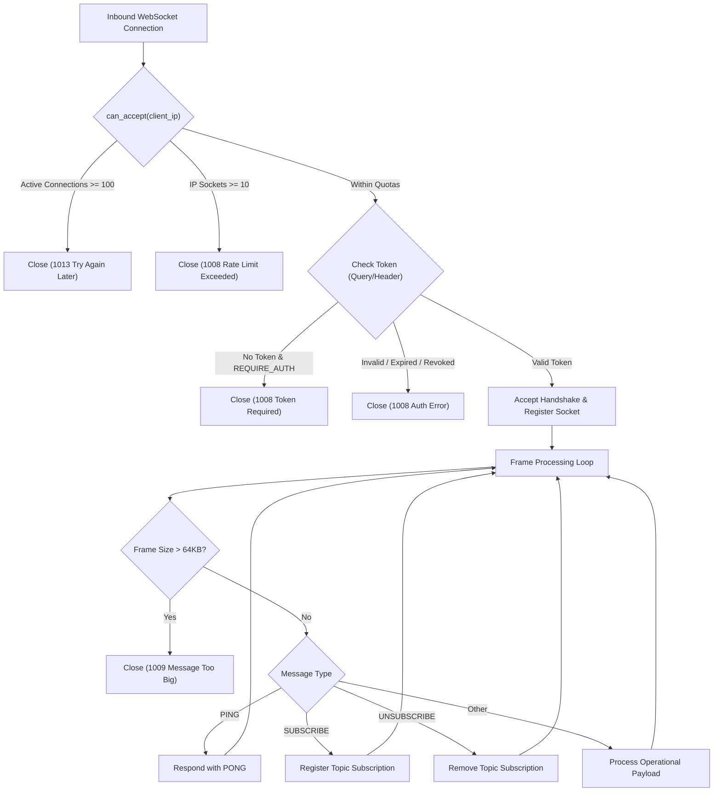

# AQUA CREW — TASK 17: WEBSOCKET SECURITY & REAL-TIME PROTOCOL HARDENING

## 1. Real-Time Telemetry Gateway Overview

AQUA CREW broadcasts real-time telemetry, rover kinematics, acoustic leak sensor streams, and virtual simulation events via WebSockets (`/api/v1/ws/telemetry` and `/ws`). Because persistent connections bypass standard per-request HTTP middleware, dedicated socket-level security controls have been engineered into `ConnectionManager` and endpoint handlers.

---

## 2. WebSocket Security Controls & Defenses

### 1. Cryptographic Authentication & Token Validation
- **Token Delivery**: Accepts JWT bearer tokens via query parameter `?token=<jwt>` or standard `Authorization: Bearer <jwt>` headers.
- **Verification**: Strict HMAC-SHA256 signature verification, issuer check, audience check, and real-time JTI revocation database lookup.
- **Rejection Code**: Closes unauthenticated or invalid connections with standard RFC 6455 policy violation code `1008`.

### 2. Connection Quotas & DoS Mitigation
- **Global Concurrency Ceiling**: Maximum 100 simultaneous WebSocket connections (`MAX_WS_CONNECTIONS = 100`). Excess connection attempts are rejected with code `1013` (Try Again Later).
- **Per-IP Rate Quota**: Maximum 10 simultaneous connections per unique client IP (`MAX_WS_PER_IP = 10`). Excess connection attempts from the same IP are rejected with code `1008` (Policy Violation).

### 3. Frame Size & Buffer Defense
- **Maximum Frame Size**: 64 KB (`65,536` bytes, `MAX_WS_MESSAGE_SIZE`).
- **Enforcement**: Any inbound message exceeding 64KB triggers immediate socket disconnection with RFC 6455 code `1009` (Message Too Big).

### 4. Topic Subscriptions & Role-Aware Broadcasting
- Connections may subscribe to specific data streams:
  - `telemetry`: Rover sensor snapshots and GPS coordinates.
  - `missions`: Mission state changes and waypoint completions.
  - `alerts`: Acoustic leak warnings and hydraulic anomalies.
  - `simulation`: Tick events, simulation speed changes, and pause/resume notifications.
- **Protocol**:
  - `{"type": "SUBSCRIBE", "topic": "missions"}` $\to$ `{"type": "SUBSCRIPTION_CONFIRMED", "topic": "missions"}`
  - `{"type": "UNSUBSCRIBE", "topic": "missions"}` $\to$ `{"type": "UNSUBSCRIPTION_CONFIRMED", "topic": "missions"}`
- **Heartbeat & Idle Reaper**:
  - Automatic ping-pong exchange (`{"type": "PING", "timestamp": ...}` $\to$ `{"type": "PONG", "timestamp": ...}`).
  - Idle connections exceeding 300 seconds without activity are pruned by `prune_idle_connections()`.

