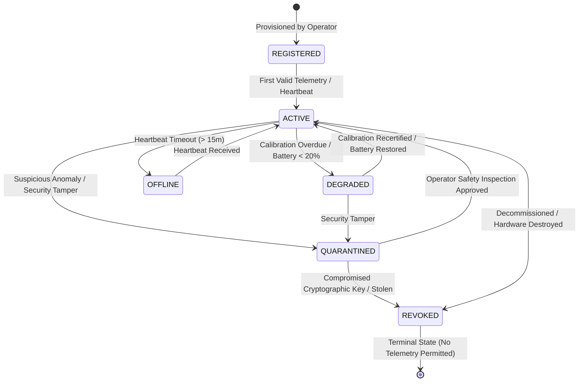

# AQUA CREW — TASK 18 DEVICE REGISTRY & LIFECYCLE MANAGEMENT

> [!NOTE]
> The AQUA CREW Device Registry provides centralized identity, hardware provenance, cryptographic authorization, and physical location mapping for all field sensor nodes and virtual simulation endpoints.

---

## 1. Device Lifecycle State Machine

Every device in the AQUA CREW catalog transitions through formal lifecycle states managed in `iot_devices.status`:



### State Definitions
- `REGISTERED`: Hardware profile created; initial API key generated; awaiting initial field contact.
- `ACTIVE`: Fully authenticated, passing metrological calibration checks, actively streaming telemetry.
- `OFFLINE`: No heartbeat or telemetry received within configured threshold (15 minutes).
- `DEGRADED`: Operational but operating under warning conditions (overdue ISO calibration, battery $< 20\%$, high clock drift). Telemetry is tagged `SUSPECT`.
- `MAINTENANCE`: Temporarily taken offline by field technicians for routine servicing or transducer replacement.
- `QUARANTINED`: Suspended by security or hydraulic safety logic due to anomalous spikes or suspected key leakage. Telemetry is rejected.
- `REVOKED`: Permanently decommissioned. All associated credentials are invalidated. Ingestion is permanently forbidden.

---

## 2. Supported Device Archetypes

| Device Type | Target Application | Typical Sampling Rate | Supported Engineering Units | Associated Pipe Component |
|---|---|:---:|---|---|
| `ACOUSTIC_LOGGER` | High-frequency acoustic leak noise detection | 2,000 Hz burst | Sound Pressure Level (dB SPL), Frequency (Hz) | Pipe Wall / Valve Flange |
| `PRESSURE_SENSOR` | Hydrostatic spine pressure & transient surge monitoring | 10 Hz continuous | bar (converted from psi, kPa) | Distribution Trunk Spine |
| `FLOW_METER` | District Metered Area (DMA) inlet/outlet volumetric flow | 1 Hz | L/s (converted from $\text{m}^3/\text{h}$, gpm) | DMA Boundary Meter Chamber |
| `MOISTURE_SENSOR` | Trench bed subsurface soil saturation for non-surfacing leaks | 0.05 Hz (periodic) | % Volumetric Water Content | Pipe Trench Bed Backfill |
| `OPTICAL_INSPECTION_SENSOR` | Camera boroscopes, visual clarity, and turbidity | Event-driven | Turbidity (NTU), Clarity Score (0-100) | Inspection Access Vault |
| `GATEWAY_NODE` | Edge concentrator (ESP32/cellular) aggregating local RS485 sensors | Continuous gateway | Multi-sensor compound payload | Street Cabinet / Vault |
| `VIRTUAL_SIMULATION_DEVICE` | EPANET / WNTR synthetic network simulation nodes | Variable step | Standard SI units (strictly `SIMULATED` provenance) | Digital Twin Baseline Model |

---

## 3. Seeded Default Device Catalog

The development and testing environment is seeded with 6 diverse IoT devices in `IotRepository.seed_defaults()`:

```
1. DEV-ACOUSTIC-01:
   - Name: Pipeline Sector 4B Acoustic Node
   - Type: ACOUSTIC_LOGGER
   - DMA: DMA-METRO-CENTRAL | Pipeline: PIPE-SEC-4B-92
   - Sensors: SNS-AC-01-A (Acoustic 48.5 dB), SNS-TEMP-01-B (Temp 16.4 °C)
   - Calibration: CALIB-AC-01 (CALIBRATED, Due in 180 days)

2. DEV-PRESSURE-02:
   - Name: High-Pressure Spine Piezoresistive Transducer
   - Type: PRESSURE_SENSOR
   - DMA: DMA-METRO-CENTRAL | Pipeline: PIPE-SEC-4A-10
   - Sensors: SNS-PR-02-A (Pressure 4.62 bar)
   - Calibration: CALIB-PR-02 (CALIBRATED, Due in 90 days)

3. DEV-FLOW-03:
   - Name: Metro District Electromagnetic Flow Meter
   - Type: FLOW_METER
   - DMA: DMA-METRO-CENTRAL | Pipeline: PIPE-SEC-4B-92
   - Sensors: SNS-FL-03-A (Flow 82.4 L/s)
   - Calibration: CALIB-FL-03 (CALIBRATED, Due in 120 days)

4. DEV-MOIST-04:
   - Name: Sub-surface Soil Moisture Time-Domain Reflector
   - Type: MOISTURE_SENSOR
   - DMA: DMA-METRO-CENTRAL | Pipeline: PIPE-SEC-4B-92
   - Sensors: SNS-MOIST-04-A (Soil Saturation 38.2%)
   - Calibration: CALIB-MOIST-04 (OVERDUE by 15 days -> Quality SUSPECT)

5. DEV-OPTICAL-05:
   - Name: Pipe Internal Boroscope Optical Rig
   - Type: OPTICAL_INSPECTION_SENSOR
   - DMA: DMA-METRO-CENTRAL | Pipeline: PIPE-SEC-4B-92
   - Sensors: SNS-OPT-05-A (Visual Clarity 88.0%)
   - Calibration: CALIB-OPT-05 (CALIBRATED, Due in 60 days)

6. DEV-VIRT-06:
   - Name: Virtual EPANET Digital Twin Node
   - Type: VIRTUAL_SIMULATION_DEVICE
   - DMA: DMA-METRO-CENTRAL | Pipeline: PIPE-SEC-4B-92
   - Sensors: SNS-VIRT-06-PR (4.50 bar), SNS-VIRT-06-FL (85.0 L/s)
   - Provenance: Strictly forced to SIMULATED
```

---

## 4. Administrative Management Workflows

### Quarantine Workflow
When an operator or automated security rule flags anomalous behavior:
```
POST /api/v1/iot/devices/{device_id}/quarantine
Body: { "reason": "Suspicious high-frequency pressure fluctuation" }
```
- Sets `status = "QUARANTINED"` and `auth_status = "QUARANTINED"`.
- Prevents subsequent telemetry from entering the platform.
- Emits an audit event `QUARANTINE` in `device_audit_logs`.

### Permanent Revocation Workflow
When a hardware device is decommissioned or stolen:
```
POST /api/v1/iot/devices/{device_id}/revoke
Body: { "reason": "Hardware decommissioned and destroyed" }
```
- Sets `status = "REVOKED"` and `auth_status = "REVOKED"`.
- Automatically marks all active `device_credentials` as `revoked = true`.
- Terminal status cannot be undone via API.

