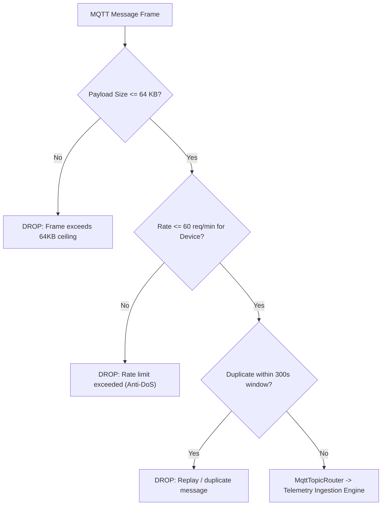

# AQUA CREW — TASK 18 MQTT COMMUNICATION PROTOCOL & GATEWAY SPECIFICATION

> [!NOTE]
> The AQUA CREW MQTT Gateway is powered by **Paho MQTT 2.0** (`paho-mqtt>=2.0.0`) supporting standard MQTT v3.1.1 and v5.0 brokers (e.g. Eclipse Mosquitto, EMQX, AWS IoT Core) over TLS/mTLS, with automatic transparent fallback to in-memory simulation mode when an external broker is offline.

---

## 1. MQTT Topic Hierarchy & Taxonomy

AQUA CREW enforces a deterministic topic namespace rooted at `aquacrew/devices/`:

```
aquacrew/
└── devices/
    └── {device_id}/
        ├── telemetry          # Inbound: High-frequency normalized sensor readings
        ├── status             # Inbound: Lifecycle, heartbeat, battery, & connectivity reports
        ├── events             # Inbound: Spontaneous alerts, threshold alarms, tampers
        ├── diagnostics        # Inbound / Outbound: Self-test results, RTC sync, bus audits
        └── configuration      # Outbound: Non-actuating configuration updates (sampling rate)
```

### Topic Access Control Matrix

| Topic Pattern | Direction | Allowed QoS | Retain | Payload Type | Description |
|---|---|:---:|:---:|---|---|
| `aquacrew/devices/{device_id}/telemetry` | Device $\to$ Gateway | QoS 1 | No | JSON | High-frequency telemetry (pressure, flow, acoustic dB). |
| `aquacrew/devices/{device_id}/status` | Device $\to$ Gateway | QoS 1 | Yes | JSON | Device heartbeat, firmware version, and battery percentage. |
| `aquacrew/devices/{device_id}/events` | Device $\to$ Gateway | QoS 1 / 2 | No | JSON | Spontaneous alarms (high acoustic SPL, battery critical). |
| `aquacrew/devices/{device_id}/diagnostics`| Bidirectional | QoS 1 | No | JSON | Diagnostics requests and hardware self-test responses. |
| `aquacrew/devices/{device_id}/configuration`| Gateway $\to$ Device | QoS 1 | Yes | JSON | Non-actuating configuration (reporting period in seconds). |

> [!WARNING]
> Actuation topics such as `aquacrew/devices/{device_id}/actuate`, `.../valves/control`, or `.../pumps/set` are **strictly prohibited** by `MqttTopicRouter`. Any message directed to an actuation topic is dropped and logged as a security violation.

---

## 2. Telemetry Payload Envelopes

Every JSON payload published over MQTT must adhere to standard framing:

### Inbound Telemetry Envelope (`.../telemetry`)
```json
{
  "version": "1.0",
  "device_id": "DEV-ACOUSTIC-01",
  "sensor_id": "SNS-AC-01-A",
  "sensor_type": "acoustic",
  "seq": 1042,
  "timestamp": "2026-11-16T14:30:00.124Z",
  "reading_value": 64.2,
  "unit": "dB",
  "provenance": "MEASURED",
  "metadata": {
    "dominant_freq_hz": 520.0,
    "battery_pct": 94.0,
    "sampling_rate_hz": 2000.0
  }
}
```

### Inbound Status & Heartbeat Envelope (`.../status`)
```json
{
  "version": "1.0",
  "device_id": "DEV-PRESSURE-02",
  "status": "ONLINE",
  "uptime_seconds": 86400,
  "battery_pct": 88.5,
  "battery_voltage_mv": 3950,
  "wifi_rssi_dbm": -64,
  "firmware_version": "v2.1.0",
  "last_calibration_cert": "CERT-2026-PR-902",
  "timestamp": "2026-11-16T14:30:00.000Z"
}
```

---

## 3. Security Guardrails & Gatekeeper Controls

The `MqttSecurityGuard` component inspects all incoming MQTT frames prior to ingestion:



### Security Parameters
- **Maximum Payload Frame Size**: `MAX_PAYLOAD_BYTES = 65,536` (64 KB). Any message exceeding this is discarded immediately.
- **Per-Device Ingestion Rate Limit**: `MAX_RATE_PER_MINUTE = 60` messages per minute. Prevents rogue or malfunctioning sensors from exhausting database connection pools.
- **Deduplication Window**: 300 seconds. Readings bearing the identical SHA-256 fingerprint within 5 minutes are suppressed.

---

## 4. TLS & Mutual TLS (mTLS) Configuration

For production deployments communicating over public cellular (NB-IoT/LTE-M) or public internet gateways:
- **Broker Port**: `8883` (MQTTS).
- **TLS Version**: Minimum TLS 1.2, recommended TLS 1.3.
- **Cipher Suites**: ECDHE-ECDSA-AES256-GCM-SHA384, ECDHE-RSA-AES256-GCM-SHA384.
- **Mutual Authentication (mTLS)**: Both broker and edge client present valid X.509 certificates signed by the municipal water authority's Certificate Authority (CA).

---

## 5. Simulation Mode Fallback

To support continuous automated testing, CI/CD pipelines, and development without requiring an active Mosquitto broker:
- `MqttManager` automatically probes broker socket connectivity on startup.
- If socket connection fails (e.g. `ConnectionRefusedError`), the gateway switches to `simulation_mode = true`.
- In simulation mode, the gateway maintains an in-memory subscription bus and synthetic telemetry generators without throwing unhandled exceptions.
- The UI displays an amber indicator badge: `MQTT: IN-MEMORY SIMULATION`.

