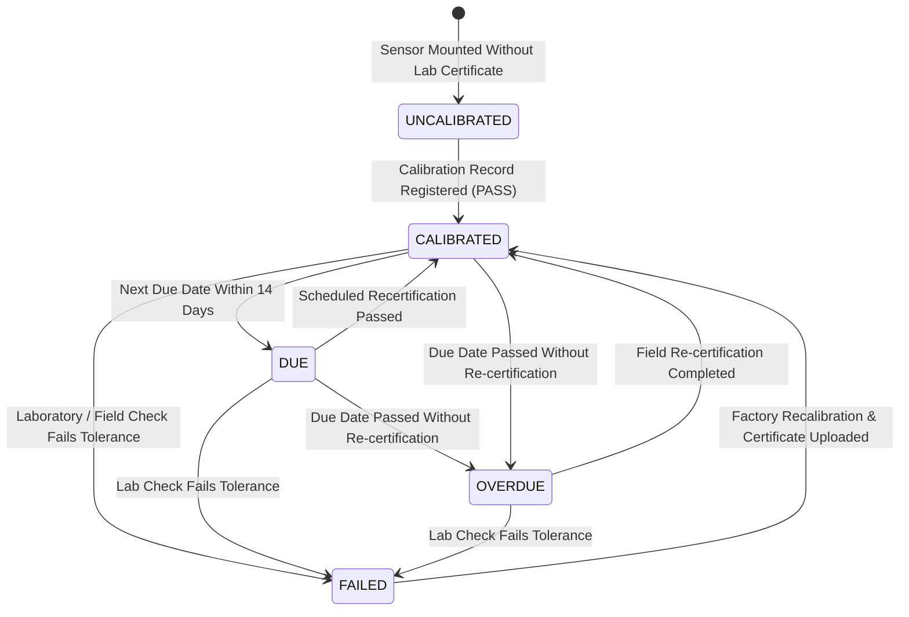

# AQUA CREW — TASK 18 SENSOR CALIBRATION & METROLOGICAL INTEGRITY

> [!NOTE]
> Reliable water network intelligence requires verified physical metrology. An uncalibrated sensor can mimic hydraulic leaks or fail to detect catastrophic pipe ruptures. AQUA CREW integrates an ISO 17025-compliant sensor calibration and due-date tracking engine.

---

## 1. Calibration Lifecycle States

Sensor metrological health is tracked through discrete calibration states in `sensor_calibrations` and `sensors.calibration_status`:



### State Criteria
1. `CALIBRATED`: Certified by authorized metrologist; calibration outcome `PASS` or `ADJUSTED_PASS`; current date is $> 14$ days before `next_due_date`.
2. `DUE`: Sensor is within 14 days of calibration expiration ($0 \le \text{next\_due\_date} - \text{now} \le 14\text{ days}$). Flagged for maintenance scheduling.
3. `OVERDUE`: `next_due_date < now`. Calibration has expired. Ingested telemetry from this sensor is automatically downgraded to `SUSPECT`.
4. `UNCALIBRATED`: Newly provisioned instrument with zero historical calibration certificates. Ingested telemetry is tagged `UNCALIBRATED`.
5. `FAILED`: Metrology verification check failed accuracy tolerance limits. Associated device is marked for urgent field inspection.

---

## 2. Metrology Standards & Tolerances by Sensor Type

| Sensor Domain | Standard Calibration Method | Standard Reference Standard | Max Permissible Tolerance ($\pm$) | Recalibration Interval |
|---|---|---|:---:|:---:|
| **Acoustic Loggers** | ISO 3745 Anechoic Chamber / Acoustic Calibrator 94 dB | B&K 4231 Sound Calibrator | $\pm 0.5\text{ dB}$ ($2.0\%$) | 180 Days (6 Months) |
| **Pressure Transducers** | Deadweight Tester / Digital Reference Manometer | Fluke 700G Series / ISO 17025 Primary Standard | $\pm 0.015\text{ bar}$ ($0.15\%$) | 90 Days (Quarterly) |
| **Flow Meters** | Gravimetric Tank Comparison / Hydraulic Loop Reference | ISO 4185 Liquid Flow in Closed Conduits | $\pm 0.015\text{ L/s}$ ($1.5\%$) | 120 Days (4 Months) |
| **Moisture Probes** | Gravimetric Core Soil Sampling | ASTM D2216 / TDR Lab Standard | $\pm 2.0\%$ Saturation | 365 Days (Annual) |
| **Optical Cameras** | Nephelometric Formazin Standard 4000 NTU | ISO 7027 Water Quality Determination | $\pm 0.1\text{ NTU}$ ($5.0\%$) | 180 Days (6 Months) |

---

## 3. Real-Time Telemetry Quality Downgrading

A critical architectural feature of Task 18 is the dynamic coupling between the calibration registry and the telemetry ingestion engine:

```python
# Executed during every telemetry ingestion cycle in TelemetryIngestionService:
calib_quality, calib_warning = CalibrationService.evaluate_sensor_calibration_quality(
    db, device_id, normalized.sensor_id
)
if calib_quality != "VALID":
    normalized.data_quality = calib_quality
    normalized.metadata["calibration_warning"] = calib_warning
```

### Impact on Downstream Modules
- **Task 07 AI Leak Detection**: Telemetry tagged `SUSPECT` or `UNCALIBRATED` incurs a 25% confidence penalty in leak likelihood calculations, preventing false emergency dispatches.
- **Task 10 Hydraulic Digital Twin**: Telemetry from overdue sensors is omitted from baseline parameter calibration loops to prevent model drift.
- **Task 16 Repair Planning**: Repair assessment evidence cards explicitly display an amber "CALIBRATION EXPIRED" warning badge.

---

## 4. Calibration Audit & Registration Workflow

### Registering a New Calibration Record
Authorized operators and engineers record calibration certificates via:
```http
POST /api/v1/iot/calibration
Authorization: Bearer <operator_token>
Content-Type: application/json

{
  "device_id": "DEV-PRESSURE-02",
  "sensor_id": "SNS-PR-02-A",
  "calibration_method": "DEADWEIGHT_TESTER",
  "calibration_reference": "STD-DWT-2026",
  "calibration_result": "PASS",
  "accuracy_tolerance": 0.015,
  "technician": "Ing. Marcus Vance",
  "certificate_reference": "CERT-2026-PR-902",
  "next_due_date": "2027-02-15T00:00:00Z",
  "notes": "Deadweight calibration verified against municipal standard bench."
}
```

### Automated Recalibration Audit Schedule
`CalibrationService.audit_and_update_overdue_calibrations(db)` runs as a background maintenance worker or can be triggered periodically to scan all active sensors, identify records where `next_due_date < now`, transition their status to `OVERDUE`, and commit an audit trail event to `device_audit_logs`.

