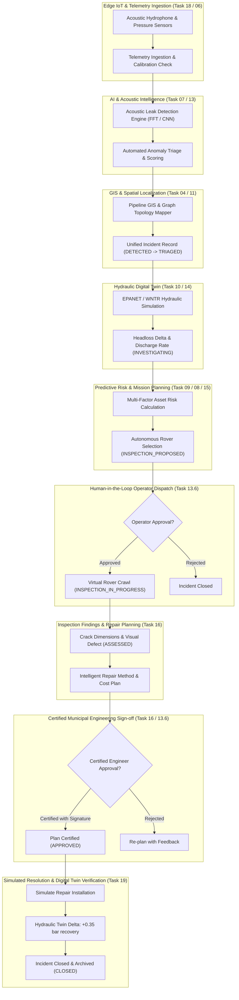

# AQUA CREW — TASK 19: ARCHITECTURE INTEGRATION SPECIFICATION
## Unified Intelligence, Full-Stack Topology & Cross-Module Orchestration

---

### 1. Executive Architectural Overview

The AQUA CREW platform synthesizes software-first autonomous water leakage detection, acoustic signal processing, GIS pipeline intelligence, hydraulic digital twin simulation, autonomous rover orchestration, predictive maintenance, intelligent repair planning, and edge IoT readiness into one cohesive, multi-tier operational ecosystem.

Task 19 establishes the **Master System Integration & Acceptance Layer**, binding together 18 preceding engineering milestones through a deterministic, event-driven, 10-stage end-to-end incident lifecycle.



---

### 2. Multi-Tier Subsystem Integration

| Subsystem Layer | Milestones | Primary Responsibilities | Data Transport / Interface |
| :--- | :--- | :--- | :--- |
| **Edge IoT & Ingestion** | Task 18, Task 06 | Sensor telemetry normalization, ISO 17025 calibration audit, edge buffering, MQTT gateway | REST `/api/v1/iot`, MQTT Broker, WebSockets |
| **Acoustic AI Leak Detection** | Task 07, Task 13.5 | Spectral analysis, acoustic leakage classification, confidence calibration | In-memory feature pipeline, REST `/api/v1/ai` |
| **GIS & Geospatial Topology** | Task 04, Task 11 | Network graph navigation, DMA zone boundary correlation, spatial clustering | GeoJSON layers, PostGIS / Spatial queries |
| **Hydraulic Digital Twin** | Task 10, Task 10.5, Task 14 | EPANET / WNTR hydraulic model execution, transient headloss, pressure curve deviation | REST `/api/v1/digital-twin`, Headloss Solvers |
| **Asset Health & Risk** | Task 09, Task 11 | Structural pipe degradation curves, multi-factor risk score (0-100), Weibull survival | REST `/api/v1/maintenance`, Risk Matrix |
| **Autonomous Rover Fleet** | Task 05, Task 08, Task 15 | Virtual rover kinematic dispatch, battery modeling, sensor payload matching | REST `/api/v1/dispatch`, `/api/v1/inspection-intelligence` |
| **Intelligent Repair Planning**| Task 16 | Material BOM generation, cost estimation, repair urgency tiers, crew scheduling | REST `/api/v1/repair-management` |
| **Identity & Zero-Trust Security**| Task 13.6, Task 17 | JWT token authentication, Zero-Trust RBAC, immutable tamper-evident audit ledger | Dependency injection `require_operator`, `require_engineer` |
| **Master Lifecycle Orchestrator**| Task 19 | 10-stage state machine coordinator, certified human approvals, simulated resolution verification | REST `/api/v1/incidents`, IncidentRepository |

---

### 3. Simulation-First Safety Architecture

A critical tenet of AQUA CREW is strict simulation-first safety:
1. **Global Actuation Prohibition**: `HARDWARE_ACTUATION_ENABLED = False` is enforced at the root configuration and architecture boundary.
2. **Command Rejection**: Commands attempting physical valve throttling, pump modulation, SCADA overriding, or physical actuator movement are trapped and returned as `403 Forbidden` (`HARDWARE_ACTUATION_PROHIBITED`).
3. **Evidence Provenance Tagging**: All virtual sensor readings, synthetic acoustic waves, and rover crawl photos are tagged as `evidence_provenance: "SIMULATED"`, preventing operator confusion with real-world certified physical telemetry.

---

### 4. Cross-Module Dataflow Mapping

```
Telemetry Record -> Classifier -> Anomaly -> Unified Incident (DETECTED)
                                                 |
                                         Triage (TRIAGED)
                                                 |
                                     Digital Twin Simulation (INVESTIGATING)
                                                 |
                                   Multi-Factor Risk (INSPECTION_PROPOSED)
                                                 |
                                  Human Operator Dispatch (APPROVED)
                                                 |
                                Virtual Rover Crawl (INSPECTION_IN_PROGRESS -> ASSESSED)
                                                 |
                               Repair Formulation (REPAIR_PLANNED -> AWAITING_APPROVAL)
                                                 |
                           Certified Engineering Sign-off (APPROVED)
                                                 |
                            Simulated Resolution (SIMULATED_RESOLUTION -> CLOSED)
```

Each transition is backed by an atomic transaction in SQLAlchemy, verified by automated unit and integration tests, and mirrored in the real-time Next.js command center.

