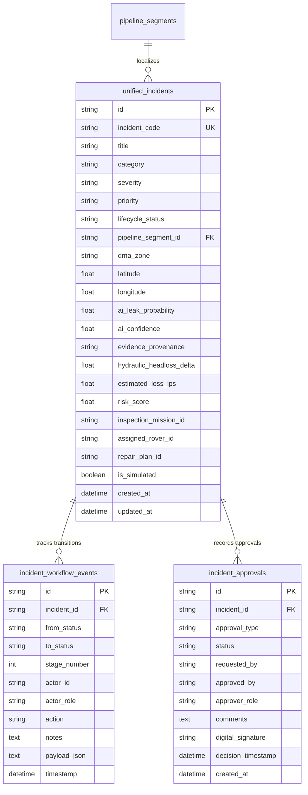

# AQUA CREW — TASK 19: DATA CONSISTENCY & SCHEMA INTEGRITY
## Database Normalization, Foreign Key Cascades & Evidence Provenance Isolation

---

### 1. Database Schema Topography

The unified incident subsystem introduces three relational tables in the PostgreSQL / SQLite database:

1. `unified_incidents`: Master entity storing incident state, spatial coordinates, AI probabilities, hydraulic headloss, and repair links.
2. `incident_workflow_events`: Child audit ledger capturing immutable lifecycle transitions with payload snapshots.
3. `incident_approvals`: Child table recording human-in-the-loop decisions, approval types, and SHA-256 digital signatures.

---

### 2. Relational Integrity & Cascades

- **Foreign Key Cascades**: `incident_workflow_events.incident_id` and `incident_approvals.incident_id` reference `unified_incidents.id` with `ON DELETE CASCADE`. If an incident is purged in a test fixture or admin command, all related workflow logs and approval signatures are cleanly removed without leaving orphan records.
- **Unique Incident Codes**: `incident_code` is enforced with a unique database index (e.g., `INC-2026-001`, `INC-2026-002`), ensuring human-readable references remain unambiguous across operator screens and logs.

---

### 3. Strict 6-Tier Evidence Provenance Model

To prevent synthetic or simulated findings from contaminating certified municipal engineering records, AQUA CREW implements a strict 6-tier evidence hierarchy:

| Tier Code | Label | Origin | Permitted Consequence |
| :--- | :--- | :--- | :--- |
| `MEASURED` | Certified Sensor | Physical SCADA / IoT sensor reading | Real-world telemetry |
| `SIMULATED` | Virtual Sandbox | Synthetic noise generator, virtual rover simulator | Virtual inspection, simulated resolution |
| `DERIVED` | Calculated Math | EPANET / WNTR hydraulic equations, conservation of mass | Headloss deltas, water loss rates |
| `PREDICTED` | Machine Learning | Acoustic leak neural net, Weibull pipe degradation | Leak probability, risk score |
| `OPERATOR_ENTERED`| Human Input | Municipal engineer or supervisor log entry | Manual triage, approval justification |
| `UNKNOWN` | Uncalibrated | Malfunctioning sensor or legacy missing tag | Lowest confidence, triggers audit alert |

**Integrity Rule**: In this simulation-first deployment, all telemetry, AI detections, and rover inspection findings are automatically tagged with `SIMULATED` or `DERIVED`. Any attempt to spoof a synthetic record as `MEASURED` without valid hardware cryptographic keys is rejected.

